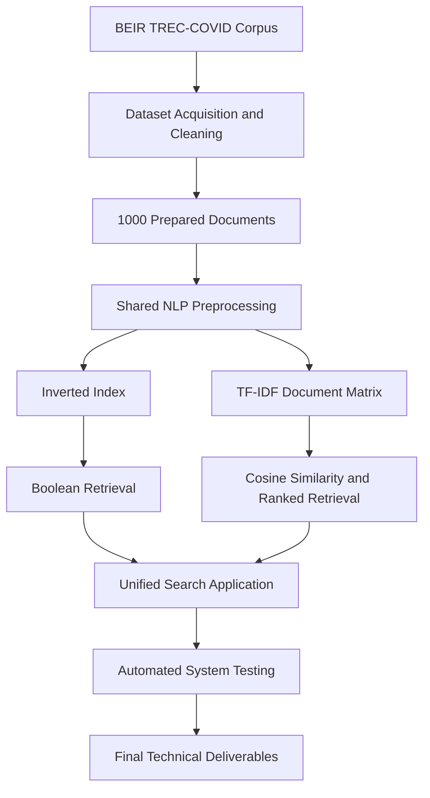

# Phase 1 — Final Submission


## 1. Project Information

| Property | Description |
|---|---|
| Project Name | Medical Research Search |
| University | Al al-Bayt University |
| Course | Information Retrieval Systems |
| Course Code | 902333 |
| Academic Year | 2026–2027 |
| Project Phase | Phase 1 |
| Team Size | 5 Members |
| Submission Deadline | November 18, 2026 |
| Programming Language | Python |
| Dataset | BEIR TREC-COVID |
| Retrieval Models | Boolean Model and Vector Space Model |
| Technical Status | Completed, Integrated and Tested |

## 2. Project Overview

Medical Research Search is an academic information retrieval system that enables users to search medical and scientific research documents using Boolean retrieval and TF-IDF ranked retrieval.

The project combines dataset acquisition, text cleaning, Natural Language Processing, inverted indexing, Boolean query processing, cosine similarity, and automated system testing into a unified Python application.

## 3. Project Team

| Team Member | Assigned Responsibility |
|---|---|
| محمد بهجت فهمي علي | Team Leadership, TF-IDF, Ranked Retrieval, Integration and Testing |
| مشهور رامي مشهور أبو سنينة | Dataset Acquisition and Preparation |
| عمر عبد الباسط محمود عطية | NLP Text Preprocessing |
| ليث بسام محمود جابر | Inverted Index Construction |
| محمد مثنى محمد خالد صالح | Boolean Retrieval |

Detailed responsibilities and repository contribution evidence are documented in the teamwork section.

## 4. System Architecture



## 5. Phase 1 Deliverables

| Step | Assessment Area | Allocated Marks | Status |
|---|---|---:|---|
| 01 | Problem Definition and Proposal | 3 | Completed |
| 02 | Progress and Teamwork | 3 | Documentation Completed |
| 03 | Dataset and Text Preprocessing | 3 | Technical Implementation Completed |
| 04 | Inverted Index and Boolean Retrieval | 3 | Completed |
| 05 | TF-IDF and Ranked Retrieval | 4 | Completed |
| Total | Phase 1 | 16 | Technical Implementation Completed |

The allocated marks represent the assessment structure rather than grades already awarded.

## 6. Final Technical Results

| Metric | Recorded Result |
|---|---:|
| Examined Dataset Records | 171,332 |
| Rejected Records | 42,383 |
| Valid Candidate Records | 128,949 |
| Prepared Documents | 1,000 |
| Vocabulary Terms | 10,758 |
| Inverted Index Postings | 87,381 |
| TF-IDF Matrix Shape | 1,000 × 10,758 |
| Nonzero TF-IDF Weights | 87,381 |
| Boolean Demonstration Queries | 5 |
| Ranked Demonstration Queries | 3 |
| Results per Ranked Demonstration | 5 |
| Automated System Tests | 15 |
| Passed Tests | 15 |
| Failed Tests | 0 |
| Final Recorded Test Duration | 8.257 seconds |

## 7. Submission Directory

```text
Final_Submission/
├── README.md
├── submission_checklist.md
├── project_summary.md
├── video_script.md
└── submission_links.md
```

## 8. Submission Documents

| Document | Purpose |
|---|---|
| [Submission Checklist](submission_checklist.md) | Verify Phase 1 requirements and final deliverables |
| [Project Summary](project_summary.md) | Summarize technical implementation and results |
| [Presentation Script](video_script.md) | Provide presentation content for all five members |
| [Submission Links](submission_links.md) | Centralize repository, evidence and presentation links |

## 9. Technical Documentation

| Component | Documentation |
|---|---|
| Project Proposal | [Step 01](../Step_01_Proposal/) |
| Progress and Teamwork | [Step 02](../Step_02_Teamwork/) |
| Dataset and Preprocessing | [Step 03](../Step_03_Preprocessing/) |
| Inverted Index and Boolean Retrieval | [Step 04](../Step_04_Boolean_Search/) |
| TF-IDF and Ranked Retrieval | [Step 05](../Step_05_Ranked_Search/) |
| System Integration | [Integration](../Integration/) |
| Automated System Testing | [Testing](../Testing/) |
| Main Project Documentation | [Main README](../README.md) |

## 10. Installation and Execution

Clone the repository:

```bash
git clone https://github.com/MOHAMMEDALMAHSERE/Medical-Research-Search-version9.git
cd Medical-Research-Search-version9
```

Install dependencies:

```bash
python -m pip install -r Step_03_Preprocessing/requirements.txt
```

Ensure that the prepared dataset is available at:

```text
Step_03_Preprocessing/dataset/documents.csv
```

If the dataset is unavailable, follow the acquisition instructions in Step 03.

Launch the application:

```bash
python -X utf8 Integration/main.py
```

Run the integrated demonstration:

```bash
python -X utf8 Integration/main.py --demo
```

Run automated system tests:

```bash
python -X utf8 Testing/test_system.py
```

## 11. Final Validation

The unified application successfully reproduced the standalone Boolean and ranked retrieval demonstrations.

The automated test suite passed all 15 tests, including nine synthetic tests and six real corpus tests.

```text
----------------------------------------------------------------------
Ran 15 tests in 8.257s

OK
```

The recorded test pass rate represents functional validation within the tested scope, not perfect retrieval accuracy.

## 12. Academic Integrity

The project acknowledges external datasets, software libraries, and technical references.

AI assistance was used to support implementation, debugging, testing, review, and documentation.

All reported numerical results are based on actual recorded execution outputs.

The repository uses centralized integration through the team leader's account. Assigned responsibilities and GitHub integration records are documented separately from independent individual authorship.

The prepared dataset remains subject to applicable source licensing and redistribution conditions.

## 13. Final Submission Status

| Deliverable | Status |
|---|---|
| Project Proposal | Completed |
| Teamwork Documentation | Completed |
| Technical Implementation | Completed |
| System Integration | Completed |
| Automated Testing | 15/15 Passed |
| Main Documentation | Completed |
| Final Submission Documents | Ready upon publication |
| Presentation Script | Prepared |
| Presentation Video | Pending Recording |
| Official Course Submission | Pending Confirmation |

The project is technically ready for final submission after completing the presentation recording and verifying the official submission requirements.

---

**Medical Research Search**

**Al al-Bayt University**

Information Retrieval Systems — 902333

Phase 1 — Final Submission
