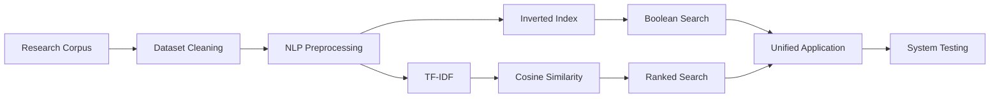

# Medical Research Search — Final Project Summary

## 1. Project Information

| Property | Description |
|---|---|
| Project | Medical Research Search |
| University | Al al-Bayt University |
| Course | Information Retrieval Systems |
| Course Code | 902333 |
| Phase | Phase 1 |
| Team Size | 5 Members |
| Programming Language | Python |
| Dataset | BEIR TREC-COVID |

## 2. Abstract

Medical Research Search is an academic information retrieval system designed to retrieve medical and scientific research documents efficiently.

The system combines Natural Language Processing with classical information retrieval techniques, including inverted indexing, Boolean retrieval, TF-IDF vectorization, and cosine similarity.

A reproducible collection of 1,000 research documents was prepared from the BEIR TREC-COVID corpus.

The application supports both logical document filtering and relevance-oriented ranked retrieval through a unified command-line interface.

The integrated system successfully reproduced all demonstrated retrieval results and passed 15 automated functional and regression tests.

## 3. Problem Definition

Searching large collections of medical research documents can be inefficient when users depend on manual inspection or simple keyword matching.

The project addresses this problem through structured preprocessing, efficient indexing, logical query evaluation, and weighted document ranking.

## 4. Project Objectives

- Prepare a real medical research document collection.
- Apply consistent NLP preprocessing.
- Build an efficient inverted index.
- Support Boolean search expressions.
- Implement TF-IDF ranked retrieval.
- Explain document similarity scores.
- Integrate all components into a unified application.
- Validate the system through automated testing.

## 5. System Methodology

### 5.1 Dataset Engineering

The BEIR TREC-COVID corpus was acquired and processed to remove records with missing fields, duplicate content, and non-searchable information.

A fixed random seed of 42 was used to support reproducible selection.

| Metric | Actual Result |
|---|---:|
| Examined Records | 171,332 |
| Rejected Records | 42,383 |
| Valid Candidate Records | 128,949 |
| Selected Documents | 1,000 |

### 5.2 Natural Language Processing

The shared preprocessing pipeline applies:

- Text normalization.
- Lowercasing.
- Tokenization.
- Stopword removal.
- Porter Stemming.

Example:

```text
Original:
COVID-19 vaccines are reducing infections.

Processed:
covid 19 vaccin reduc infect
```

The same preprocessing implementation is used for documents and search queries.

### 5.3 Inverted Index

The inverted index maps processed terms to sets of document identifiers.

Python dictionaries and sets support term lookup and Boolean operations.

| Metric | Result |
|---|---:|
| Indexed Documents | 1,000 |
| Vocabulary Terms | 10,758 |
| Index Postings | 87,381 |

### 5.4 Boolean Retrieval

The Boolean retrieval module implements:

| Operator | Set Operation |
|---|---|
| AND | Intersection |
| OR | Union |
| NOT | Complement |

Parentheses and operator precedence are supported.

The NOT operation uses the complete indexed document collection.

### 5.5 Ranked Retrieval

The ranked retrieval module uses the Vector Space Model.

Documents and queries are represented using TF-IDF.

```text
TF-IDF(t, d) = TF(t, d) × IDF(t)
```

The implementation uses smoothed IDF:

```text
IDF(t) = ln((1 + N) / (1 + DF(t))) + 1
```

Document and query similarity is calculated using cosine similarity.

```text
Cosine(q, d) = (q · d) / (||q|| × ||d||)
```

Documents are sorted by descending similarity, and the system returns the requested Top-K positive-scoring results.

The fitted TF-IDF vectorizer is reused for subsequent queries.

## 6. System Architecture



## 7. Experimental Results

### 7.1 Boolean Retrieval

| Query | Matching Documents |
|---|---:|
| covid AND vaccine | 21 |
| covid OR vaccine | 357 |
| NOT vaccine | 923 |
| covid AND NOT vaccine | 280 |
| (covid OR virus) AND vaccine | 53 |

### 7.2 Ranked Retrieval

| Query | Highest-Ranked Document ID | Highest Score |
|---|---|---:|
| covid vaccine immune response | 6fhuon6k | 0.451483 |
| respiratory infection treatment | yqr3e4kp | 0.331911 |
| coronavirus transmission prevention | nlzdto1h | 0.279990 |

Each demonstrated ranked query returned five documents in descending similarity order.

### 7.3 Explainable Ranking

For the first ranked query, the top document received the following shared term contributions:

| Term | Contribution |
|---|---:|
| immun | 0.222565 |
| respons | 0.144711 |
| vaccin | 0.084207 |
| Total Similarity | 0.451483 |

The highest-ranked document concerns HIV-1 vaccine development rather than COVID-19.

This illustrates a limitation of lexical retrieval: weighted term similarity does not always establish complete semantic relevance.

## 8. System Integration

All technical components are accessible through:

`Integration/main.py`

The unified application provides Boolean retrieval, ranked retrieval, preprocessing demonstrations, system statistics, and complete execution demonstrations.

The integrated application successfully reproduced the standalone retrieval results.

## 9. Automated Testing

The automated testing framework uses Python unittest.

| Category | Total | Passed |
|---|---:|---:|
| Synthetic Tests | 9 | 9 |
| Real Corpus Tests | 6 | 6 |
| Total | 15 | 15 |

Final recorded output:

```text
Ran 15 tests in 8.257s

OK
```

The tests validate system functionality, data integrity, preprocessing, indexing, retrieval behavior, error handling, and regression consistency.

## 10. Team Responsibility Allocation

| Member | Assigned Technical Area |
|---|---|
| محمد بهجت فهمي علي | Ranked Retrieval, System Integration, Testing and Project Management |
| مشهور رامي مشهور أبو سنينة | Dataset Engineering |
| عمر عبد الباسط محمود عطية | NLP Preprocessing |
| ليث بسام محمود جابر | Inverted Index |
| محمد مثنى محمد خالد صالح | Boolean Retrieval |

The repository organizes the assigned components using dedicated development branches and centralized integration through five merged pull requests.

## 11. Technologies Used

| Technology | Purpose |
|---|---|
| Python | Core implementation |
| NLTK | Porter Stemming |
| scikit-learn | TF-IDF and cosine similarity |
| Regular Expressions | Tokenization |
| Dictionaries and Sets | Indexing and Boolean operations |
| Sparse Matrices | Efficient TF-IDF representation |
| CSV and JSON | Dataset storage and reporting |
| unittest | Automated testing |
| Git and GitHub | Version control |
| Markdown and Mermaid | Documentation and architecture diagrams |

## 12. Technical Limitations

- The dataset represents a subset of the source corpus.
- The preprocessing pipeline primarily targets English.
- Some source documents or titles may contain other languages.
- TF-IDF depends on lexical term matching.
- Semantic relevance is not directly modeled.
- Formal retrieval relevance metrics have not been measured.
- The application provides a command-line interface.
- The system is not intended for clinical decision-making.

## 13. Future Improvements

- BM25 ranking.
- Document title weighting.
- Phrase and proximity search.
- Medical terminology normalization.
- Query expansion.
- Language detection.
- Semantic search using sentence embeddings.
- Hybrid lexical and semantic retrieval.
- Web-based graphical interface.
- Evaluation using Precision@K, Recall@K, MAP, MRR, and NDCG.

These improvements represent proposed future work rather than implemented Phase 1 features.

## 14. References

- Introduction to Information Retrieval: https://nlp.stanford.edu/IR-book/
- BEIR: https://github.com/beir-cellar/beir
- TREC-COVID Dataset: https://huggingface.co/datasets/BeIR/trec-covid
- NLTK: https://www.nltk.org/
- Scikit-learn: https://scikit-learn.org/
- Python Documentation: https://docs.python.org/3/

## 15. Conclusion

Medical Research Search demonstrates a complete classical information retrieval pipeline using a prepared collection of 1,000 research documents.

The system successfully implements shared NLP preprocessing, inverted indexing, Boolean retrieval, TF-IDF vectorization, cosine similarity, and explainable ranking.

All core technical components were integrated successfully, and all 15 automated system tests passed.

The project is technically ready for Phase 1 submission, subject to final presentation and administrative requirements.

---

**Medical Research Search**

**Al al-Bayt University**

Information Retrieval Systems — Phase 1
