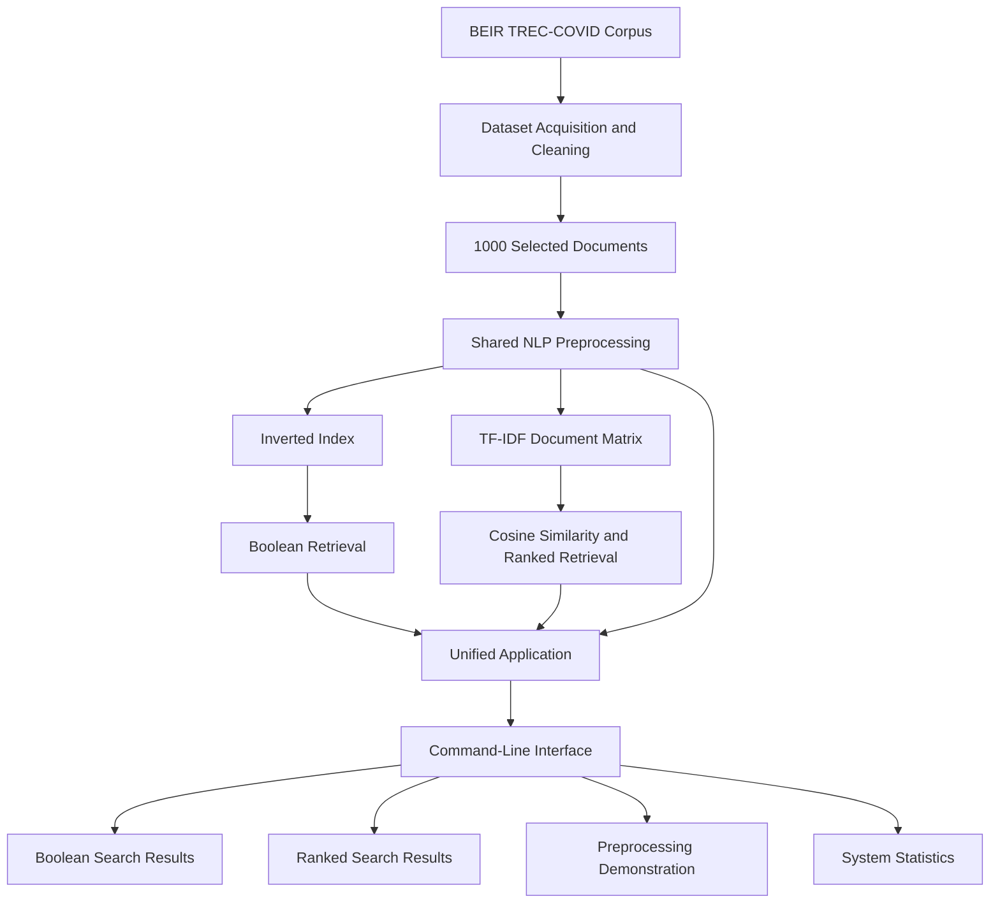

# System Integration — Medical Research Search

## 1. Overview

The System Integration stage combines all independently developed information retrieval modules into a unified application.

The integrated system provides a centralized command-line interface for Boolean Search, TF-IDF Ranked Search, text preprocessing demonstrations, and system statistics.

| Property | Description |
|---|---|
| Project | Medical Research Search |
| Course | Information Retrieval Systems (902333) |
| Phase | Phase 1 |
| Integration Owner | Mohammed — Team Leader |
| Dataset | BEIR TREC-COVID |
| Collection Size | 1,000 Documents |
| Integration Demo | Passed |

## 2. Integration Objectives

- Integrate all independently developed modules.
- Load a shared document collection.
- Maintain consistent text preprocessing.
- Connect the inverted index with Boolean retrieval.
- Integrate TF-IDF and cosine similarity.
- Provide a unified user interface.
- Resolve module import and directory path dependencies.
- Support Unicode text output.
- Verify consistency between standalone and integrated results.

## 3. Integrated Components

| Component | File | Owner |
|---|---|---|
| Dataset Engineering | download_dataset.py | Mashhour Rami |
| NLP Preprocessing | preprocessing.py | Omar Atiyeh |
| Inverted Index | inverted_index.py | Laith Jaber |
| Boolean Retrieval | boolean_search.py | Mohammad Saleh |
| Ranked Retrieval | ranked_search.py | Team Leader |
| System Integration | main.py | Team Leader |

The integration layer uses the prepared dataset generated by the acquisition module and connects the retrieval components through their shared programming interfaces.

## 4. System Architecture



## 5. Directory Structure

```text
Integration/
├── README.md
├── main.py
└── integration_results.txt
```

The integration module accesses the existing components located in Step 03, Step 04, and Step 05 without duplicating their implementations.

## 6. Integrated System Features

| Feature | Description |
|---|---|
| Automatic Module Imports | Configure project module paths automatically |
| Dataset Loading | Load the prepared CSV document collection |
| Shared Preprocessing | Use consistent NLP functions across retrieval modules |
| Boolean Search | Evaluate logical search expressions |
| Ranked Search | Rank documents using TF-IDF and cosine similarity |
| Top-K Retrieval | Return a configurable number of ranked results |
| Explainable Ranking | Display shared term contributions |
| System Statistics | Display document, vocabulary, and index statistics |
| UTF-8 Support | Support Unicode document titles |
| Full Demonstration | Execute reproducible examples in one run |

## 7. Actual Integrated System Statistics

The integrated demonstration was successfully executed on the prepared collection of 1,000 documents.

| Metric | Actual Result |
|---|---:|
| Loaded Documents | 1,000 |
| Vocabulary Size | 10,758 |
| Inverted Index Postings | 87,381 |
| TF-IDF Matrix Rows | 1,000 |
| TF-IDF Matrix Columns | 10,758 |
| Nonzero TF-IDF Weights | 87,381 |

The recorded statistics are consistent with the standalone Inverted Index and Ranked Retrieval results.

## 8. Integrated Preprocessing Demonstration

Original text:

```text
COVID-19 vaccines are reducing infections.
```

Normalized text:

```text
covid-19 vaccines are reducing infections.
```

Tokenization:

```text
covid, 19, vaccines, are, reducing, infections
```

After stopword removal:

```text
covid, 19, vaccines, reducing, infections
```

Final processed terms:

```text
covid, 19, vaccin, reduc, infect
```

The demonstration confirms that the shared preprocessing pipeline is accessible through the integrated system.

## 9. Integrated Boolean Retrieval Results

Five Boolean queries were successfully executed.

| Query | Standalone Matches | Integrated Matches |
|---|---:|---:|
| covid AND vaccine | 21 | 21 |
| covid OR vaccine | 357 | 357 |
| NOT vaccine | 923 | 923 |
| covid AND NOT vaccine | 280 | 280 |
| (covid OR virus) AND vaccine | 53 | 53 |

All reported match counts remained consistent after integration.

The system displays matching document identifiers and research document titles.

## 10. Integrated Ranked Retrieval Results

Three ranked retrieval queries were successfully executed.

| Query | Top Document ID | Standalone Score | Integrated Score |
|---|---|---:|---:|
| covid vaccine immune response | 6fhuon6k | 0.451483 | 0.451483 |
| respiratory infection treatment | yqr3e4kp | 0.331911 | 0.331911 |
| coronavirus transmission prevention | nlzdto1h | 0.279990 | 0.279990 |

Each demonstration query returned five ranked results.

The reported ranked document identifiers, similarity scores, and term contribution explanations remained consistent after integration.

## 11. Explainable Ranking

The integrated system displays term contributions for the highest-ranked document.

### Query 1

| Processed Term | Contribution |
|---|---:|
| immun | 0.222565 |
| respons | 0.144711 |
| vaccin | 0.084207 |
| Total | 0.451483 |

### Query 2

| Processed Term | Contribution |
|---|---:|
| respiratori | 0.208921 |
| infect | 0.122990 |
| Total | 0.331911 |

### Query 3

| Processed Term | Contribution |
|---|---:|
| transmiss | 0.182608 |
| coronaviru | 0.097382 |
| Total | 0.279990 |

Similarity scores represent lexical relevance rather than clinical quality or medical correctness.

## 12. User Interface

The unified command-line interface provides the following menu options:

```text
1. Boolean search
2. Ranked search
3. Preprocessing demonstration
4. System statistics
5. Full demo
0. Exit
```

Users can select a retrieval method, enter their search query, and inspect the corresponding document results.

## 13. Installation and Execution

Run the following commands from the project root using PowerShell.

### Create and Activate a Virtual Environment

```powershell
python -m venv .venv
.\.venv\Scripts\Activate.ps1
```

### Install Dependencies

```powershell
pip install -r Step_03_Preprocessing/requirements.txt
```

### Prepare the Dataset If Required

```powershell
python Step_03_Preprocessing/download_dataset.py --count 1000 --seed 42
```

### Configure UTF-8 Output

```powershell
$env:PYTHONIOENCODING = "utf-8"
[Console]::OutputEncoding = [System.Text.Encoding]::UTF8
[Console]::InputEncoding = [System.Text.Encoding]::UTF8
$OutputEncoding = [System.Text.Encoding]::UTF8
```

### Launch the Application

```powershell
python -X utf8 Integration/main.py
```

### Execute the Integrated Demonstration

```powershell
python -X utf8 Integration/main.py --demo
```

### Save Integration Results

```powershell
python -X utf8 Integration/main.py --demo | Tee-Object -FilePath Integration/integration_results.txt
```

## 14. Integration Demonstration Validation

The supplied integration execution output was reviewed against the standalone module results.

| Validation | Result |
|---|---|
| Dataset Loading | PASS |
| Loading 1,000 Documents | PASS |
| Shared Text Preprocessing | PASS |
| Inverted Index Construction | PASS |
| TF-IDF Matrix Construction | PASS |
| Vocabulary Consistency | PASS |
| Posting Count Consistency | PASS |
| Five Boolean Query Demonstrations | PASS |
| Three Ranked Query Demonstrations | PASS |
| Ranked Result Consistency | PASS |
| Term Contribution Explanations | PASS |
| Unicode Document Titles | PASS |
| Full Demonstration Completion | PASS |

These results establish successful integrated demonstration execution.

Interactive menu behavior, invalid input handling, edge cases, and additional regression checks will be verified during system-level testing.

## 15. Technical Challenges and Solutions

| Challenge | Solution |
|---|---|
| Modules distributed across different directories | Automatic module path configuration |
| Inconsistent relative file paths | Centralized project-relative dataset resolution |
| Unicode output errors on Windows | UTF-8 output configuration |
| Duplicate preprocessing implementations | Shared preprocessing functions |
| Potential inconsistencies between retrieval modules | Shared document collection |
| Repeated vectorizer initialization | Reusable fitted TF-IDF representation |

## 16. Integration Evidence

The actual execution output is available in:

[integration_results.txt](integration_results.txt)

Supporting standalone module evidence:

- [Dataset Report](../Step_03_Preprocessing/dataset/dataset_report.json)
- [Preprocessing Results](../Step_03_Preprocessing/preprocessing_results.txt)
- [Inverted Index Results](../Step_04_Boolean_Search/index_results.txt)
- [Boolean Search Results](../Step_04_Boolean_Search/boolean_results.txt)
- [Ranked Search Results](../Step_05_Ranked_Search/ranking_results.txt)

## 17. Limitations

- Retrieval depends on lexical term matching.
- The selected dataset represents a subset of the original corpus.
- The preprocessing pipeline primarily targets English text.
- The current application provides a command-line interface.
- Formal relevance evaluation is not included in the integration demonstration.
- Additional system-level and edge-case testing remains necessary.

## 18. Academic Integrity

The integrated system combines the assigned project modules into a single application.

AI assistance was used to review, refine, and document the implementation.

All numerical integration results presented in this section are based on the supplied execution output.

## 19. Completion Status

The integrated system successfully loaded the prepared collection of 1,000 documents and demonstrated the shared NLP pipeline, inverted index, Boolean retrieval, TF-IDF ranked retrieval, and ranking explanations.

The integrated results are consistent with the corresponding standalone module demonstrations.

System integration demonstration has been completed successfully.

The project is ready for comprehensive system testing and final submission preparation.

## 20. Project Navigation

- [Main Repository](../README.md)
- [Step 01 — Proposal](../Step_01_Proposal/)
- [Step 02 — Progress and Teamwork](../Step_02_Teamwork/)
- [Step 03 — Dataset and Preprocessing](../Step_03_Preprocessing/)
- [Step 04 — Inverted Index and Boolean Search](../Step_04_Boolean_Search/)
- [Step 05 — Ranked Retrieval](../Step_05_Ranked_Search/)
- System Integration
- [Testing and Validation](../Testing/)
- [Final Submission](../Final_Submission/)

---

**Medical Research Search**

Al al-Bayt University

Information Retrieval Systems — Phase 1
