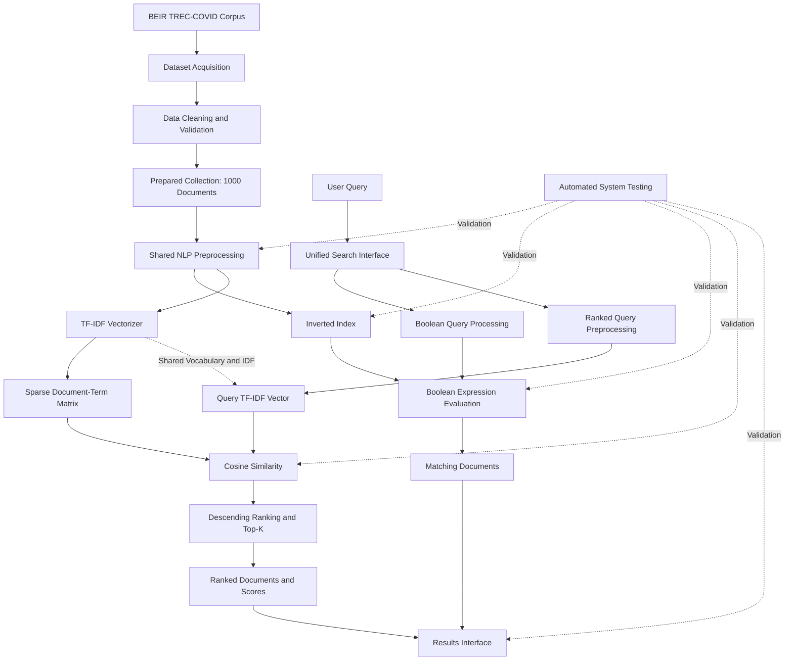
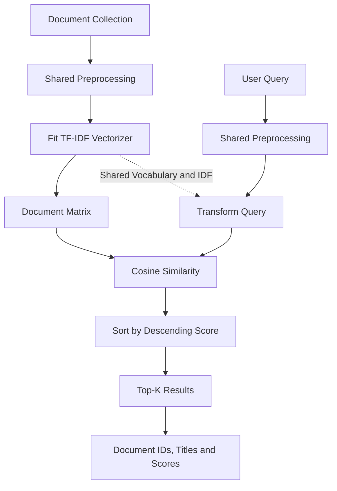

# Medical Research Search

### An Information Retrieval System for Medical and Scientific Research Documents


---

## 1. Project Information

| Property | Description |
|---|---|
| Project Name | Medical Research Search |
| University | Al al-Bayt University |
| Course | Information Retrieval Systems |
| Course Code | 902333 |
| Academic Year | 2026–2027 |
| Project Phase | Phase 1 |
| Team Size | 5 Members |
| Programming Language | Python |
| Dataset | BEIR TREC-COVID |
| Retrieval Models | Boolean Model and Vector Space Model |
| Ranking Method | TF-IDF and Cosine Similarity |
| User Interface | Command-Line Interface |
| Technical Status | Implemented, Integrated and Tested |

---

## 2. Project Overview

Medical Research Search is an academic information retrieval system designed to help users search and retrieve relevant medical and scientific research documents from a structured document collection.

The system combines Natural Language Processing techniques with classical information retrieval algorithms to transform unstructured textual documents into searchable representations.

Two complementary retrieval approaches are implemented:

- **Boolean Retrieval:** Retrieves documents that satisfy explicit logical expressions using AND, OR, and NOT operators.
- **Ranked Retrieval:** Orders documents according to their estimated lexical relevance using TF-IDF and cosine similarity.

The system integrates dataset acquisition, text preprocessing, inverted indexing, Boolean retrieval, ranked retrieval, and automated testing into a unified Python application.

---

## 3. Problem Statement

Medical and scientific research collections contain large amounts of textual information.

Manually searching these collections can be inefficient because users must inspect numerous documents before identifying potentially relevant information.

Simple keyword matching also has several limitations:

- Different grammatical forms of the same term.
- Frequent words with limited retrieval value.
- Difficulty expressing complex search conditions.
- Lack of relevance-based document ordering.
- Inefficient repeated searching across large document collections.

Medical Research Search addresses these challenges through structured text preprocessing, efficient indexing, Boolean expressions, and weighted vector-based ranking.

The system is intended for academic information retrieval and is not designed to provide medical diagnoses or clinical recommendations.

---

## 4. Project Objectives

The primary objectives are to:

1. Acquire and prepare a real medical research document collection.
2. Clean document records and remove invalid or duplicate entries.
3. Apply consistent Natural Language Processing techniques.
4. Construct an inverted index for efficient document retrieval.
5. Support AND, OR, and NOT Boolean operators.
6. Support compound Boolean expressions and operator precedence.
7. Represent documents and queries using TF-IDF vectors.
8. Calculate cosine similarity between queries and documents.
9. Retrieve and rank the Top-K matching documents.
10. Explain the contribution of shared terms to ranking scores.
11. Integrate all components into a unified application.
12. Validate system functionality through automated testing.
13. Document the development process and assigned team responsibilities.

---

## 5. Team Members and Responsibilities

| Team Member | Assigned Role | Main Responsibilities |
|---|---|---|
| محمد بهجت فهمي علي | Team Leader and Ranked Retrieval Engineer | TF-IDF, cosine similarity, ranked retrieval, integration and project management |
| مشهور رامي مشهور أبو سنينة | Dataset Engineer | Dataset acquisition, cleaning, validation and preparation |
| عمر عبد الباسط محمود عطية | NLP Preprocessing Engineer | Text normalization, tokenization, stopword removal and stemming |
| ليث بسام محمود جابر | Inverted Index Engineer | Inverted index construction, posting sets and index statistics |
| محمد مثنى محمد خالد صالح | Boolean Retrieval Engineer | Boolean query processing, logical operations and expression evaluation |

Individual responsibilities, development activities, and contribution evidence are documented in the teamwork section.

[Teamwork and Progress Documentation](Step_02_Teamwork/)

---

## 6. System Architecture



The architecture uses a shared document collection and common preprocessing functions to maintain consistency between Boolean and ranked retrieval.

---

## 7. Repository Structure

```text
Medical-Research-Search-version9/
│
├── README.md
├── .gitignore
│
├── Step_01_Proposal/
│   ├── README.md
│   ├── phase1-proposal.docx
│   ├── problem_statement.md
│   ├── objectives.md
│   ├── dataset_description.md
│   ├── search_features.md
│   └── team_roles.md
│
├── Step_02_Teamwork/
│   ├── README.md
│   ├── task_allocation.md
│   ├── milestones.md
│   ├── development_workflow.md
│   ├── contributions.md
│   ├── progress_log.md
│   ├── meeting_notes.md
│   ├── integration_log.md
│   └── evidence/
│
├── Step_03_Preprocessing/
│   ├── README.md
│   ├── download_dataset.py
│   ├── preprocessing.py
│   ├── preprocessing_results.txt
│   ├── requirements.txt
│   └── dataset/
│       ├── documents.csv
│       └── dataset_report.json
│
├── Step_04_Boolean_Search/
│   ├── README.md
│   ├── inverted_index.py
│   ├── boolean_search.py
│   ├── index_results.txt
│   └── boolean_results.txt
│
├── Step_05_Ranked_Search/
│   ├── README.md
│   ├── ranked_search.py
│   └── ranking_results.txt
│
├── Integration/
│   ├── README.md
│   ├── main.py
│   └── integration_results.txt
│
├── Testing/
│   ├── README.md
│   ├── test_system.py
│   └── test_results.txt
│
└── Final_Submission/
```

---

## 8. Project Development Stages

| Stage | Description | Status |
|---|---|---|
| Step 01 | Problem Definition and Proposal | Completed |
| Step 02 | Progress and Teamwork | Final Documentation Pending |
| Step 03 | Dataset and Text Preprocessing | Completed |
| Step 04 | Inverted Index and Boolean Retrieval | Completed |
| Step 05 | TF-IDF and Ranked Retrieval | Completed |
| Integration | Unified System Integration | Completed |
| Testing | Automated System Testing | 15/15 Passed |
| Final Submission | Submission Materials and Video | In Progress |

### Detailed Documentation

| Section | Documentation |
|---|---|
| Problem Definition and Proposal | [Step 01](Step_01_Proposal/) |
| Progress and Teamwork | [Step 02](Step_02_Teamwork/) |
| Dataset and Preprocessing | [Step 03](Step_03_Preprocessing/) |
| Inverted Index and Boolean Search | [Step 04](Step_04_Boolean_Search/) |
| TF-IDF and Ranked Search | [Step 05](Step_05_Ranked_Search/) |
| System Integration | [Integration](Integration/) |
| System Testing | [Testing](Testing/) |
| Final Submission | [Final Submission](Final_Submission/) |

---

## 9. Dataset Engineering

### 9.1 Dataset Source

The project uses the BEIR TREC-COVID corpus, which contains research documents related to COVID-19, infectious diseases, virology, vaccines, and other medical research topics.

Dataset source:

https://huggingface.co/datasets/BeIR/trec-covid

The project uses a selected subset of 1,000 valid documents for its initial information retrieval implementation.

### 9.2 Dataset Structure

Each prepared document contains the following fields:

| Field | Description |
|---|---|
| document_id | Unique document identifier |
| title | Research document title |
| text | Document textual content |
| source | Dataset source information |

### 9.3 Dataset Preparation

The dataset preparation workflow includes:

- Corpus acquisition.
- Required field validation.
- Missing-value handling.
- Removal of non-searchable records.
- Duplicate identifier detection.
- Duplicate content detection.
- Reproducible document selection.
- CSV generation.
- Dataset statistics reporting.

### 9.4 Actual Dataset Statistics

| Metric | Value |
|---|---:|
| Examined Records | 171,332 |
| Records with Missing Fields | 42,146 |
| Non-searchable Records | 51 |
| Duplicate Identifiers | 0 |
| Duplicate Content Records | 186 |
| Total Rejected Records | 42,383 |
| Valid Candidate Records | 128,949 |
| Selected Documents | 1,000 |
| Random Seed | 42 |

A fixed random seed is used to support reproducible dataset selection.

The preprocessing system primarily targets English text. However, the selected corpus may include documents or titles in other languages.

The original dataset and its contents remain subject to their applicable source licenses and redistribution conditions.

### Dataset Evidence

- [Dataset Acquisition Implementation](Step_03_Preprocessing/download_dataset.py)
- [Dataset Preparation Report](Step_03_Preprocessing/dataset/dataset_report.json)
- [Dataset and Preprocessing Documentation](Step_03_Preprocessing/README.md)

---

## 10. Natural Language Processing

The project uses a shared NLP preprocessing pipeline to transform document text and search queries into normalized searchable terms.

### 10.1 Preprocessing Pipeline


### 10.2 Applied NLP Techniques

| Technique | Purpose |
|---|---|
| Text Normalization | Standardize textual representation |
| Lowercasing | Reduce case-sensitive vocabulary variations |
| Tokenization | Split text into individual searchable terms |
| Stopword Removal | Remove common words with limited retrieval value |
| Porter Stemming | Reduce related word forms to common stems |

### 10.3 Actual Preprocessing Example

**Original text**

```text
COVID-19 vaccines are reducing infections.
```

**Normalized text**

```text
covid-19 vaccines are reducing infections.
```

**Tokenization**

```text
['covid', '19', 'vaccines', 'are', 'reducing', 'infections']
```

**Stopword Removal**

```text
['covid', '19', 'vaccines', 'reducing', 'infections']
```

**Final Stemmed Terms**

```text
['covid', '19', 'vaccin', 'reduc', 'infect']
```

Applying consistent preprocessing to documents and queries reduces vocabulary inconsistency and supports reliable retrieval operations.

### Implementation and Evidence

- [preprocessing.py](Step_03_Preprocessing/preprocessing.py)
- [preprocessing_results.txt](Step_03_Preprocessing/preprocessing_results.txt)

---

## 11. Inverted Index

An inverted index maps each processed term to the identifiers of documents containing that term.

Instead of scanning every document for every search operation, the system accesses the posting set associated with each query term.

### 11.1 Conceptual Representation

```text
term -> {document_id_1, document_id_2, ...}
```

Illustrative example:

| Term | Posting Set |
|---|---|
| covid | {D1, D2, D4} |
| vaccin | {D1, D3, D4} |
| virus | {D2, D3} |

The implementation uses Python dictionaries and sets to support efficient term lookup and logical set operations.

### 11.2 Actual Index Statistics

| Metric | Value |
|---|---:|
| Indexed Documents | 1,000 |
| Unique Vocabulary Terms | 10,758 |
| Total Index Postings | 87,381 |
| Documents Without Searchable Terms | 0 |
| Document Frequency of covid | 301 |
| Document Frequency of vaccine | 77 |
| Document Frequency of virus | 253 |

Document frequencies are calculated using the corresponding processed search terms.

### Implementation and Evidence

- [inverted_index.py](Step_04_Boolean_Search/inverted_index.py)
- [index_results.txt](Step_04_Boolean_Search/index_results.txt)

---

## 12. Boolean Information Retrieval

Boolean retrieval evaluates logical expressions against document posting sets.

The system supports AND, OR, NOT, parentheses, and operator precedence.

### 12.1 Boolean Operators

| Operator | Set Operation | Description |
|---|---|---|
| AND | Intersection | Retrieve documents containing both terms |
| OR | Union | Retrieve documents containing either term or both |
| NOT | Complement | Exclude documents containing the specified term |

The NOT operation is evaluated relative to the complete indexed document collection.

### 12.2 Operator Precedence

```text
Parentheses override logical precedence.

NOT > AND > OR
```

### 12.3 Actual Boolean Search Results

| Query | Matching Documents |
|---|---:|
| covid AND vaccine | 21 |
| covid OR vaccine | 357 |
| NOT vaccine | 923 |
| covid AND NOT vaccine | 280 |
| (covid OR virus) AND vaccine | 53 |

These match counts were reproduced successfully after system integration.

### 12.4 Boolean Retrieval Characteristics

- Explicit logical query conditions.
- Efficient set-based retrieval.
- Support for compound expressions.
- Document identifiers and titles in results.
- No relevance score assigned by the Boolean model.

### Implementation and Evidence

- [boolean_search.py](Step_04_Boolean_Search/boolean_search.py)
- [boolean_results.txt](Step_04_Boolean_Search/boolean_results.txt)
- [Boolean Search Documentation](Step_04_Boolean_Search/README.md)

---

## 13. TF-IDF and Ranked Information Retrieval

The ranked retrieval component implements the Vector Space Model.

Documents and queries are represented as numerical vectors using Term Frequency–Inverse Document Frequency.

### 13.1 Term Frequency

Term Frequency measures the number of occurrences of a term within a document.

```text
TF(t, d) = frequency of term t in document d
```

### 13.2 Inverse Document Frequency

Inverse Document Frequency reduces the influence of terms that occur frequently throughout the document collection.

```text
IDF(t) = ln((1 + N) / (1 + DF(t))) + 1
```

Where:

- N represents the number of documents.
- DF(t) represents the number of documents containing term t.

### 13.3 TF-IDF Weighting

```text
TF-IDF(t, d) = TF(t, d) × IDF(t)
```

The resulting vectors are L2-normalized.

### 13.4 Cosine Similarity

Cosine similarity measures the similarity between a query vector and a document vector.

```text
Cosine(q, d) = (q · d) / (||q|| × ||d||)
```

For the non-negative TF-IDF representations used by this system, similarity scores range from 0 to 1.

Higher scores indicate stronger lexical similarity.

### 13.5 Ranked Retrieval Pipeline



The TF-IDF vectorizer is fitted on the document collection and reused for subsequent queries.

### 13.6 Actual TF-IDF Statistics

| Metric | Value |
|---|---:|
| Documents | 1,000 |
| Vocabulary Size | 10,758 |
| Matrix Shape | 1,000 × 10,758 |
| Total Possible Matrix Entries | 10,758,000 |
| Nonzero Weights | 87,381 |
| Approximate Matrix Density | 0.81% |

Sparse matrix storage is used to avoid explicitly storing unnecessary zero-valued features.

---

## 14. Actual Ranked Search Results

### Query 1

```text
covid vaccine immune response
```

| Rank | Document ID | Similarity |
|---:|---|---:|
| 1 | 6fhuon6k | 0.451483 |
| 2 | 1d17iafs | 0.396692 |
| 3 | od4c6fcg | 0.354211 |
| 4 | vbqgyll9 | 0.335271 |
| 5 | 0pmsfrcx | 0.320604 |

**Highest-Ranked Document:**

The immune response during acute HIV-1 infection: clues for vaccine development

### Query 2

```text
respiratory infection treatment
```

| Rank | Document ID | Similarity |
|---:|---|---:|
| 1 | yqr3e4kp | 0.331911 |
| 2 | 3hgupch5 | 0.220218 |
| 3 | ckbik777 | 0.210443 |
| 4 | r286hc2k | 0.206962 |
| 5 | vzwu2qol | 0.205862 |

**Highest-Ranked Document:**

Viruses and acute respiratory infections

### Query 3

```text
coronavirus transmission prevention
```

| Rank | Document ID | Similarity |
|---:|---|---:|
| 1 | nlzdto1h | 0.279990 |
| 2 | w0vm70no | 0.195235 |
| 3 | ynaum52m | 0.189076 |
| 4 | m1hampmt | 0.182151 |
| 5 | b0wd2jd3 | 0.168638 |

**Highest-Ranked Document:**

Comparison of transmissibility of coronavirus between symptomatic and asymptomatic patients: Reanalysis of the Ningbo Covid-19 data

All three demonstration queries returned five documents ordered by descending cosine similarity.

Complete document titles and ranking explanations are available in the execution evidence.

### Implementation and Evidence

- [ranked_search.py](Step_05_Ranked_Search/ranked_search.py)
- [ranking_results.txt](Step_05_Ranked_Search/ranking_results.txt)
- [Ranked Search Documentation](Step_05_Ranked_Search/README.md)

---

## 15. Explainable Ranking

The system provides term-level explanations for the highest-ranked document.

For L2-normalized TF-IDF vectors, the cosine similarity score can be expressed as the sum of the products of corresponding query and document term weights.

### Example

Query:

```text
covid vaccine immune response
```

| Shared Processed Term | Score Contribution |
|---|---:|
| immun | 0.222565 |
| respons | 0.144711 |
| vaccin | 0.084207 |
| Total Similarity | 0.451483 |

The highest-ranked document discusses HIV-1 rather than COVID-19.

This demonstrates an important limitation of traditional lexical retrieval: a document may receive a high similarity score because of shared weighted terms, even when its medical topic does not fully match the query.

Similarity scores should not be interpreted as probabilities, clinical quality indicators, or guarantees of topical relevance.

---

## 16. Boolean Retrieval vs Ranked Retrieval

| Feature | Boolean Retrieval | Ranked Retrieval |
|---|---|---|
| Retrieval Model | Boolean Model | Vector Space Model |
| Data Representation | Inverted Index | TF-IDF Vectors |
| Query Processing | Logical Expressions | Processed Query Vectors |
| Retrieval Technique | Set Operations | Cosine Similarity |
| Matching | Logical Conditions | Weighted Term Similarity |
| Similarity Scores | Not Provided | Provided |
| Relevance-Based Ordering | Not Provided | Supported |
| Top-K Retrieval | Not Inherent | Supported |
| Partial Term Matching | Depends on Logical Expression | Supported |
| Primary Use | Precise Logical Filtering | Relevance-Oriented Searching |

---

## 17. System Integration

The integration module connects all implemented components through a single application.

The unified system provides:

- Automatic module path configuration.
- Project-relative dataset loading.
- Shared preprocessing.
- Inverted index construction.
- Boolean query processing.
- TF-IDF document representation.
- Cosine similarity calculation.
- Custom Top-K retrieval.
- Highest-result term explanations.
- System statistics.
- Interactive command-line interface.
- Reproducible execution demonstrations.

### Application Menu

```text
1. Boolean search
2. Ranked search
3. Preprocessing demonstration
4. System statistics
5. Full demo
0. Exit
```

### Integration Results

The integrated system successfully loaded the 1,000-document collection and reproduced the previously recorded Boolean and ranked retrieval results.

| Validation | Status |
|---|---|
| Dataset Loading | PASS |
| Shared Preprocessing | PASS |
| Inverted Index Construction | PASS |
| TF-IDF Matrix Construction | PASS |
| Five Boolean Demonstration Queries | PASS |
| Three Ranked Demonstration Queries | PASS |
| Ranking Explanations | PASS |
| Full Integrated Demonstration | PASS |

### Integration Evidence

- [main.py](Integration/main.py)
- [integration_results.txt](Integration/integration_results.txt)
- [System Integration Documentation](Integration/README.md)

---

## 18. Automated System Testing

The system was validated using Python's unittest framework.

The testing suite combines controlled synthetic data and the actual 1,000-document collection.

### 18.1 Testing Summary

| Category | Total | Passed | Failed |
|---|---:|---:|---:|
| Synthetic Tests | 9 | 9 | 0 |
| Real Corpus Tests | 6 | 6 | 0 |
| Total | 15 | 15 | 0 |

### 18.2 Test Coverage Areas

| Validation Area | Status |
|---|---|
| Dataset Integrity | PASS |
| NLP Preprocessing | PASS |
| Inverted Index | PASS |
| Boolean Logic | PASS |
| Invalid Boolean Queries | PASS |
| Invalid CSV Handling | PASS |
| Ranked Retrieval | PASS |
| Top-K Retrieval | PASS |
| Similarity Score Bounds | PASS |
| Ranking Ties | PASS |
| Empty and Invalid Queries | PASS |
| Interactive Menu | PASS |
| Portable CLI Execution | PASS |
| Boolean Regression | PASS |
| Ranked Regression | PASS |

### 18.3 Actual Execution Results

The automated test suite was executed twice on November 17, 2026.

| Metric | First Execution | Second Execution |
|---|---:|---:|
| Total Tests | 15 | 15 |
| Passed | 15 | 15 |
| Failed | 0 | 0 |
| Errors | 0 | 0 |
| Test Pass Rate | 100% | 100% |
| Execution Time | 10.161s | 8.257s |

Recorded final output:

```text
----------------------------------------------------------------------
Ran 15 tests in 8.257s

OK
```

The 100% pass rate describes the executed functional tests. It does not represent retrieval accuracy, relevance quality, or complete source code coverage.

### Testing Evidence

- [test_system.py](Testing/test_system.py)
- [test_results.txt](Testing/test_results.txt)
- [Testing Documentation](Testing/README.md)

---

## 19. Technologies and Libraries

| Technology | Application |
|---|---|
| Python | Core programming language |
| NLTK | Porter Stemming |
| scikit-learn | TF-IDF and cosine similarity |
| Regular Expressions | Text tokenization and processing |
| Python Dictionaries | Inverted index representation |
| Python Sets | Boolean retrieval operations |
| Sparse Matrices | Efficient document representation |
| CSV | Structured document storage |
| JSON | Dataset statistics reporting |
| argparse | Command-line argument processing |
| pathlib | File path management |
| unittest | Automated testing |
| Git | Version control |
| GitHub | Repository management and collaboration |
| Markdown | Technical documentation |
| Mermaid | Architecture diagrams |
| Visual Studio Code | Development environment |

---

## 20. Installation and Setup

### Prerequisites

- Python 3.
- Git.
- Internet access for initial dependency installation and dataset acquisition.
- A compatible terminal environment.

### Step 1 — Clone the Repository

```bash
git clone https://github.com/MOHAMMEDALMAHSERE/Medical-Research-Search-version9.git
cd Medical-Research-Search-version9
```

### Step 2 — Create a Virtual Environment

```bash
python -m venv .venv
```

### Step 3 — Activate the Virtual Environment

Windows PowerShell:

```powershell
.\.venv\Scripts\Activate.ps1
```

Linux or macOS:

```bash
source .venv/bin/activate
```

### Step 4 — Install Dependencies

```bash
python -m pip install -r Step_03_Preprocessing/requirements.txt
```

### Step 5 — Prepare the Dataset

The application expects the prepared dataset at:

```text
Step_03_Preprocessing/dataset/documents.csv
```

If the dataset is unavailable, use the dataset preparation script.

Inspect its supported arguments:

```bash
python Step_03_Preprocessing/download_dataset.py --help
```

Follow the reproducible dataset acquisition instructions in:

[Step 03 — Dataset Preparation](Step_03_Preprocessing/README.md)

The regression tests require the original prepared collection of 1,000 documents.

---

## 21. Running the Application

All commands should be executed from the repository root unless otherwise specified.

### Launch the Interactive Application

```bash
python -X utf8 Integration/main.py
```

### Run the Full Integrated Demonstration

```bash
python -X utf8 Integration/main.py --demo
```

### Run Automated System Tests

```bash
python -X utf8 Testing/test_system.py
```

### Save Integration Results in PowerShell

```powershell
python -X utf8 Integration/main.py --demo | Tee-Object -FilePath Integration/integration_results.txt
```

### Save Automated Test Results in PowerShell

```powershell
python -X utf8 Testing/test_system.py 2>&1 | Tee-Object -FilePath Testing/test_results.txt
```

### Windows UTF-8 Configuration

If Unicode characters are displayed incorrectly in PowerShell, execute:

```powershell
$env:PYTHONIOENCODING = "utf-8"
[Console]::OutputEncoding = [System.Text.Encoding]::UTF8
[Console]::InputEncoding = [System.Text.Encoding]::UTF8
$OutputEncoding = [System.Text.Encoding]::UTF8
```

The integration module handles project module paths automatically, eliminating the need to manually configure PYTHONPATH for normal application execution.

---

## 22. Example Search Queries

### Boolean Search

```text
covid AND vaccine
```

```text
covid OR vaccine
```

```text
NOT vaccine
```

```text
covid AND NOT vaccine
```

```text
(covid OR virus) AND vaccine
```

### Ranked Search

```text
covid vaccine immune response
```

```text
respiratory infection treatment
```

```text
coronavirus transmission prevention
```

```text
covid vaccine effectiveness
```

Users may specify the desired number of ranked results when using the interactive ranked search option.

---

## 23. Phase 1 Requirements and Deliverables

| Step | Assessment Area | Allocated Marks | Current Status |
|---|---|---:|---|
| 01 | Problem Definition and Proposal | 3 | Completed |
| 02 | Progress and Teamwork | 3 | Final Documentation Pending |
| 03 | Dataset and Text Preprocessing | 3 | Completed |
| 04 | Inverted Index and Boolean Retrieval | 3 | Completed |
| 05 | TF-IDF and Ranked Retrieval | 4 | Completed |
| Total | Phase 1 | 16 | Technical Implementation Completed |

Integration and automated testing provide additional verification of the technical deliverables.

The allocated marks represent the course assessment structure rather than grades already awarded.

---

## 24. Team Development Workflow

The project follows a modular development approach with assigned responsibilities and dedicated Git branches.

The workflow consists of:

1. Define project requirements and component responsibilities.
2. Prepare individual development branches.
3. Implement and document the assigned components.
4. Perform component-level demonstrations.
5. Create and review pull requests.
6. Merge compatible components into the main branch.
7. Integrate the complete application.
8. Execute automated system and regression tests.
9. Prepare final documentation and submission materials.

Actual contributions, branch history, commits, pull requests, and development evidence should be consulted when evaluating individual participation.

### Collaboration Documentation

[Step 02 — Progress and Teamwork](Step_02_Teamwork/)

---

## 25. Technical Challenges and Solutions

| Challenge | Implemented Solution |
|---|---|
| Large source document collection | Reproducible selection of 1,000 documents |
| Missing or invalid document fields | Dataset cleaning and validation |
| Duplicate document records | Duplicate identifier and content detection |
| Vocabulary variations | Shared NLP preprocessing and stemming |
| Repeated full-document searching | Inverted index |
| Complex logical queries | Boolean expression evaluation |
| Unordered search results | TF-IDF and cosine similarity ranking |
| High-dimensional document representations | Sparse matrix storage |
| Unexplained ranking scores | Shared term contribution explanations |
| Distributed project modules | Centralized integration module |
| Relative path dependencies | Automatic project path configuration |
| Unicode terminal output | UTF-8 configuration |
| Potential integration regressions | Automated regression testing |

---

## 26. Limitations

The current implementation has several limitations:

- The application uses a selected subset of the complete source corpus.
- The lexical preprocessing pipeline primarily targets English.
- The dataset may include documents or titles in other languages.
- Porter Stemming may produce non-dictionary stems.
- TF-IDF depends on weighted term overlap.
- The system does not directly model contextual or semantic relationships.
- Lexical similarity does not guarantee complete topical relevance.
- The current user interface is command-line based.
- Formal relevance judgments have not been established for the demonstrated queries.
- Automated testing does not guarantee the absence of undiscovered defects.
- The application is not a clinical decision-support system.

---

## 27. Future Improvements

Potential future extensions include:

- BM25 document ranking.
- Field-specific title and document weighting.
- Phrase and proximity search.
- Medical terminology normalization.
- Explicit document language detection.
- Query expansion and synonym handling.
- Semantic search using sentence embeddings.
- Hybrid lexical and semantic retrieval.
- Relevance-based reranking.
- Larger document collections.
- Persistent indexing.
- Web-based graphical user interface.
- Formal retrieval evaluation.

Potential retrieval evaluation metrics include:

| Metric | Purpose |
|---|---|
| Precision@K | Measure the proportion of relevant retrieved documents |
| Recall@K | Measure the proportion of relevant documents successfully retrieved |
| MAP | Evaluate average retrieval precision across queries |
| MRR | Evaluate the rank of the first relevant result |
| NDCG | Evaluate ranking quality using graded relevance judgments |

These techniques and metrics are proposed extensions rather than completed Phase 1 experiments.

---

## 28. Execution Evidence

| Component | Actual Evidence |
|---|---|
| Dataset Preparation | [dataset_report.json](Step_03_Preprocessing/dataset/dataset_report.json) |
| NLP Preprocessing | [preprocessing_results.txt](Step_03_Preprocessing/preprocessing_results.txt) |
| Inverted Index | [index_results.txt](Step_04_Boolean_Search/index_results.txt) |
| Boolean Search | [boolean_results.txt](Step_04_Boolean_Search/boolean_results.txt) |
| Ranked Search | [ranking_results.txt](Step_05_Ranked_Search/ranking_results.txt) |
| System Integration | [integration_results.txt](Integration/integration_results.txt) |
| Automated Testing | [test_results.txt](Testing/test_results.txt) |

### Final Technical Summary

| Metric | Actual Result |
|---|---:|
| Prepared Documents | 1,000 |
| Vocabulary Terms | 10,758 |
| Inverted Index Postings | 87,381 |
| Nonzero TF-IDF Weights | 87,381 |
| Boolean Demonstration Queries | 5 |
| Ranked Demonstration Queries | 3 |
| Automated System Tests | 15 |
| Passed System Tests | 15 |
| Failed System Tests | 0 |
| Functional Test Pass Rate | 100% |
| Final Recorded Test Execution | 8.257s |

---

## 29. References

1. Manning, C. D., Raghavan, P., and Schütze, H. Introduction to Information Retrieval. Cambridge University Press.

   https://nlp.stanford.edu/IR-book/

2. BEIR — Benchmarking Information Retrieval.

   https://github.com/beir-cellar/beir

3. BEIR TREC-COVID Dataset.

   https://huggingface.co/datasets/BeIR/trec-covid

4. Python Documentation.

   https://docs.python.org/3/

5. NLTK Documentation.

   https://www.nltk.org/

6. Scikit-learn TF-IDF Vectorizer.

   https://scikit-learn.org/stable/modules/generated/sklearn.feature_extraction.text.TfidfVectorizer.html

7. Scikit-learn Cosine Similarity.

   https://scikit-learn.org/stable/modules/generated/sklearn.metrics.pairwise.cosine_similarity.html

8. Python unittest Documentation.

   https://docs.python.org/3/library/unittest.html

9. GitHub Documentation.

   https://docs.github.com/

---

## 30. Academic Integrity

This repository is developed for academic purposes as part of the Information Retrieval Systems course at Al al-Bayt University.

External datasets, libraries, and technical references are acknowledged in the corresponding documentation.

AI assistance was used to support implementation development, code review, debugging, test design, and technical documentation.

Reported numerical retrieval results and automated test statistics are based on actual system execution outputs.

Team responsibility assignments are documented separately from verified individual contribution evidence.

The source dataset remains subject to its original licensing and usage conditions.

---

## 31. Conclusion

Medical Research Search demonstrates a complete classical information retrieval pipeline combining Natural Language Processing, inverted indexing, Boolean retrieval, TF-IDF vectorization, and cosine similarity.

The system successfully processes a prepared collection of 1,000 research documents, supports logical and ranked search, and provides explanations for the highest-ranked results.

The independently implemented retrieval components have been integrated into a unified command-line application.

All 15 automated system tests passed successfully, demonstrating functional consistency within the tested scope.

The technical implementation of Phase 1 is complete, with final teamwork documentation and submission materials remaining.

---

**Medical Research Search**

**Al al-Bayt University**

Information Retrieval Systems — 902333

Academic Year 2026–2027

Phase 1

Developed by the Medical Research Search Team.
