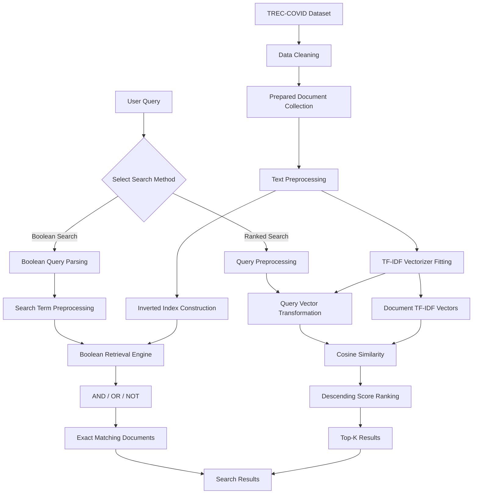

# Step 01 — Problem Definition & Project Proposal

## 1. Project Information

| Property | Description |
|---|---|
| Project Title | Medical Research Search |
| Course | Information Retrieval Systems (902333) |
| University | Al al-Bayt University |
| Faculty | Prince Al Hussein Bin Abdullah II Faculty of IT |
| Project Phase | Phase 1 |
| Team Size | 5 Students |
| Team Leader | محمد بهجت فهمي علي |
| Programming Language | Python |
| Dataset | TREC-COVID (BEIR) |
| Target Collection | 1,000 Documents |
| Assessment Weight | 3 Marks |
| Current Status | In Progress |

## 2. Project Overview

Medical Research Search is a Python-based Information Retrieval System designed to retrieve relevant biomedical research documents using traditional information retrieval techniques.

The project aims to improve access to biomedical research articles by combining two complementary retrieval approaches:

- Boolean Information Retrieval.
- Ranked Information Retrieval.

Both approaches will operate on the same document collection and use consistent text preprocessing techniques.

## 3. Core Technologies

| Technology | Purpose |
|---|---|
| Python | System implementation |
| Text Normalization | Standardizing textual content |
| Tokenization | Splitting text into searchable terms |
| Stopword Handling | Managing common and less informative words |
| Stemming / Lemmatization | Reducing words to their base forms |
| Inverted Index | Mapping terms to document identifiers |
| Boolean Retrieval | Exact logical document matching |
| TF-IDF | Document and query vector representation |
| Vector Space Model | Representing documents in a vector space |
| Cosine Similarity | Measuring query-document similarity |
| Top-K Ranking | Returning the most relevant documents |
| Git & GitHub | Version control and team collaboration |

## 4. Proposal Documentation

| Document | Description |
|---|---|
| [Problem Statement](problem_statement.md) | Problem definition, proposed solution, and target users |
| [Project Objectives](objectives.md) | Technical objectives and measurable success criteria |
| [Search Features](search_features.md) | Expected system features, inputs, outputs, and retrieval methods |
| [Dataset Description](dataset_description.md) | Dataset source, structure, licensing, and acquisition plan |
| [Team Roles](team_roles.md) | Team members and individual technical responsibilities |
| Phase 1 Proposal PDF | Pending preparation |

## 5. Proposed System Architecture

## 6. Assessment Requirements

This section addresses the first assessment criterion of Phase 1: Problem Definition and Proposal (3 marks).

- [x] Define the project title.
- [x] Define the project problem.
- [x] Identify target users.
- [x] Identify user information needs.
- [x] Define at least three achievable objectives.
- [x] Define expected search features.
- [x] Identify and cite the dataset source.
- [x] Define planned document fields.
- [x] Document dataset licensing considerations.
- [x] Assign individual team responsibilities.
- [ ] Prepare the formal project proposal PDF.

## 7. Expected Deliverables

- Complete project proposal documentation.
- Clearly defined problem statement.
- Measurable technical objectives.
- Documented search system features.
- Documented dataset acquisition strategy.
- Proposed system architecture.
- Individual team responsibilities.
- Formal Phase 1 proposal PDF.

## 8. Development Status

The project is currently in the planning and documentation stage.

The problem definition, project objectives, expected search features, dataset acquisition strategy, and team responsibilities have been documented.

The actual implementation and validation of the dataset acquisition pipeline, text preprocessing, inverted index, Boolean retrieval, ranked retrieval, and system integration will be completed during the subsequent development steps.

## 9. Project Navigation

| Development Step | Section |
|---|---|
| Step 01 | Problem Definition and Proposal |
| Step 02 | [Progress and Teamwork](../Step_02_Teamwork/) |
| Step 03 | [Dataset and Preprocessing](../Step_03_Preprocessing/) |
| Step 04 | [Inverted Index and Boolean Search](../Step_04_Boolean_Search/) |
| Step 05 | [TF-IDF and Ranked Search](../Step_05_Ranked_Search/) |
| Integration | [System Integration](../Integration/) |
| Testing | [Testing and Validation](../Testing/) |
| Submission | [Final Submission](../Final_Submission/) |

[Return to Main Repository](../README.md)

---

**Medical Research Search**

Information Retrieval Systems (902333)

Al al-Bayt University — Phase 1
