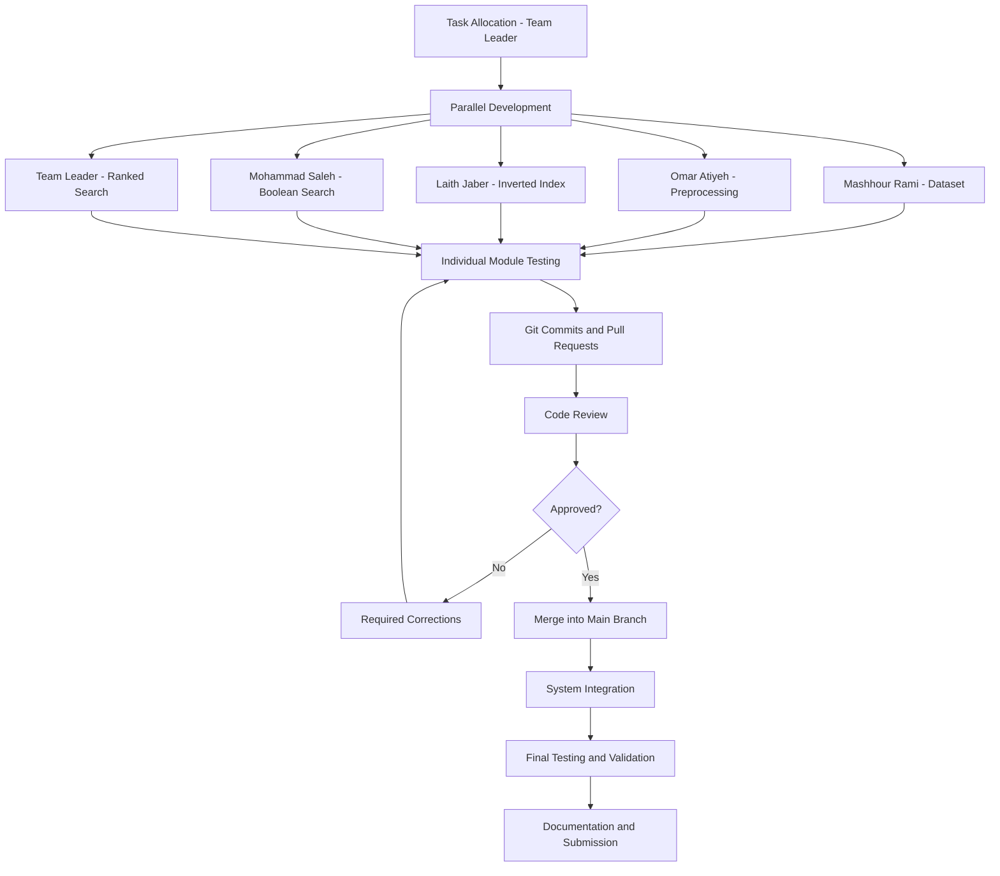

# Step 02 — Progress and Teamwork

## 1. Project Information

| Property | Description |
|---|---|
| Project | Medical Research Search |
| Course | Information Retrieval Systems (902333) |
| University | Al al-Bayt University |
| Phase | Phase 1 |
| Team Leader | محمد بهجت فهمي علي |
| Team Size | 5 Students |
| Assessment Weight | 3 Marks |
| Approximate Project Start | November 12, 2026 |
| Target Completion | November 17, 2026 |
| Final Submission | November 18, 2026 |
| Management Documentation | Completed |
| Development Status | In Progress |

## 2. Overview

This section documents the project management, teamwork, individual responsibilities, development progress, and system integration activities of the Medical Research Search project.

The team follows an incremental and parallel development approach using Git and GitHub.

The team leader coordinates development, monitors progress, reviews technical contributions, manages dependencies, and integrates individual modules into a unified Information Retrieval System.

## 3. Team Members and Module Ownership

| Team Member | Technical Responsibility | Development Section |
|---|---|---|
| Mohammed — Team Leader | Project Management, System Architecture, TF-IDF, Cosine Similarity and Integration | Step 01, Step 02, Step 05 and Integration |
| Laith Jaber | Inverted Index Construction | Step 04 |
| Mohammad Saleh | Boolean Information Retrieval | Step 04 |
| Omar Atiyeh | NLP and Text Preprocessing | Step 03 |
| Mashhour Rami | Dataset Engineering and Data Cleaning | Step 03 |

All members are responsible for testing and documenting their assigned components.

## 4. Teamwork Documentation

| Document | Description |
|---|---|
| [Task Allocation](task_allocation.md) | Individual tasks, responsibilities, expected deliverables, and acceptance criteria |
| [Project Milestones](milestones.md) | Development milestones, target dates, dependencies, and risk management |
| [Development Workflow](development_workflow.md) | GitHub branches, commits, pull requests, code reviews, and merge procedures |
| [Individual Contributions](contributions.md) | Individual implementation activities and contribution evidence |
| [Progress Log](progress_log.md) | Chronological development activities, technical decisions, and progress tracking |
| [Meeting Notes](meeting_notes.md) | Team coordination, technical discussions, decisions, and action items |
| [Integration Log](integration_log.md) | Module reviews, integration activities, and system validation |
| [Development Evidence](evidence/README.md) | Supporting implementation, testing, and teamwork evidence |

## 5. GitHub Branching Strategy

| Branch | Owner | Responsibility |
|---|---|---|
| `main` | Team Leader | Approved project and integrated system |
| `laith-jaber` | Laith Jaber | Inverted Index |
| `mohammad-saleh` | Mohammad Saleh | Boolean Search |
| `omar-atiyeh` | Omar Atiyeh | NLP and Text Preprocessing |
| `mashhour-rami` | Mashhour Rami | Dataset Engineering |

The team leader is also responsible for ranked retrieval development and final system integration.

Individual technical contributions will be tracked through Git commits, pull requests, code reviews, and actual testing results.

## 6. Collaborative Development Workflow

## 7. Project Development Timeline

| Period | Planned Activities |
|---|---|
| November 12–15, 2026 | Preliminary project preparation and planning |
| November 16, 2026 | Repository organization, project proposal, and task allocation |
| November 16–17, 2026 | Parallel technical module development |
| November 17, 2026 | Individual module testing and code reviews |
| November 17, 2026 | System integration and final validation |
| November 17, 2026 | Final documentation and recorded presentation |
| November 18, 2026 | Final project submission |

The project initiation date is approximate. Actual development and completion dates will be supported by available project evidence.

## 8. Assessment Requirements

This section addresses the second assessment criterion of Phase 1: Progress and Teamwork (3 marks).

| Assessment Requirement | Supporting Documentation |
|---|---|
| Divide work into milestones | milestones.md |
| Assign individual responsibilities | task_allocation.md |
| Record module implementation ownership | contributions.md |
| Maintain dated code changes | Git commit history |
| Maintain progress notes | progress_log.md |
| Document short testing results | evidence/ |
| Demonstrate collaborative development | Branches and pull requests |
| Integrate all technical modules | integration_log.md and Integration/ |
| Provide a contribution table | contributions.md |

## 9. Management Documentation Checklist

- [x] Define team roles and responsibilities.
- [x] Establish individual module ownership.
- [x] Define task allocation and acceptance criteria.
- [x] Establish project milestones and target dates.
- [x] Define the GitHub development workflow.
- [x] Establish individual contribution tracking.
- [x] Establish the project progress log.
- [x] Establish team coordination documentation.
- [x] Define system integration procedures.
- [x] Initialize the development evidence directory.

## 10. Implementation and Teamwork Checklist

- [ ] Complete individual technical modules.
- [ ] Record individual Git commits.
- [ ] Collect actual module testing results.
- [ ] Review individual pull requests.
- [ ] Merge approved technical contributions.
- [ ] Update individual contribution records.
- [ ] Update milestone completion statuses.
- [ ] Document actual integration activities.
- [ ] Verify the complete integrated system.
- [ ] Collect final development evidence.

## 11. Academic Integrity and Evidence

The project maintains transparent and accurate records of individual contributions.

Completed technical activities must be supported by actual implementation evidence, including:

- Git commits and pull requests.
- Source code changes.
- Code review records.
- Actual execution and testing results.
- Progress documentation.
- Integration evidence.

External code, datasets, libraries, and relevant AI assistance must be appropriately acknowledged.

Planned activities must not be presented as completed work.

## 12. Current Development Status

The project management and teamwork documentation structure has been established.

Individual responsibilities, milestones, development workflows, contribution tracking, progress recording, integration procedures, and evidence requirements have been documented.

Technical implementation, testing, code reviews, and system integration remain in progress or planned.

Step 02 will remain active throughout project development and will be finalized after the actual technical contributions and integration evidence have been verified.

## 13. Project Navigation

| Development Section | Link |
|---|---|
| Main Repository | [Project Overview](../README.md) |
| Step 01 | [Problem Definition and Proposal](../Step_01_Proposal/) |
| Step 02 | Progress and Teamwork |
| Step 03 | [Dataset and Preprocessing](../Step_03_Preprocessing/) |
| Step 04 | [Inverted Index and Boolean Search](../Step_04_Boolean_Search/) |
| Step 05 | [TF-IDF and Ranked Search](../Step_05_Ranked_Search/) |
| Integration | [System Integration](../Integration/) |
| Testing | [Testing and Validation](../Testing/) |
| Final Submission | [Final Submission](../Final_Submission/) |

---

**Medical Research Search**

Information Retrieval Systems (902333)

Al al-Bayt University — Phase 1
