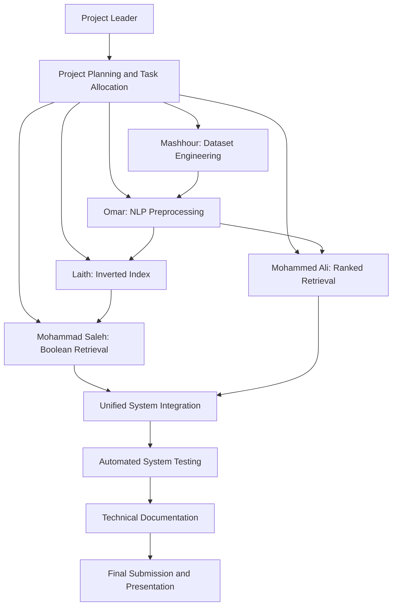

# Step 02 — Project Progress and Teamwork


---

## 1. Project Information

| Property | Description |
|---|---|
| Project | Medical Research Search |
| University | Al al-Bayt University |
| Course | Information Retrieval Systems |
| Course Code | 902333 |
| Academic Year | 2026–2027 |
| Phase | Phase 1 |
| Assessment Area | Progress and Teamwork |
| Allocated Marks | 3 Marks |
| Team Size | 5 Members |
| Team Leader | محمد بهجت فهمي علي |
| Project Management | Milestone-Based Modular Development |
| Version Control | Git and GitHub |
| Submission Deadline | November 18, 2026 |
| Last Updated | November 17, 2026 |
| Technical Status | Implemented, Integrated and Tested |

---

## 2. Overview

This section documents the project management, task allocation, development progress, team responsibilities, technical coordination, repository activities, integration procedures, and supporting evidence of the Medical Research Search project.

The project follows a modular development approach in which each team member is assigned a specific information retrieval component.

The assigned components are integrated into a unified Python application that supports Boolean retrieval, TF-IDF ranked retrieval, shared NLP preprocessing, and automated system validation.

---

## 3. Teamwork Objectives

- Establish clear individual responsibilities.
- Organize technical tasks and dependencies.
- Maintain structured development milestones.
- Coordinate component compatibility.
- Use GitHub for development and version control.
- Track project implementation progress.
- Document technical decisions and challenges.
- Integrate independently assigned components.
- Validate the integrated application.
- Maintain authentic project execution evidence.
- Prepare the final presentation and submission materials.

---

## 4. Team Members and Responsibilities

| Team Member | Assigned Role | Main Technical Responsibility |
|---|---|---|
| محمد بهجت فهمي علي | Team Leader | TF-IDF, Cosine Similarity, Ranked Retrieval, Integration, Testing and Management |
| مشهور رامي مشهور أبو سنينة | Dataset Engineer | Dataset Acquisition, Cleaning and Preparation |
| عمر عبد الباسط محمود عطية | NLP Preprocessing Engineer | Normalization, Tokenization, Stopword Removal and Stemming |
| ليث بسام محمود جابر | Inverted Index Engineer | Inverted Index Construction and Posting Sets |
| محمد مثنى محمد خالد صالح | Boolean Retrieval Engineer | Boolean Operators and Query Evaluation |

The responsibilities represent the assigned project structure. Individual authorship and participation should be supported by authentic contribution evidence.

---

## 5. Documentation Structure

```text
Step_02_Teamwork/
│
├── README.md
├── task_allocation.md
├── contributions.md
├── progress_log.md
├── milestones.md
├── development_workflow.md
├── integration_log.md
├── meeting_notes.md
│
└── evidence/
    └── README.md
```

### Documentation Register

| Document | Purpose |
|---|---|
| [Task Allocation](task_allocation.md) | Detailed technical tasks, responsibilities, inputs and outputs |
| [Team Contributions](contributions.md) | Assigned responsibilities and technical deliverable evidence |
| [Progress Log](progress_log.md) | Chronological development checkpoints |
| [Project Milestones](milestones.md) | Milestone objectives, acceptance criteria and completion status |
| [Development Workflow](development_workflow.md) | Git, GitHub, component interfaces and development procedures |
| [Integration Log](integration_log.md) | Repository integration, technical challenges and regression results |
| [Meeting and Coordination Notes](meeting_notes.md) | Technical decisions, coordination topics and action items |
| [Evidence Register](evidence/README.md) | Centralized implementation, execution and repository evidence |

---

## 6. Teamwork and Development Architecture



This architecture illustrates the assigned technical responsibilities and dependencies between the project components.

---

## 7. Project Management Approach

The project follows a milestone-based development approach supported by modular implementation and centralized integration.

The development process includes:

1. Define the information retrieval problem.
2. Establish project objectives.
3. Allocate technical responsibilities.
4. Organize the repository structure.
5. Establish development branches.
6. Develop and validate the assigned modules.
7. Document component execution results.
8. Integrate the technical components.
9. Execute automated system tests.
10. Complete technical and teamwork documentation.
11. Prepare presentation and submission materials.

Detailed procedures are available in [development_workflow.md](development_workflow.md).

---

## 8. GitHub Collaboration Strategy

### Development Branches

| Branch | Assigned Component |
|---|---|
| main | Integrated Project |
| mashhour-rami | Dataset Engineering |
| omar-atiyeh | NLP Preprocessing |
| laith-jaber | Inverted Index |
| Mohammad-Saleh | Boolean Retrieval |
| Team Leader Development Branch | Ranked Retrieval |

Exact branch names and current availability can be verified through the repository history.

### Pull Request Register

| Pull Request | Assigned Component |
|---|---|
| [PR #1](https://github.com/MOHAMMEDALMAHSERE/Medical-Research-Search-version9/pull/1) | Dataset Engineering |
| [PR #2](https://github.com/MOHAMMEDALMAHSERE/Medical-Research-Search-version9/pull/2) | NLP Preprocessing |
| [PR #3](https://github.com/MOHAMMEDALMAHSERE/Medical-Research-Search-version9/pull/3) | Inverted Index |
| [PR #4](https://github.com/MOHAMMEDALMAHSERE/Medical-Research-Search-version9/pull/4) | Boolean Retrieval |
| [PR #5](https://github.com/MOHAMMEDALMAHSERE/Medical-Research-Search-version9/pull/5) | Ranked Retrieval |

### Repository Evidence

- [Main Repository](https://github.com/MOHAMMEDALMAHSERE/Medical-Research-Search-version9)
- [Commit History](https://github.com/MOHAMMEDALMAHSERE/Medical-Research-Search-version9/commits/main/)
- [Development Branches](https://github.com/MOHAMMEDALMAHSERE/Medical-Research-Search-version9/branches)
- [Pull Requests](https://github.com/MOHAMMEDALMAHSERE/Medical-Research-Search-version9/pulls?q=is%3Apr)
- [Contributors](https://github.com/MOHAMMEDALMAHSERE/Medical-Research-Search-version9/graphs/contributors)

The team leader manages centralized repository organization and integration.

Repository branch assignments and pull requests do not independently establish individual authorship.

---

## 9. Component Responsibility and Deliverable Matrix

| Assigned Member | Technical Component | Main Deliverable | Technical Status |
|---|---|---|---|
| Mashhour Rami | Dataset Engineering | download_dataset.py | Completed |
| Omar Atiyeh | NLP Preprocessing | preprocessing.py | Completed |
| Laith Jaber | Inverted Index | inverted_index.py | Completed |
| Mohammad Saleh | Boolean Retrieval | boolean_search.py | Completed |
| Mohammed Ali | Ranked Retrieval | ranked_search.py | Completed |
| Mohammed Ali | System Integration | main.py | Completed |
| Mohammed Ali | System Testing | test_system.py | 15/15 Passed |
| Team Leader and Members | Final Presentation | Presentation Video | Pending |

All core technical components are available within the integrated project.

---

## 10. Development Timeline

| Date | Development Checkpoint | Status |
|---|---|---|
| November 16, 2026 | Project Planning and Repository Organization | Completed |
| November 16, 2026 | Proposal and Task Allocation | Completed |
| November 17, 2026 | Dataset Engineering | Completed |
| November 17, 2026 | NLP Preprocessing | Completed |
| November 17, 2026 | Inverted Index Construction | Completed |
| November 17, 2026 | Boolean Retrieval | Completed |
| November 17, 2026 | TF-IDF Ranked Retrieval | Completed |
| November 17, 2026 | System Integration | Completed |
| November 17, 2026 | Automated System Testing | Completed |
| November 17, 2026 | Main Repository Documentation | Completed |
| November 17, 2026 | Teamwork Documentation Update | Completed upon publication |
| November 18, 2026 | Submission Deadline | Scheduled |

The dates represent documented development checkpoints rather than verified individual working durations.

Detailed progress records are available in [progress_log.md](progress_log.md).

---

## 11. Project Milestones

| ID | Milestone | Status |
|---|---|---|
| M01 | Problem Definition and Proposal | Completed |
| M02 | Team Planning and Task Allocation | Completed |
| M03 | Dataset Acquisition and Cleaning | Completed |
| M04 | NLP Text Preprocessing | Completed |
| M05 | Inverted Index Construction | Completed |
| M06 | Boolean Information Retrieval | Completed |
| M07 | TF-IDF Ranked Retrieval | Completed |
| M08 | System Integration | Completed |
| M09 | Automated System Testing | Completed |
| M10 | Technical Documentation | Completed |
| M11 | Final Teamwork Documentation | Documentation Completed; Individual Verification Pending |
| M12 | Final Submission and Presentation Video | Pending |

### Milestone Summary

| Metric | Value |
|---|---:|
| Total Milestones | 12 |
| Fully Completed Milestones | 10 |
| Partially Completed Milestones | 1 |
| Pending Milestones | 1 |

The remaining activities concern individual contribution verification and final submission requirements.

See [milestones.md](milestones.md) for detailed objectives and acceptance criteria.

---

## 12. Actual Technical Achievements

### Dataset Engineering

| Metric | Recorded Result |
|---|---:|
| Examined Records | 171,332 |
| Rejected Records | 42,383 |
| Valid Candidate Records | 128,949 |
| Selected Documents | 1,000 |
| Random Seed | 42 |

### Inverted Index

| Metric | Recorded Result |
|---|---:|
| Indexed Documents | 1,000 |
| Vocabulary Terms | 10,758 |
| Total Postings | 87,381 |

### Ranked Retrieval

| Metric | Recorded Result |
|---|---:|
| TF-IDF Matrix Shape | 1,000 × 10,758 |
| Nonzero TF-IDF Weights | 87,381 |
| Demonstrated Ranked Queries | 3 |
| Results per Demonstration Query | 5 |

---

## 13. System Integration Results

The independently assigned technical modules were integrated into a unified information retrieval application.

### Integrated Components

- Dataset loading.
- Shared NLP preprocessing.
- Inverted index construction.
- Boolean retrieval.
- TF-IDF vectorization.
- Cosine similarity.
- Ranked retrieval.
- Top-K result selection.
- Ranking explanations.
- Interactive command-line interface.

### Boolean Regression Results

| Query | Standalone Matches | Integrated Matches |
|---|---:|---:|
| covid AND vaccine | 21 | 21 |
| covid OR vaccine | 357 | 357 |
| NOT vaccine | 923 | 923 |
| covid AND NOT vaccine | 280 | 280 |
| (covid OR virus) AND vaccine | 53 | 53 |

### Ranked Regression Results

| Query | Standalone Top Score | Integrated Top Score |
|---|---:|---:|
| covid vaccine immune response | 0.451483 | 0.451483 |
| respiratory infection treatment | 0.331911 | 0.331911 |
| coronavirus transmission prevention | 0.279990 | 0.279990 |

The integrated application successfully reproduced the previously recorded retrieval results.

### Integration Evidence

- [Unified Application](../Integration/main.py)
- [Integration Results](../Integration/integration_results.txt)
- [Integration Documentation](../Integration/README.md)
- [Integration Log](integration_log.md)

---

## 14. Automated Testing and Quality Assurance

The integrated system was validated using Python unittest.

### Test Results

| Test Category | Total | Passed | Failed |
|---|---:|---:|---:|
| Synthetic Tests | 9 | 9 | 0 |
| Real Corpus Tests | 6 | 6 | 0 |
| Total | 15 | 15 | 0 |

### Actual Execution History

| Execution | Passed | Failed | Duration |
|---|---:|---:|---:|
| First Execution | 15 | 0 | 10.161s |
| Second Execution | 15 | 0 | 8.257s |

### Final Recorded Output

```text
----------------------------------------------------------------------
Ran 15 tests in 8.257s

OK
```

All defined automated system tests passed successfully.

The 100% functional test pass rate does not represent perfect retrieval relevance, clinical reliability, or complete source code coverage.

### Testing Evidence

- [Automated Test Implementation](../Testing/test_system.py)
- [Actual Test Results](../Testing/test_results.txt)
- [Testing Documentation](../Testing/README.md)

---

## 15. Technical Challenges and Solutions

| Challenge | Implemented Solution |
|---|---|
| Large research document collection | Reproducible dataset selection |
| Missing document information | Required-field validation |
| Duplicate records | Duplicate detection |
| Inconsistent word forms | Shared NLP preprocessing |
| Inefficient repeated document searching | Inverted index |
| Complex Boolean expressions | Operator precedence and set operations |
| Unordered search results | TF-IDF and cosine similarity |
| High-dimensional vectors | Sparse matrix representation |
| Unexplained rankings | Term contribution explanations |
| Distributed module directories | Automatic module path configuration |
| Relative dataset paths | Project-relative dataset resolution |
| Unicode output errors | UTF-8 terminal configuration |
| Potential integration regressions | Automated regression testing |

---

## 16. Technical Evidence Register

| Component | Execution Evidence |
|---|---|
| Dataset Preparation | [dataset_report.json](../Step_03_Preprocessing/dataset/dataset_report.json) |
| NLP Preprocessing | [preprocessing_results.txt](../Step_03_Preprocessing/preprocessing_results.txt) |
| Inverted Index | [index_results.txt](../Step_04_Boolean_Search/index_results.txt) |
| Boolean Retrieval | [boolean_results.txt](../Step_04_Boolean_Search/boolean_results.txt) |
| Ranked Retrieval | [ranking_results.txt](../Step_05_Ranked_Search/ranking_results.txt) |
| System Integration | [integration_results.txt](../Integration/integration_results.txt) |
| Automated Testing | [test_results.txt](../Testing/test_results.txt) |

All evidence files are linked directly to their original locations to avoid unnecessary duplication.

The complete evidence register is available at [evidence/README.md](evidence/README.md).

---

## 17. Team Coordination and Technical Decisions

The project coordination records cover:

- Project requirements.
- Task allocation.
- Dataset selection.
- Shared preprocessing.
- Component interfaces.
- Indexing and retrieval algorithms.
- Integration requirements.
- Technical challenges.
- Automated system testing.
- Final presentation planning.

Technical decisions and development checkpoints are documented in [meeting_notes.md](meeting_notes.md).

These records are not represented as authenticated meeting transcripts or verified attendance records.

---

## 18. Individual Contribution Verification

The project distinguishes between:

- Assigned responsibilities.
- Completed technical components.
- Repository activities.
- Actual individual authorship.
- Demonstrated individual understanding.

At an observed repository checkpoint on November 17, 2026, GitHub displayed one contributor despite the use of separate component branches and pull requests.

Therefore, additional authentic evidence may be required to establish the individual participation of all five assigned team members.

Examples of supporting evidence include:

- Original files submitted by individual members.
- Authentic development records.
- GitHub commits and pull requests.
- Actual team communication records.
- Individual technical demonstrations.
- Final presentation participation.

No unsupported working hours, fabricated meeting attendance, or unverified contribution percentages are claimed.

---

## 19. Planned Presentation Responsibilities

| Presenter | Assigned Topic | Target Duration |
|---|---|---|
| Mohammed Ali | Project Overview, TF-IDF, Ranked Retrieval, Integration and Testing | Approximately 2 minutes |
| Mashhour Rami | Dataset Acquisition and Preparation | Approximately 2 minutes |
| Omar Atiyeh | NLP Preprocessing | Approximately 2 minutes |
| Laith Jaber | Inverted Index | Approximately 2 minutes |
| Mohammad Saleh | Boolean Retrieval | Approximately 2 minutes |

**Maximum Total Duration:** 10 minutes, including transitions.

The presentation allocation represents a planned recording structure rather than a completed presentation.

---

## 20. Step 02 Requirements and Completion Status

| Requirement | Status |
|---|---|
| Team Members Identified | Completed |
| Technical Responsibilities Assigned | Completed |
| Task Allocation Documented | Completed |
| Development Workflow Documented | Completed |
| Milestones Defined | Completed |
| Progress Log Updated | Completed |
| Technical Contributions Mapped | Completed |
| GitHub Repository History Linked | Completed |
| Integration Activities Documented | Completed |
| Technical Coordination Documented | Completed |
| Execution Evidence Organized | Completed |
| Automated Testing Evidence Available | Completed |
| Individual Contribution Verification | Pending Additional Evidence |
| Final Presentation | Pending |

The teamwork documentation structure is complete. Individual participation should be evaluated using authentic supporting records.

The allocated three marks for Step 02 represent the assessment structure and are not grades already awarded.

---

## 21. Academic Integrity

This project was developed for academic purposes as part of the Information Retrieval Systems course at Al al-Bayt University.

External datasets, software libraries, and technical references are acknowledged in the corresponding project documentation.

AI assistance was used to support implementation, debugging, technical review, testing, and documentation.

All reported numerical results are based on recorded execution outputs.

Assigned responsibilities and individual authorship are documented separately to maintain accurate contribution attribution.

Private communication records should not be published without appropriate permission or removal of unnecessary personal information.

The prepared dataset remains subject to applicable source licensing and redistribution requirements.

---

## 22. Final Status

The Medical Research Search project has successfully completed its core technical development, system integration, and automated functional testing.

All 15 automated system tests passed successfully.

The Step 02 documentation provides a consolidated record of assigned responsibilities, project milestones, development activities, technical decisions, integration results, and execution evidence.

The remaining activities focus on authentic individual contribution verification, final presentation preparation, and submission.

---

## 23. Project Navigation

| Project Section | Link |
|---|---|
| Main Project Documentation | [Main README](../README.md) |
| Step 01 — Proposal | [Step 01](../Step_01_Proposal/) |
| Step 02 — Progress and Teamwork | Current Section |
| Step 03 — Dataset and Preprocessing | [Step 03](../Step_03_Preprocessing/) |
| Step 04 — Inverted Index and Boolean Search | [Step 04](../Step_04_Boolean_Search/) |
| Step 05 — TF-IDF and Ranked Retrieval | [Step 05](../Step_05_Ranked_Search/) |
| System Integration | [Integration](../Integration/) |
| Automated System Testing | [Testing](../Testing/) |
| Final Submission | [Final Submission](../Final_Submission/) |

---

**Medical Research Search**

**Al al-Bayt University**

Information Retrieval Systems — 902333

Phase 1 — Progress and Teamwork

Last Updated: November 17, 2026
