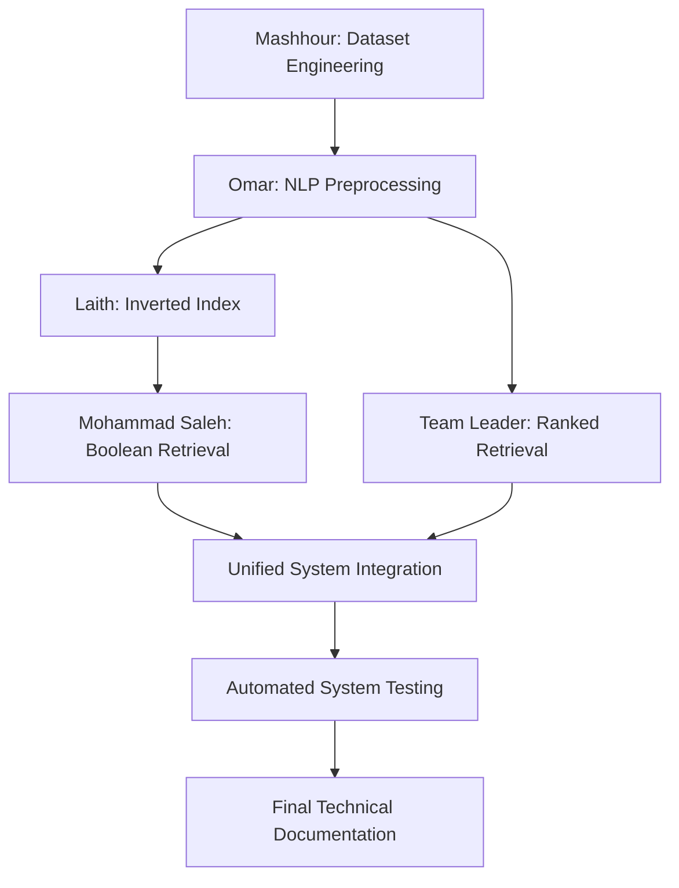

# Team Contributions and Technical Responsibilities

## 1. Overview

This document describes the assigned responsibilities, technical deliverables, development branches, and available contribution evidence for the Medical Research Search project.

The project follows a modular development approach in which each team member is assigned responsibility for a specific information retrieval component.

| Property | Description |
|---|---|
| Project | Medical Research Search |
| University | Al al-Bayt University |
| Course | Information Retrieval Systems (902333) |
| Phase | Phase 1 |
| Team Size | 5 Members |
| Technical Status | Implemented, Integrated and Tested |
| Last Updated | November 17, 2026 |

## 2. Team Responsibilities

| Team Member | Assigned Role | Technical Component |
|---|---|---|
| محمد بهجت فهمي علي | Team Leader | Ranked Retrieval, Integration and Management |
| مشهور رامي مشهور أبو سنينة | Dataset Engineer | Dataset Acquisition and Preparation |
| عمر عبد الباسط محمود عطية | NLP Engineer | Text Preprocessing |
| ليث بسام محمود جابر | Indexing Engineer | Inverted Index |
| محمد مثنى محمد خالد صالح | Boolean Retrieval Engineer | Boolean Search |

## 3. Team Leader — Mohammed Ali

**Full Name:** محمد بهجت فهمي علي

**Role:** Team Leader and Ranked Retrieval Engineer

### Assigned Responsibilities

- Project planning and technical coordination.
- Task allocation and milestone management.
- Repository organization.
- TF-IDF document and query representation.
- Cosine similarity calculation.
- Top-K ranked retrieval.
- Ranking explanation.
- Module integration.
- Automated system testing.
- Technical documentation.

### Technical Deliverables

| Deliverable | Evidence |
|---|---|
| Ranked Retrieval Implementation | [ranked_search.py](../Step_05_Ranked_Search/ranked_search.py) |
| Ranked Search Results | [ranking_results.txt](../Step_05_Ranked_Search/ranking_results.txt) |
| Unified Application | [main.py](../Integration/main.py) |
| Integration Results | [integration_results.txt](../Integration/integration_results.txt) |
| Automated Testing | [test_system.py](../Testing/test_system.py) |
| Test Results | [test_results.txt](../Testing/test_results.txt) |
| Main Documentation | [README.md](../README.md) |

### Recorded Component Results

- 1,000 documents represented using TF-IDF.
- 10,758 vocabulary terms.
- 87,381 nonzero TF-IDF weights.
- Three demonstrated ranked search queries.
- Five ranked results per demonstration query.
- Highest-ranked document explanations.
- Successful unified system demonstration.
- 15 out of 15 automated system tests passed.

### Component Status

Implemented, integrated, tested, and documented.

## 4. Dataset Engineering — Mashhour Rami

**Full Name:** مشهور رامي مشهور أبو سنينة

**Role:** Dataset Engineer

**Assigned Branch:** `mashhour-rami`

### Assigned Responsibilities

- Identify a suitable medical research corpus.
- Acquire the source dataset.
- Validate required document fields.
- Remove missing or invalid records.
- Detect duplicate documents.
- Select a reproducible document collection.
- Prepare structured CSV data.
- Generate dataset statistics.

### Technical Deliverables

| Deliverable | Evidence |
|---|---|
| Dataset Acquisition | [download_dataset.py](../Step_03_Preprocessing/download_dataset.py) |
| Prepared Document Collection | [documents.csv](../Step_03_Preprocessing/dataset/documents.csv) |
| Dataset Statistics | [dataset_report.json](../Step_03_Preprocessing/dataset/dataset_report.json) |

### Recorded Component Results

| Metric | Result |
|---|---:|
| Examined Records | 171,332 |
| Rejected Records | 42,383 |
| Valid Candidate Records | 128,949 |
| Selected Documents | 1,000 |
| Random Seed | 42 |

### Component Status

Implemented and integrated into the shared document collection.

## 5. NLP Preprocessing — Omar Atiyeh

**Full Name:** عمر عبد الباسط محمود عطية

**Role:** NLP Preprocessing Engineer

**Assigned Branch:** `omar-atiyeh`

### Assigned Responsibilities

- Text normalization.
- Lowercasing.
- Regular expression tokenization.
- Configurable stopword removal.
- Porter Stemming.
- Shared document and query preprocessing.
- Preprocessing demonstrations.

### Technical Deliverables

| Deliverable | Evidence |
|---|---|
| NLP Implementation | [preprocessing.py](../Step_03_Preprocessing/preprocessing.py) |
| Preprocessing Results | [preprocessing_results.txt](../Step_03_Preprocessing/preprocessing_results.txt) |

### Recorded Component Example

Original text:

```text
COVID-19 vaccines are reducing infections.
```

Final processed terms:

```text
['covid', '19', 'vaccin', 'reduc', 'infect']
```

The shared preprocessing pipeline is used by both Boolean and ranked retrieval.

### Component Status

Implemented, integrated, and functionally tested.

## 6. Inverted Index — Laith Jaber

**Full Name:** ليث بسام محمود جابر

**Role:** Inverted Index Engineer

**Assigned Branch:** `laith-jaber`

### Assigned Responsibilities

- Construct the inverted index.
- Map processed terms to document identifiers.
- Implement dictionary-based term lookup.
- Maintain document posting sets.
- Calculate document frequencies.
- Generate index statistics.
- Support Boolean retrieval integration.

### Technical Deliverables

| Deliverable | Evidence |
|---|---|
| Inverted Index Implementation | [inverted_index.py](../Step_04_Boolean_Search/inverted_index.py) |
| Index Execution Results | [index_results.txt](../Step_04_Boolean_Search/index_results.txt) |

### Recorded Component Results

| Metric | Result |
|---|---:|
| Indexed Documents | 1,000 |
| Unique Vocabulary Terms | 10,758 |
| Total Postings | 87,381 |
| Documents Without Searchable Terms | 0 |

The integrated index vocabulary and posting count are consistent with the TF-IDF document representation.

### Component Status

Implemented, integrated, and functionally tested.

## 7. Boolean Retrieval — Mohammad Saleh

**Full Name:** محمد مثنى محمد خالد صالح

**Role:** Boolean Retrieval Engineer

**Assigned Branch:** `Mohammad-Saleh`

### Assigned Responsibilities

- Boolean query tokenization.
- AND operator implementation.
- OR operator implementation.
- NOT operator implementation.
- Logical operator precedence.
- Parenthesized expression evaluation.
- Invalid query handling.
- Boolean search demonstrations.

### Technical Deliverables

| Deliverable | Evidence |
|---|---|
| Boolean Search Implementation | [boolean_search.py](../Step_04_Boolean_Search/boolean_search.py) |
| Boolean Search Results | [boolean_results.txt](../Step_04_Boolean_Search/boolean_results.txt) |

### Recorded Component Results

| Boolean Query | Matching Documents |
|---|---:|
| covid AND vaccine | 21 |
| covid OR vaccine | 357 |
| NOT vaccine | 923 |
| covid AND NOT vaccine | 280 |
| (covid OR virus) AND vaccine | 53 |

The integrated system reproduced all five recorded Boolean match counts successfully.

### Component Status

Implemented, integrated, and functionally tested.

## 8. Component Dependencies



The assigned modules form a unified information retrieval pipeline in which each component provides inputs or functionality required by subsequent components.

## 9. Technical Deliverable Completion Matrix

| Assigned Area | Implementation | Execution Evidence | Integration | System Validation |
|---|---|---|---|---|
| Dataset Engineering | Completed | Available | Completed | Passed |
| NLP Preprocessing | Completed | Available | Completed | Passed |
| Inverted Index | Completed | Available | Completed | Passed |
| Boolean Retrieval | Completed | Available | Completed | Passed |
| Ranked Retrieval | Completed | Available | Completed | Passed |
| Unified System | Completed | Available | Completed | Passed |

Completion in this table refers to the technical component rather than independent verification of individual authorship.

## 10. GitHub Collaboration Evidence

The repository uses dedicated development branches, pull requests, and a main integration branch.

### Pull Requests

| Pull Request | Assigned Component |
|---|---|
| [PR #1](../../pull/1) | Dataset Engineering |
| [PR #2](../../pull/2) | NLP Preprocessing |
| [PR #3](../../pull/3) | Inverted Index |
| [PR #4](../../pull/4) | Boolean Retrieval |
| [PR #5](../../pull/5) | Ranked Retrieval |

### Repository Evidence

- [Repository Commit History](https://github.com/MOHAMMEDALMAHSERE/Medical-Research-Search-version9/commits/main/)
- [Development Branches](https://github.com/MOHAMMEDALMAHSERE/Medical-Research-Search-version9/branches)
- [Pull Requests](https://github.com/MOHAMMEDALMAHSERE/Medical-Research-Search-version9/pulls?q=is%3Apr)
- [Contributors](https://github.com/MOHAMMEDALMAHSERE/Medical-Research-Search-version9/graphs/contributors)

## 11. Individual Contribution Verification

Assigned responsibilities, technical deliverable ownership, and GitHub commit authorship are separate forms of evidence.

The team leader coordinates repository management, integration, and documentation.

The GitHub repository displayed one contributor as of November 17, 2026. Therefore, repository-level contributor statistics alone do not establish the individual participation of all five assigned team members.

Individual participation should be supported by authentic evidence, including original submitted files, actual development activity, communication records, demonstrations, and GitHub history where available.

No individual working hours, unverified meeting attendance, or unsupported contribution percentages are claimed in this document.

## 12. Integrated Project Results

| Metric | Final Result |
|---|---:|
| Prepared Documents | 1,000 |
| Vocabulary Terms | 10,758 |
| Inverted Index Postings | 87,381 |
| Nonzero TF-IDF Weights | 87,381 |
| Boolean Demonstration Queries | 5 |
| Ranked Demonstration Queries | 3 |
| Automated System Tests | 15 |
| Passed Tests | 15 |
| Failed Tests | 0 |
| Final Recorded Test Execution | 8.257 seconds |

These results describe the completed technical system.

The 100% functional test pass rate does not represent retrieval relevance accuracy or clinical reliability.

## 13. Academic Integrity

All documented numerical results are based on recorded project execution evidence.

External datasets, libraries, and information retrieval references are acknowledged in the project documentation.

AI assistance was used to support implementation, debugging, review, automated testing, and technical documentation.

Individual contribution claims must reflect the actual work performed by each team member.

## 14. Completion Status

All assigned technical components have been implemented and integrated into the Medical Research Search application.

The unified application successfully completed its integrated demonstration and all 15 automated system tests.

The remaining activities concern final teamwork evidence, contribution verification, and submission preparation.

---

**Medical Research Search**

Al al-Bayt University

Information Retrieval Systems — Phase 1
