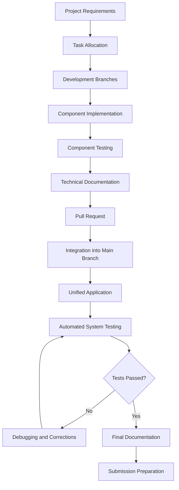
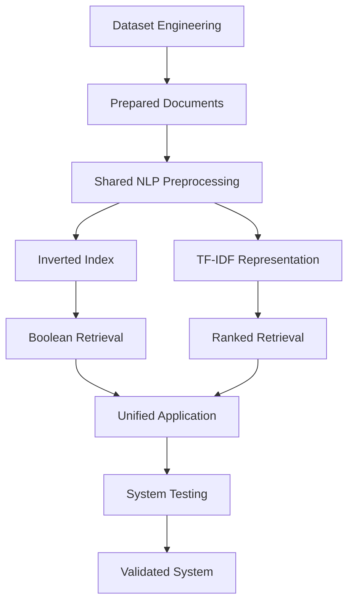

# Development Workflow and Version Control

## 1. Project Information

| Property | Description |
|---|---|
| Project | Medical Research Search |
| University | Al al-Bayt University |
| Course | Information Retrieval Systems (902333) |
| Phase | Phase 1 |
| Team Size | 5 Members |
| Development Approach | Modular Development |
| Version Control | Git |
| Repository Platform | GitHub |
| Integration Branch | main |
| Project Manager | محمد بهجت فهمي علي |
| Last Updated | November 17, 2026 |

---

## 2. Development Strategy

The Medical Research Search project follows a modular development workflow.

The system is divided into individual technical components with clearly defined responsibilities, dependencies, inputs, outputs, and acceptance criteria.

This approach supports:

- Structured task allocation.
- Separation of technical responsibilities.
- Independent component development.
- Reusable source code.
- Consistent programming interfaces.
- Controlled system integration.
- Functional and regression testing.
- Traceable technical documentation.
- Centralized repository management.

The team leader coordinates the development workflow, component integration, testing, and final documentation.

---

## 3. Development Workflow Architecture



This diagram represents the project's development and validation workflow.

---

## 4. Development Environment

| Technology | Purpose |
|---|---|
| Visual Studio Code | Source code development |
| Python | Core project implementation |
| Python Virtual Environment | Dependency isolation |
| PowerShell | Command execution |
| Git | Version control |
| GitHub | Repository management |
| Markdown | Technical documentation |
| Mermaid | Architecture and workflow diagrams |
| NLTK | NLP preprocessing |
| scikit-learn | TF-IDF and cosine similarity |
| unittest | Automated testing |
| CSV | Structured dataset storage |
| JSON | Dataset statistics reporting |

---

## 5. Modular Development Structure

| Component | Assigned Responsibility | Main Deliverable |
|---|---|---|
| Dataset Engineering | Mashhour Rami | download_dataset.py |
| NLP Preprocessing | Omar Atiyeh | preprocessing.py |
| Inverted Index | Laith Jaber | inverted_index.py |
| Boolean Retrieval | Mohammad Saleh | boolean_search.py |
| Ranked Retrieval | Mohammed Ali | ranked_search.py |
| System Integration | Mohammed Ali | main.py |
| System Testing | Mohammed Ali | test_system.py |
| Final Documentation | Team Leader and Team Members | Project Documentation |

Each technical module provides functionality required by the integrated information retrieval application.

The responsibilities listed above represent the assigned development structure.

---

## 6. Git Branching Strategy

The repository follows a component-based branching strategy.

The main branch contains the integrated project, while dedicated development branches are associated with individual technical components.

### Branch Register

| Branch | Assigned Component |
|---|---|
| main | Integrated System |
| mashhour-rami | Dataset Engineering |
| omar-atiyeh | NLP Preprocessing |
| laith-jaber | Inverted Index |
| Mohammad-Saleh | Boolean Retrieval |
| Team Leader Development Branch | Ranked Retrieval |

The exact branch names and current branch availability can be verified through the repository.

[View Development Branches](https://github.com/MOHAMMEDALMAHSERE/Medical-Research-Search-version9/branches)

### Branch Management Principles

- Separate major technical components into development branches.
- Organize implementation files according to project stages.
- Use descriptive commit messages.
- Associate pull requests with their technical components.
- Integrate compatible components into the main branch.
- Execute system validation after integration.

---

## 7. Git Development Commands

The following commands document the standard Git workflow applicable to the project.

### Clone the Repository

```bash
git clone https://github.com/MOHAMMEDALMAHSERE/Medical-Research-Search-version9.git
```

### Navigate to the Repository

```bash
cd Medical-Research-Search-version9
```

### Check Repository Status

```bash
git status
```

### Synchronize the Main Branch

```bash
git switch main
git pull origin main
```

### Switch to a Development Branch

Example:

```bash
git switch mashhour-rami
```

### Stage Component Changes

```bash
git add Step_03_Preprocessing/
```

### Commit Changes

```bash
git commit -m "Implement dataset acquisition and validation"
```

### Push the Development Branch

```bash
git push origin mashhour-rami
```

These commands illustrate the recommended Git workflow. They are not presented as authenticated terminal activity performed by every individual team member.

---

## 8. Commit Management

Commit messages should describe the technical purpose of each change.

### Commit Message Guidelines

- Use clear and descriptive messages.
- Identify the modified technical component.
- Separate unrelated changes when practical.
- Document significant implementation updates.
- Record testing and documentation changes.
- Avoid committing unnecessary temporary files.

### Representative Commit Messages

| Component | Commit Message Example |
|---|---|
| Dataset | Implement dataset acquisition and validation |
| Preprocessing | Implement shared NLP preprocessing pipeline |
| Inverted Index | Implement dictionary-based inverted index |
| Boolean Search | Implement Boolean query evaluation |
| Ranked Search | Complete TF-IDF ranked retrieval |
| Integration | Integrate all retrieval modules and add execution results |
| Testing | Add automated system tests and successful execution results |
| Documentation | Complete main project README |

### Repository History

[View Main Branch Commit History](https://github.com/MOHAMMEDALMAHSERE/Medical-Research-Search-version9/commits/main/)

---

## 9. Pull Request Workflow

Pull requests provide a structured mechanism for organizing component integration.

### Pull Request Process

1. Prepare the technical component.
2. Verify required implementation files.
3. Execute component-level demonstrations.
4. Document implementation changes.
5. Create a pull request targeting the main branch.
6. Inspect component compatibility.
7. Integrate the component.
8. Execute integration validation.

### Pull Request Register

| Pull Request | Assigned Component |
|---|---|
| [PR #1](https://github.com/MOHAMMEDALMAHSERE/Medical-Research-Search-version9/pull/1) | Dataset Engineering |
| [PR #2](https://github.com/MOHAMMEDALMAHSERE/Medical-Research-Search-version9/pull/2) | NLP Preprocessing |
| [PR #3](https://github.com/MOHAMMEDALMAHSERE/Medical-Research-Search-version9/pull/3) | Inverted Index |
| [PR #4](https://github.com/MOHAMMEDALMAHSERE/Medical-Research-Search-version9/pull/4) | Boolean Retrieval |
| [PR #5](https://github.com/MOHAMMEDALMAHSERE/Medical-Research-Search-version9/pull/5) | Ranked Retrieval |

Actual pull request authorship, review activity, changes, and merge information are available through the corresponding GitHub records.

[View All Pull Requests](https://github.com/MOHAMMEDALMAHSERE/Medical-Research-Search-version9/pulls?q=is%3Apr)

---

## 10. Component Interface Management

Consistent programming interfaces allow the independently assigned components to operate together.

### Dataset Interface

The prepared dataset provides structured document records.

```text
document_id, title, text, source
```

### Preprocessing Interface

```python
terms = preprocess(text)
processed_text = normalized(text)
```

The preprocessing functions provide consistent searchable terms for document indexing and query processing.

### Inverted Index Interface

```python
index = build_inverted_index(documents)
```

The inverted index maps processed terms to document identifier sets.

### Boolean Retrieval Interface

```python
results = boolean_search(query, index, all_ids)
```

The Boolean retrieval module returns document identifiers satisfying the logical expression.

### Ranked Retrieval Interface

```python
ranker = RankedSearch(documents)
results = ranker.search(query, top_k=5)
```

The ranked retrieval module returns relevant document candidates ordered by cosine similarity.

### Integration Interface

```bash
python -X utf8 Integration/main.py
```

The integrated application provides centralized access to the preprocessing and retrieval modules.

---

## 11. Component Dependency Workflow



The Boolean and ranked retrieval components use a common document collection and preprocessing pipeline.

This reduces inconsistencies between their searchable vocabularies.

---

## 12. Dependency Management

The project uses a Python virtual environment to isolate required libraries.

### Create the Virtual Environment

```bash
python -m venv .venv
```

### Activate the Environment

Windows PowerShell:

```powershell
.\.venv\Scripts\Activate.ps1
```

Linux or macOS:

```bash
source .venv/bin/activate
```

### Install Dependencies

```bash
python -m pip install -r Step_03_Preprocessing/requirements.txt
```

### Main External Dependencies

| Dependency | Purpose |
|---|---|
| NLTK | Porter Stemming |
| scikit-learn | Stopwords, TF-IDF vectorization and cosine similarity |

Python standard library modules are used for CSV processing, regular expressions, file management, command-line arguments, and automated testing.

---

## 13. Component Validation Workflow

Each technical component is associated with implementation files and recorded execution evidence.

| Component | Validation Evidence |
|---|---|
| Dataset Engineering | Dataset preparation report |
| NLP Preprocessing | Original and processed text demonstrations |
| Inverted Index | Vocabulary and posting statistics |
| Boolean Retrieval | Logical retrieval results and self-tests |
| Ranked Retrieval | Ranked search results and self-tests |
| System Integration | Full integrated demonstration |
| Automated Testing | Recorded unittest execution |

The project uses both controlled synthetic examples and actual research documents during validation.

---

## 14. System Integration Workflow

System integration connects all technical components without unnecessarily duplicating their implementations.

### Integration Activities

- Load the common document collection.
- Configure project-relative module paths.
- Reuse the shared preprocessing functions.
- Construct the inverted index.
- Initialize the TF-IDF representation.
- Connect Boolean retrieval.
- Connect ranked retrieval.
- Provide a unified command-line interface.
- Display retrieval results.
- Execute integrated demonstrations.
- Verify regression consistency.

### Execute the Unified Application

```bash
python -X utf8 Integration/main.py
```

### Run the Full Demonstration

```bash
python -X utf8 Integration/main.py --demo
```

### Actual Integration Results

| Metric | Recorded Result |
|---|---:|
| Loaded Documents | 1,000 |
| Vocabulary Terms | 10,758 |
| Inverted Index Postings | 87,381 |
| Nonzero TF-IDF Weights | 87,381 |
| Boolean Demonstration Queries | 5 |
| Ranked Demonstration Queries | 3 |
| Integration Demonstration | Passed |

[Integration Documentation](../Integration/README.md)

---

## 15. Quality Assurance and Automated Testing

The project uses Python unittest for automated system validation.

The test suite combines synthetic tests and real corpus tests.

### Execute Automated Tests

```bash
python -X utf8 Testing/test_system.py
```

### Save Test Evidence

```powershell
python -X utf8 Testing/test_system.py 2>&1 | Tee-Object -FilePath Testing/test_results.txt
```

### Actual Test Results

| Category | Passed | Failed |
|---|---:|---:|
| Synthetic Tests | 9 | 0 |
| Real Corpus Tests | 6 | 0 |
| Total | 15 | 0 |

Final recorded output:

```text
----------------------------------------------------------------------
Ran 15 tests in 8.257s

OK
```

The functional test pass rate was 100%.

This result applies to the implemented test suite and does not represent retrieval relevance accuracy or complete source code coverage.

[Automated Testing Documentation](../Testing/README.md)

---

## 16. Definition of Done

A technical component is considered completed within the project scope when its applicable completion criteria have been satisfied.

| Completion Criterion | Purpose |
|---|---|
| Implementation Available | Required source code exists |
| Assigned Requirements Addressed | Technical functionality is implemented |
| Execution Demonstrated | Actual component output is available |
| Documentation Available | Implementation and usage are explained |
| Integration Compatible | Component works with existing modules |
| Functional Validation Passed | Applicable tests execute successfully |
| Evidence Recorded | Supporting output is documented |

Individual contribution verification remains separate from technical component completion.

---

## 17. Issue Management and Technical Resolutions

| Technical Issue | Resolution | Status |
|---|---|---|
| Invalid dataset records | Dataset validation and filtering | Resolved |
| Duplicate document content | Duplicate detection | Resolved |
| Inconsistent word forms | Shared normalization and stemming | Addressed |
| Complex Boolean expressions | Operator precedence and expression evaluation | Validated |
| High-dimensional vectors | Sparse TF-IDF representation | Addressed |
| Unexplained ranking results | Term contribution explanations | Addressed |
| Distributed module directories | Automatic module path configuration | Resolved |
| Relative dataset paths | Project-relative dataset resolution | Resolved |
| Unicode output problems | UTF-8 terminal configuration | Resolved |
| Potential retrieval regressions | Automated regression testing | Validated |

Technical limitations related to lexical relevance remain documented as future improvement opportunities.

---

## 18. Documentation Management

Every major project stage has dedicated technical documentation.

The documentation includes:

- Component objectives.
- Implementation details.
- Applied algorithms.
- Architecture diagrams.
- Installation instructions.
- Execution commands.
- Actual results.
- Testing outcomes.
- Technical limitations.
- Supporting references.

### Documentation Register

| Section | Documentation |
|---|---|
| Proposal | [Step 01](../Step_01_Proposal/) |
| Teamwork | [Step 02](README.md) |
| Dataset and Preprocessing | [Step 03](../Step_03_Preprocessing/) |
| Boolean Retrieval | [Step 04](../Step_04_Boolean_Search/) |
| Ranked Retrieval | [Step 05](../Step_05_Ranked_Search/) |
| System Integration | [Integration](../Integration/) |
| Automated Testing | [Testing](../Testing/) |
| Main Project Documentation | [Main README](../README.md) |

---

## 19. Repository Management Guidelines

The repository should maintain a clear separation between source code, documentation, implementation evidence, dependencies, and submission materials.

Recommended repository practices include:

- Exclude local virtual environments.
- Exclude Python cache files.
- Avoid committing unnecessary temporary files.
- Avoid storing credentials or access tokens.
- Respect dataset licensing and redistribution conditions.
- Maintain reproducible dataset preparation instructions.
- Preserve relevant execution evidence.
- Use clear directory names.
- Maintain accurate documentation links.

The prepared dataset remains subject to the applicable source licensing conditions.

---

## 20. Collaboration Evidence and Authorship

Git branches, commits, pull requests, and technical execution logs provide evidence of repository and project development activities.

However, these records must be interpreted accurately.

Assigned component responsibility is not equivalent to verified individual commit authorship.

The team leader coordinates centralized integration and repository management.

Individual contributions should be supported by authentic development records, original submitted files, actual communication, demonstrations, and GitHub activity where available.

The development workflow does not claim unverified review approvals, meeting attendance, individual working hours, or unsupported contribution percentages.

---

## 21. Final Development Status

| Development Activity | Status |
|---|---|
| Project Planning | Completed |
| Task Allocation | Established |
| Repository Organization | Completed |
| Dataset Engineering | Completed |
| Shared NLP Preprocessing | Completed |
| Inverted Index | Completed |
| Boolean Retrieval | Completed |
| Ranked Retrieval | Completed |
| System Integration | Completed |
| Automated Testing | 15/15 Passed |
| Main Technical Documentation | Completed |
| Final Teamwork Documentation | In Progress |
| Presentation Video | Pending |
| Final Submission | Pending |

---

## 22. Academic Integrity

External datasets, software libraries, and information retrieval references are acknowledged in the corresponding project documentation.

AI assistance was used to support implementation, debugging, technical review, testing, and documentation.

Numerical results are based on recorded execution outputs.

Development procedures and assigned responsibilities are distinguished from verified individual participation.

---

## 23. Related Documentation

- [Task Allocation](task_allocation.md)
- [Team Contributions](contributions.md)
- [Project Milestones](milestones.md)
- [Progress Log](progress_log.md)
- [Integration Log](integration_log.md)
- [Meeting Notes](meeting_notes.md)
- [Collaboration Evidence](evidence/)
- [Main Repository](../README.md)

---

**Medical Research Search**

Al al-Bayt University

Information Retrieval Systems — Phase 1

Last Updated: November 17, 2026
