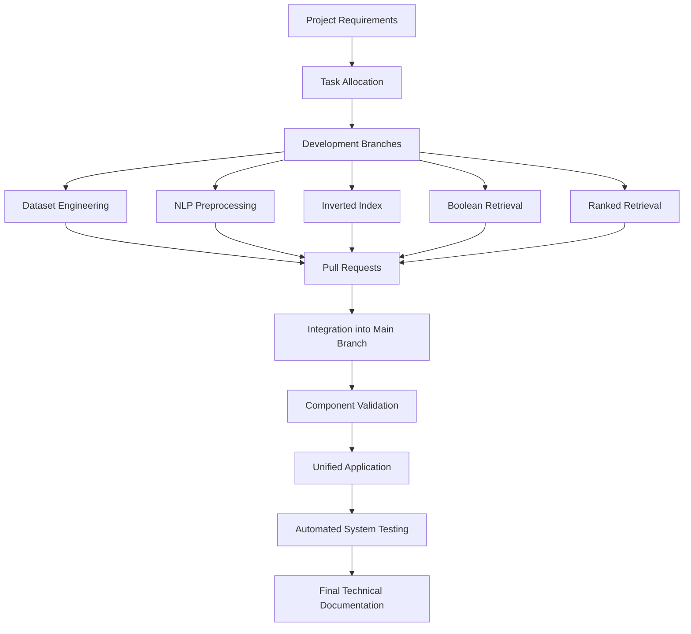
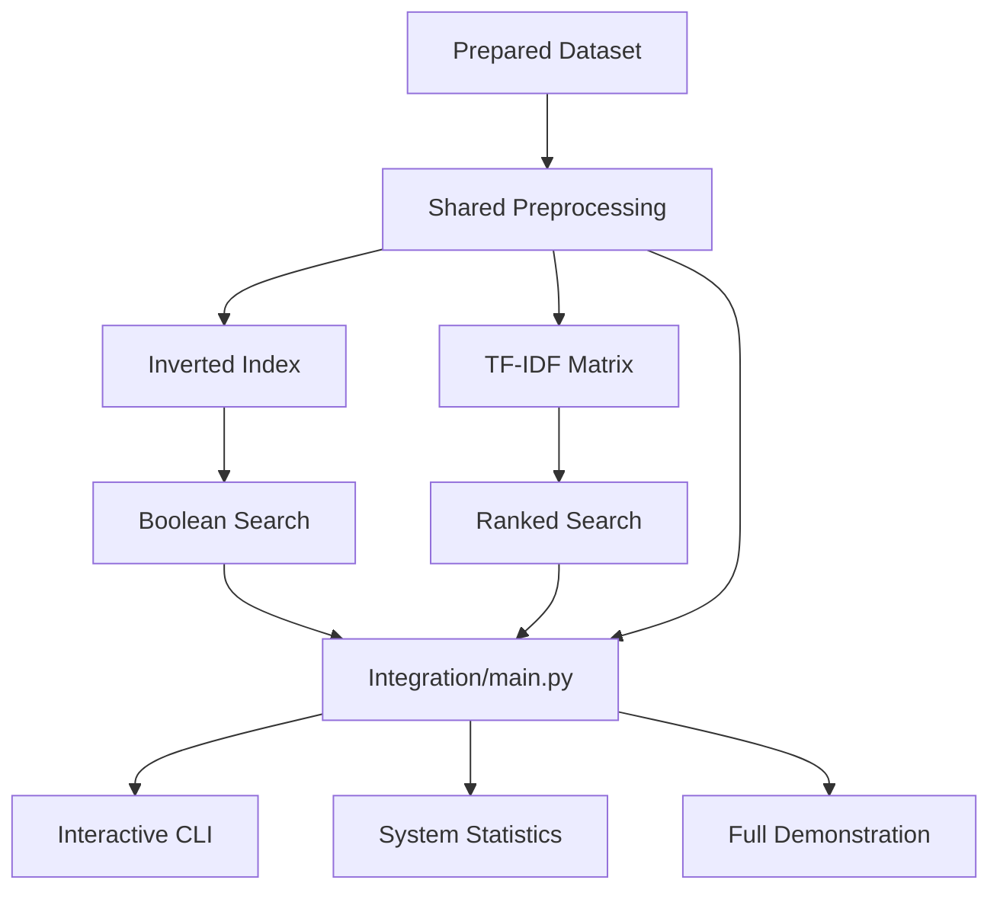

# Integration and Merge Log

## 1. Project Information

| Property | Description |
|---|---|
| Project | Medical Research Search |
| University | Al al-Bayt University |
| Course | Information Retrieval Systems (902333) |
| Phase | Phase 1 |
| Integration Manager | محمد بهجت فهمي علي |
| Team Size | 5 Members |
| Version Control | Git and GitHub |
| Main Integration Branch | main |
| Last Updated | November 17, 2026 |
| Integration Status | Completed Successfully |

---

## 2. Purpose

This document records the repository integration activities, development branches, pull requests, component dependencies, technical integration challenges, and system validation results.

The integration process combines the independently assigned information retrieval modules into a unified application while maintaining consistent document processing and retrieval behavior.

---

## 3. Integration Objectives

- Maintain a structured development workflow.
- Organize components through dedicated development branches.
- Track module integration using pull requests.
- Establish compatible programming interfaces.
- Maintain shared dataset and preprocessing dependencies.
- Integrate Boolean and ranked retrieval.
- Prevent unnecessary duplication of source code.
- Preserve previously validated retrieval results.
- Verify the integrated system through automated testing.

---

## 4. Development Branch Register

| Branch | Assigned Responsibility | Component |
|---|---|---|
| main | Team Leader | Integrated Project |
| mashhour-rami | Mashhour Rami | Dataset Engineering |
| omar-atiyeh | Omar Atiyeh | NLP Preprocessing |
| laith-jaber | Laith Jaber | Inverted Index |
| Mohammad-Saleh | Mohammad Saleh | Boolean Retrieval |
| Team Leader Development Branch | Mohammed Ali | Ranked Retrieval |

The development branches represent assigned technical components. Branch ownership and actual commit authorship should be evaluated separately using the repository history.

[View Repository Branches](https://github.com/MOHAMMEDALMAHSERE/Medical-Research-Search-version9/branches)

---

## 5. GitHub Development Workflow



The workflow separates component development from final application integration.

---

## 6. Pull Request Register

| PR | Assigned Component | Integration Destination |
|---|---|---|
| [PR #1](https://github.com/MOHAMMEDALMAHSERE/Medical-Research-Search-version9/pull/1) | Dataset Acquisition | main |
| [PR #2](https://github.com/MOHAMMEDALMAHSERE/Medical-Research-Search-version9/pull/2) | NLP Preprocessing | main |
| [PR #3](https://github.com/MOHAMMEDALMAHSERE/Medical-Research-Search-version9/pull/3) | Inverted Index | main |
| [PR #4](https://github.com/MOHAMMEDALMAHSERE/Medical-Research-Search-version9/pull/4) | Boolean Retrieval | main |
| [PR #5](https://github.com/MOHAMMEDALMAHSERE/Medical-Research-Search-version9/pull/5) | Ranked Retrieval | main |

The corresponding technical components are available in the main branch.

Individual pull request authorship, merge timestamps, review activity, and merge status should be verified directly from the respective GitHub records.

[View All Pull Requests](https://github.com/MOHAMMEDALMAHSERE/Medical-Research-Search-version9/pulls?q=is%3Apr)

---

## 7. Component Dependency Matrix

| Component | Required Input or Dependency | Output |
|---|---|---|
| Dataset Engineering | BEIR TREC-COVID Corpus | Prepared CSV Collection |
| NLP Preprocessing | Raw Document or Query Text | Processed Terms |
| Inverted Index | Documents and Preprocessing | Term Posting Sets |
| Boolean Retrieval | Inverted Index and Query | Matching Document IDs |
| Ranked Retrieval | Documents and Preprocessing | Ranked Documents and Similarity Scores |
| System Integration | All Retrieval Components | Unified Application |
| Automated Testing | Integrated Application and Dataset | Validation Results |

---

## 8. Integration Entry 01 — Dataset Engineering

**Date:** November 17, 2026

**Related Stage:** Step 03

**Assigned Responsibility:** Mashhour Rami

### Integrated Files

- download_dataset.py
- documents.csv
- dataset_report.json

### Integration Activities

- Establish the shared document collection.
- Standardize required document fields.
- Validate document identifiers.
- Prepare structured CSV input.
- Establish a common dataset location for retrieval components.

### Recorded Results

| Metric | Result |
|---|---:|
| Examined Records | 171,332 |
| Valid Candidate Records | 128,949 |
| Rejected Records | 42,383 |
| Selected Documents | 1,000 |

### Supporting Evidence

- [Dataset Acquisition](../Step_03_Preprocessing/download_dataset.py)
- [Dataset Report](../Step_03_Preprocessing/dataset/dataset_report.json)

**Status:** Integrated Successfully

---

## 9. Integration Entry 02 — NLP Preprocessing

**Date:** November 17, 2026

**Related Stage:** Step 03

**Assigned Responsibility:** Omar Atiyeh

### Integrated File

- preprocessing.py

### Integration Activities

- Establish shared preprocessing functions.
- Standardize document normalization.
- Apply consistent tokenization.
- Support configurable stopword removal.
- Apply Porter Stemming.
- Connect preprocessing with indexing and ranked retrieval.

### Integration Demonstration

Original text:

```text
COVID-19 vaccines are reducing infections.
```

Processed terms:

```text
['covid', '19', 'vaccin', 'reduc', 'infect']
```

### Supporting Evidence

- [Preprocessing Implementation](../Step_03_Preprocessing/preprocessing.py)
- [Preprocessing Results](../Step_03_Preprocessing/preprocessing_results.txt)

**Status:** Integrated Successfully

---

## 10. Integration Entry 03 — Inverted Index

**Date:** November 17, 2026

**Related Stage:** Step 04

**Assigned Responsibility:** Laith Jaber

### Integrated File

- inverted_index.py

### Integration Activities

- Connect the index builder to the shared dataset.
- Reuse the shared preprocessing module.
- Construct term-to-document mappings.
- Maintain set-based posting lists.
- Provide the index required by Boolean retrieval.

### Recorded Results

| Metric | Result |
|---|---:|
| Indexed Documents | 1,000 |
| Vocabulary Size | 10,758 |
| Total Postings | 87,381 |
| Documents Without Searchable Terms | 0 |

### Supporting Evidence

- [Inverted Index Implementation](../Step_04_Boolean_Search/inverted_index.py)
- [Index Results](../Step_04_Boolean_Search/index_results.txt)

**Status:** Integrated Successfully

---

## 11. Integration Entry 04 — Boolean Retrieval

**Date:** November 17, 2026

**Related Stage:** Step 04

**Assigned Responsibility:** Mohammad Saleh

### Integrated File

- boolean_search.py

### Integration Activities

- Connect Boolean query processing to the inverted index.
- Implement logical operations using document posting sets.
- Establish the complete document universe for NOT operations.
- Support operator precedence and parentheses.
- Connect matching document identifiers to document titles.
- Validate retrieval results after integration.

### Regression Results

| Query | Standalone Matches | Integrated Matches | Status |
|---|---:|---:|---|
| covid AND vaccine | 21 | 21 | PASS |
| covid OR vaccine | 357 | 357 | PASS |
| NOT vaccine | 923 | 923 | PASS |
| covid AND NOT vaccine | 280 | 280 | PASS |
| (covid OR virus) AND vaccine | 53 | 53 | PASS |

### Supporting Evidence

- [Boolean Search Implementation](../Step_04_Boolean_Search/boolean_search.py)
- [Boolean Search Results](../Step_04_Boolean_Search/boolean_results.txt)

**Status:** Integrated Successfully

---

## 12. Integration Entry 05 — Ranked Retrieval

**Date:** November 17, 2026

**Related Stage:** Step 05

**Assigned Responsibility:** Team Leader

### Integrated File

- ranked_search.py

### Integration Activities

- Connect ranked retrieval to the shared dataset.
- Reuse the shared NLP preprocessing functions.
- Fit the TF-IDF vectorizer on the document collection.
- Construct the sparse document-term matrix.
- Transform user queries into the same vector space.
- Calculate cosine similarity.
- Support configurable Top-K retrieval.
- Display document titles and similarity scores.
- Provide highest-ranked document explanations.

### Regression Results

| Query | Standalone Top Score | Integrated Top Score | Status |
|---|---:|---:|---|
| covid vaccine immune response | 0.451483 | 0.451483 | PASS |
| respiratory infection treatment | 0.331911 | 0.331911 | PASS |
| coronavirus transmission prevention | 0.279990 | 0.279990 | PASS |

### Supporting Evidence

- [Ranked Search Implementation](../Step_05_Ranked_Search/ranked_search.py)
- [Ranked Search Results](../Step_05_Ranked_Search/ranking_results.txt)

**Status:** Integrated Successfully

---

## 13. Integration Entry 06 — Unified Application

**Date:** November 17, 2026

**Assigned Responsibility:** Team Leader

### Integrated File

- Integration/main.py

### Integration Activities

- Establish automatic module path configuration.
- Implement centralized dataset loading.
- Load the shared document collection.
- Construct the inverted index.
- Initialize the TF-IDF ranked retrieval component.
- Provide access to Boolean retrieval.
- Provide access to ranked retrieval.
- Implement the interactive command-line interface.
- Display system statistics.
- Support preprocessing demonstrations.
- Support full integrated demonstrations.
- Configure Unicode output.

### Unified Application Architecture



### Actual Integration Statistics

| Metric | Recorded Result |
|---|---:|
| Loaded Documents | 1,000 |
| Vocabulary Terms | 10,758 |
| Inverted Index Postings | 87,381 |
| TF-IDF Matrix Shape | 1,000 × 10,758 |
| Nonzero TF-IDF Weights | 87,381 |
| Boolean Demonstration Queries | 5 |
| Ranked Demonstration Queries | 3 |

### Recorded Output

```text
Demo completed successfully.
```

### Supporting Evidence

- [Unified Application](../Integration/main.py)
- [Integration Execution Results](../Integration/integration_results.txt)
- [Integration Documentation](../Integration/README.md)

**Status:** Completed Successfully

---

## 14. Technical Challenges and Resolutions

| Integration Challenge | Implemented Resolution |
|---|---|
| Modules stored in separate directories | Automatic module path configuration |
| Relative dataset path dependencies | Project-relative dataset path resolution |
| Potential preprocessing inconsistency | Shared preprocessing implementation |
| Different retrieval representations | Shared document collection and vocabulary validation |
| Boolean NOT document scope | Complete indexed document universe |
| Repeated TF-IDF construction | Reusable fitted vectorizer and document matrix |
| High-dimensional document representations | Sparse matrix storage |
| Unicode output errors on Windows | UTF-8 execution and terminal configuration |
| Potential changes in retrieval behavior after integration | Automated regression testing |

These resolutions address the documented technical integration requirements and observed execution issues.

Git merge conflicts or conflict-resolution activities are not claimed unless supported by repository records.

---

## 15. Index and TF-IDF Consistency Validation

The inverted index and TF-IDF representation were constructed using the same prepared document collection and shared preprocessing pipeline.

| Metric | Inverted Index | TF-IDF |
|---|---:|---:|
| Documents | 1,000 | 1,000 |
| Vocabulary Terms | 10,758 | 10,758 |
| Postings / Nonzero Weights | 87,381 | 87,381 |

The index and matrix consistency test passed successfully.

This verifies consistency within the implemented testing scope.

---

## 16. Integration Entry 07 — Automated System Testing

**Date:** November 17, 2026

**Assigned Responsibility:** Team Leader

### Testing Activities

- Validate real corpus integrity.
- Validate shared preprocessing.
- Validate inverted index construction.
- Verify Boolean logical operations.
- Verify ranked search results.
- Verify Top-K retrieval and score bounds.
- Validate invalid input handling.
- Validate interactive application behavior.
- Verify execution from different working directories.
- Perform regression testing.

### Actual Test Results

| Category | Total Tests | Passed | Failed |
|---|---:|---:|---:|
| Synthetic Tests | 9 | 9 | 0 |
| Real Corpus Tests | 6 | 6 | 0 |
| Total | 15 | 15 | 0 |

### Execution History

| Execution | Passed | Failed | Duration |
|---|---:|---:|---:|
| First Execution | 15 | 0 | 10.161 seconds |
| Second Execution | 15 | 0 | 8.257 seconds |

### Final Recorded Output

```text
----------------------------------------------------------------------
Ran 15 tests in 8.257s

OK
```

### Supporting Evidence

- [Automated Test Implementation](../Testing/test_system.py)
- [Actual Test Results](../Testing/test_results.txt)
- [Testing Documentation](../Testing/README.md)

**Status:** All Tests Passed

---

## 17. Repository Integration Checkpoints

The following repository checkpoints were recorded on November 17, 2026.

| Component | Recorded Commit Message |
|---|---|
| Step 03 | Complete Step 03 dataset and preprocessing documentation |
| Step 05 | Complete Step 05 TF-IDF ranked retrieval and result validation |
| System Integration | Integrate all retrieval modules and add execution results |
| Integration Documentation | Complete system integration and validate unified retrieval pipeline |
| Automated Testing | Add automated system tests and successful execution results |
| Testing Documentation | Complete system testing documentation and quality validation |
| Main Documentation | Complete main project README with architecture, results and testing documentation |

At the checkpoint following the main README update, the repository displayed 60 commits.

The commit count is a historical observation and will change as final documentation and submission activities continue.

[View Main Branch Commit History](https://github.com/MOHAMMEDALMAHSERE/Medical-Research-Search-version9/commits/main/)

---

## 18. Final Integration Validation Matrix

| Component | Available in Main | Integrated | Functional Validation |
|---|---|---|---|
| Dataset Engineering | Yes | Yes | PASS |
| NLP Preprocessing | Yes | Yes | PASS |
| Inverted Index | Yes | Yes | PASS |
| Boolean Retrieval | Yes | Yes | PASS |
| Ranked Retrieval | Yes | Yes | PASS |
| Unified Application | Yes | Yes | PASS |
| Automated Testing | Yes | Yes | PASS |

The validation status describes the technical components and executed test cases rather than complete source code coverage or formal retrieval relevance evaluation.

---

## 19. Collaboration and Authorship Verification

The project uses assigned technical responsibilities, development branches, pull requests, and centralized integration.

The team leader manages repository organization, integration, testing, and final technical documentation.

Repository screenshots recorded during development displayed one GitHub contributor.

Therefore, the existence of separate branches and pull requests must not be interpreted as independent verification that each assigned member authored the associated commits.

Original submitted files, authentic communication records, development activity, demonstrations, and GitHub history should be used to establish individual participation.

---

## 20. Integration Evidence Register

| Evidence | Location |
|---|---|
| Dataset Preparation | [dataset_report.json](../Step_03_Preprocessing/dataset/dataset_report.json) |
| NLP Preprocessing | [preprocessing_results.txt](../Step_03_Preprocessing/preprocessing_results.txt) |
| Inverted Index | [index_results.txt](../Step_04_Boolean_Search/index_results.txt) |
| Boolean Retrieval | [boolean_results.txt](../Step_04_Boolean_Search/boolean_results.txt) |
| Ranked Retrieval | [ranking_results.txt](../Step_05_Ranked_Search/ranking_results.txt) |
| Unified Application | [main.py](../Integration/main.py) |
| Integration Results | [integration_results.txt](../Integration/integration_results.txt) |
| Automated Tests | [test_system.py](../Testing/test_system.py) |
| Test Results | [test_results.txt](../Testing/test_results.txt) |
| Main Documentation | [README.md](../README.md) |
| Repository History | [GitHub Commits](https://github.com/MOHAMMEDALMAHSERE/Medical-Research-Search-version9/commits/main/) |
| Development Branches | [GitHub Branches](https://github.com/MOHAMMEDALMAHSERE/Medical-Research-Search-version9/branches) |
| Pull Requests | [GitHub Pull Requests](https://github.com/MOHAMMEDALMAHSERE/Medical-Research-Search-version9/pulls?q=is%3Apr) |

---

## 21. Final Integration Status

All technical information retrieval components have been successfully integrated into a unified Python application.

The integrated system processes 1,000 research documents and supports Boolean retrieval, TF-IDF ranked retrieval, shared NLP preprocessing, and ranking explanations.

The previously recorded Boolean and ranked retrieval results were reproduced successfully after integration.

All 15 automated system tests passed successfully.

| Final Validation | Status |
|---|---|
| Component Integration | Completed |
| Unified Application | Completed |
| Integration Demonstration | Passed |
| Boolean Regression | Passed |
| Ranked Regression | Passed |
| Automated System Testing | 15/15 Passed |
| Technical Documentation | Completed |
| Final Submission | Pending |

The project is technically ready for final submission preparation.

---

**Medical Research Search**

Al al-Bayt University

Information Retrieval Systems — Phase 1

Last Updated: November 17, 2026
