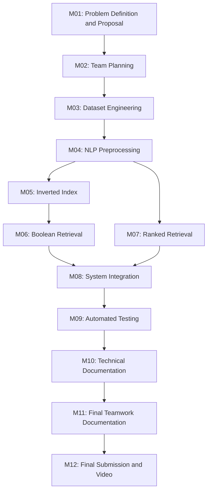
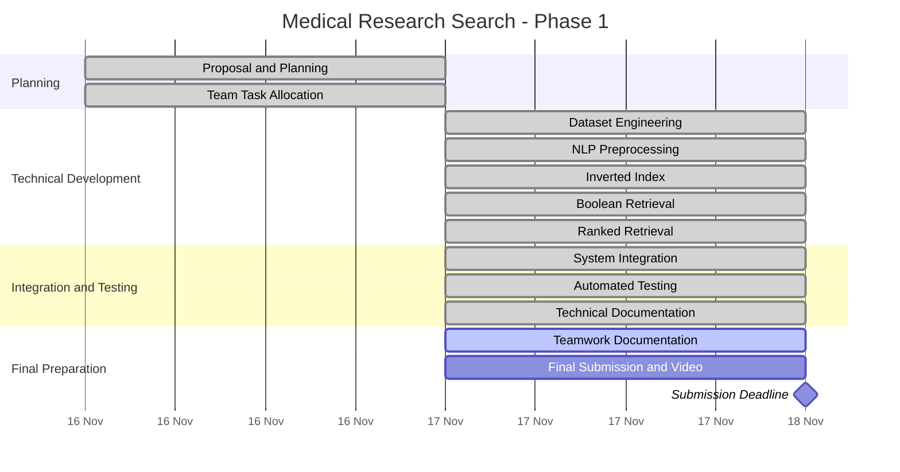

# Project Milestones and Deliverables

## 1. Project Information

| Property | Description |
|---|---|
| Project | Medical Research Search |
| University | Al al-Bayt University |
| Course | Information Retrieval Systems |
| Course Code | 902333 |
| Phase | Phase 1 |
| Team Leader | محمد بهجت فهمي علي |
| Team Size | 5 Members |
| Submission Deadline | November 18, 2026 |
| Last Updated | November 17, 2026 |
| Technical Status | Completed and Tested |

---

## 2. Milestone Management Strategy

The project follows a milestone-based development approach.

Each milestone represents a specific technical or academic deliverable with defined objectives, assigned responsibilities, completion criteria, and supporting evidence.

The development process follows a modular dependency structure, allowing independently assigned components to be integrated into a unified information retrieval system.

Milestone completion is evaluated using:

- Availability of implementation files.
- Completion of assigned technical requirements.
- Actual execution results.
- Technical documentation.
- Integration compatibility.
- Automated testing evidence.

---

## 3. Milestone Roadmap

---

## 4. Master Milestone Register

| ID | Milestone | Assigned Responsibility | Completion Date | Status |
|---|---|---|---|---|
| M01 | Problem Definition and Proposal | Team Leader | November 16, 2026 | Completed |
| M02 | Team Planning and Task Allocation | Team Leader | November 16, 2026 | Completed |
| M03 | Dataset Acquisition and Cleaning | Mashhour Rami | November 17, 2026 | Completed |
| M04 | NLP Text Preprocessing | Omar Atiyeh | November 17, 2026 | Completed |
| M05 | Inverted Index Construction | Laith Jaber | November 17, 2026 | Completed |
| M06 | Boolean Information Retrieval | Mohammad Saleh | November 17, 2026 | Completed |
| M07 | TF-IDF Ranked Retrieval | Team Leader | November 17, 2026 | Completed |
| M08 | System Integration | Team Leader | November 17, 2026 | Completed |
| M09 | Automated System Testing | Team Leader | November 17, 2026 | Completed |
| M10 | Technical Documentation | Team Leader | November 17, 2026 | Completed |
| M11 | Final Teamwork Documentation | Team Leader and Team Members | Pending | In Progress |
| M12 | Final Submission and Presentation Video | Entire Team | Pending | Pending |

The dates represent documented project milestones and repository activities rather than individual development start dates or working hours.

---

## 5. M01 — Problem Definition and Proposal

**Related Stage:** Step 01

**Assigned Responsibility:** Team Leader

### Objectives

- Define the information retrieval problem.
- Identify the target research domain.
- Establish project objectives.
- Define the required search features.
- Identify a suitable dataset.
- Establish the proposed system architecture.

### Acceptance Criteria

| Criterion | Status |
|---|---|
| Project problem defined | Met |
| Project objectives documented | Met |
| Dataset source identified | Met |
| Retrieval methods identified | Met |
| Team responsibilities documented | Met |
| Proposal prepared | Met |

### Supporting Evidence

- [Proposal Documentation](../Step_01_Proposal/)
- [Problem Statement](../Step_01_Proposal/problem_statement.md)
- [Project Objectives](../Step_01_Proposal/objectives.md)
- [Project Proposal](../Step_01_Proposal/phase1-proposal.docx)

**Milestone Status:** Completed

---

## 6. M02 — Team Planning and Task Allocation

**Related Stage:** Step 02

**Assigned Responsibility:** Team Leader

### Objectives

- Establish a five-member project team.
- Define individual technical responsibilities.
- Establish the development workflow.
- Organize the repository.
- Define component dependencies.
- Establish development branches and integration procedures.

### Acceptance Criteria

| Criterion | Status |
|---|---|
| Team responsibilities assigned | Met |
| Technical modules defined | Met |
| Repository structure established | Met |
| Development workflow documented | Met |
| Component dependencies identified | Met |
| Development branches established | Met |

### Supporting Evidence

- [Task Allocation](task_allocation.md)
- [Development Workflow](development_workflow.md)
- [Team Contributions](contributions.md)

Completion of this milestone refers to project planning and task allocation. Final individual contribution verification is tracked separately under milestone M11.

**Milestone Status:** Completed

---

## 7. M03 — Dataset Acquisition and Cleaning

**Related Stage:** Step 03

**Assigned Responsibility:** Mashhour Rami

### Objectives

- Acquire a real research document collection.
- Validate required document information.
- Remove invalid and duplicate records.
- Generate a structured dataset.
- Support reproducible dataset preparation.

### Acceptance Criteria

| Criterion | Actual Result | Status |
|---|---|---|
| Real research dataset | BEIR TREC-COVID | Met |
| Minimum 100 documents | 1,000 documents | Met |
| Unique document identifiers | Validated | Met |
| Document titles and text | Available | Met |
| Missing-field filtering | Implemented | Met |
| Duplicate detection | Implemented | Met |
| Reproducible selection | Seed 42 | Met |
| Structured CSV output | Available | Met |

### Actual Results

| Metric | Value |
|---|---:|
| Examined Records | 171,332 |
| Rejected Records | 42,383 |
| Valid Candidate Records | 128,949 |
| Selected Documents | 1,000 |

The preprocessing pipeline primarily targets English, although the source collection may contain documents or titles in other languages. Complete English-only coverage has not been independently established.

### Supporting Evidence

- [Dataset Acquisition Implementation](../Step_03_Preprocessing/download_dataset.py)
- [Dataset Report](../Step_03_Preprocessing/dataset/dataset_report.json)
- [Dataset Documentation](../Step_03_Preprocessing/README.md)

**Milestone Status:** Completed within the documented implementation scope.

---

## 8. M04 — NLP Text Preprocessing

**Related Stage:** Step 03

**Assigned Responsibility:** Omar Atiyeh

### Objectives

- Normalize document text.
- Apply consistent tokenization.
- Remove stopwords.
- Apply Porter Stemming.
- Implement reusable preprocessing functions.

### Acceptance Criteria

| Criterion | Status |
|---|---|
| Text normalization | Met |
| Lowercasing | Met |
| Regular expression tokenization | Met |
| Configurable stopword removal | Met |
| Porter Stemming | Met |
| Shared preprocessing functions | Met |
| Preprocessing demonstration | Met |
| Automated functional validation | Passed |

### Supporting Evidence

- [Preprocessing Implementation](../Step_03_Preprocessing/preprocessing.py)
- [Preprocessing Results](../Step_03_Preprocessing/preprocessing_results.txt)

**Milestone Status:** Completed

---

## 9. M05 — Inverted Index Construction

**Related Stage:** Step 04

**Assigned Responsibility:** Laith Jaber

### Objectives

- Construct an inverted index.
- Map terms to document posting sets.
- Support efficient term lookup.
- Generate index statistics.
- Provide a foundation for Boolean retrieval.

### Acceptance Criteria

| Criterion | Actual Result | Status |
|---|---|---|
| Dictionary-based index | Implemented | Met |
| Set-based posting lists | Implemented | Met |
| Indexed documents | 1,000 | Met |
| Vocabulary terms | 10,758 | Met |
| Total postings | 87,381 | Met |
| Integration compatibility | Verified | Met |
| Automated testing | Passed | Met |

### Supporting Evidence

- [Inverted Index Implementation](../Step_04_Boolean_Search/inverted_index.py)
- [Index Results](../Step_04_Boolean_Search/index_results.txt)

**Milestone Status:** Completed

---

## 10. M06 — Boolean Information Retrieval

**Related Stage:** Step 04

**Assigned Responsibility:** Mohammad Saleh

### Objectives

- Implement AND, OR, and NOT operators.
- Support operator precedence.
- Support parenthesized expressions.
- Retrieve matching document identifiers.
- Handle invalid query expressions.

### Acceptance Criteria

| Criterion | Status |
|---|---|
| AND intersection | Met |
| OR union | Met |
| NOT complement | Met |
| Operator precedence | Met |
| Parentheses | Met |
| Invalid expression handling | Met |
| Real dataset demonstrations | Met |
| Regression validation | Passed |

### Actual Demonstration Results

| Query | Matching Documents |
|---|---:|
| covid AND vaccine | 21 |
| covid OR vaccine | 357 |
| NOT vaccine | 923 |
| covid AND NOT vaccine | 280 |
| (covid OR virus) AND vaccine | 53 |

### Supporting Evidence

- [Boolean Search Implementation](../Step_04_Boolean_Search/boolean_search.py)
- [Boolean Search Results](../Step_04_Boolean_Search/boolean_results.txt)

**Milestone Status:** Completed

---

## 11. M07 — TF-IDF Ranked Retrieval

**Related Stage:** Step 05

**Assigned Responsibility:** Team Leader

### Objectives

- Implement the Vector Space Model.
- Construct TF-IDF document representations.
- Transform user queries into the shared vector space.
- Calculate cosine similarity.
- Retrieve Top-K ranked documents.
- Explain the highest-ranked results.

### Acceptance Criteria

| Criterion | Status |
|---|---|
| TF-IDF document representation | Met |
| Shared vocabulary and IDF | Met |
| Query vectorization | Met |
| Cosine similarity | Met |
| Descending document ranking | Met |
| Top-K retrieval | Met |
| Document identifiers and titles | Met |
| Similarity score display | Met |
| Three real query demonstrations | Met |
| Ranking explanations | Met |
| Component self-tests | Passed |
| Regression validation | Passed |

### Actual Results

| Metric | Value |
|---|---:|
| Documents | 1,000 |
| Vocabulary Terms | 10,758 |
| Nonzero TF-IDF Weights | 87,381 |
| Demonstrated Search Queries | 3 |
| Results per Demonstration Query | 5 |

### Supporting Evidence

- [Ranked Search Implementation](../Step_05_Ranked_Search/ranked_search.py)
- [Ranked Search Results](../Step_05_Ranked_Search/ranking_results.txt)

**Milestone Status:** Completed

---

## 12. M08 — System Integration

**Assigned Responsibility:** Team Leader

### Objectives

- Connect all retrieval modules.
- Establish automatic module imports.
- Implement centralized dataset loading.
- Provide a unified command-line interface.
- Preserve previously validated retrieval behavior.
- Execute a complete system demonstration.

### Acceptance Criteria

| Criterion | Status |
|---|---|
| Automatic module imports | Met |
| Shared dataset loading | Met |
| Shared preprocessing | Met |
| Inverted index integration | Met |
| Boolean retrieval integration | Met |
| Ranked retrieval integration | Met |
| Interactive CLI | Met |
| Ranking explanations | Met |
| Integrated demonstration | Passed |

### Supporting Evidence

- [Unified Application](../Integration/main.py)
- [Integration Results](../Integration/integration_results.txt)
- [Integration Documentation](../Integration/README.md)

**Milestone Status:** Completed

---

## 13. M09 — Automated System Testing

**Assigned Responsibility:** Team Leader

### Objectives

- Validate the complete information retrieval pipeline.
- Test controlled synthetic datasets.
- Test the real research document collection.
- Validate edge cases and invalid inputs.
- Verify regression consistency.
- Verify portable application execution.

### Acceptance Criteria

| Criterion | Actual Result | Status |
|---|---|---|
| Synthetic testing | 9/9 Passed | Met |
| Real corpus testing | 6/6 Passed | Met |
| Boolean regression | Passed | Met |
| Ranked regression | Passed | Met |
| Dataset integrity | Passed | Met |
| Index and matrix consistency | Passed | Met |
| CLI validation | Passed | Met |
| Error handling | Passed | Met |

### Final Recorded Test Results

| Metric | Value |
|---|---:|
| Total Tests | 15 |
| Passed Tests | 15 |
| Failed Tests | 0 |
| Errors | 0 |
| Functional Test Pass Rate | 100% |
| Final Recorded Execution Time | 8.257 seconds |

The functional test pass rate does not represent retrieval relevance accuracy or complete source code coverage.

### Supporting Evidence

- [Automated Test Implementation](../Testing/test_system.py)
- [Test Results](../Testing/test_results.txt)
- [Testing Documentation](../Testing/README.md)

**Milestone Status:** Completed

---

## 14. M10 — Technical Documentation

**Assigned Responsibility:** Team Leader

### Objectives

- Document individual project stages.
- Document system architecture.
- Document implementation methods.
- Record actual execution results.
- Provide installation and execution instructions.
- Document testing and validation.
- Document technical limitations.
- Acknowledge external references.

### Acceptance Criteria

| Criterion | Status |
|---|---|
| Proposal documentation | Met |
| Dataset documentation | Met |
| Preprocessing documentation | Met |
| Boolean retrieval documentation | Met |
| Ranked retrieval documentation | Met |
| Integration documentation | Met |
| Testing documentation | Met |
| Main repository README | Met |
| References and academic integrity | Met |

### Supporting Evidence

- [Main Repository README](../README.md)
- [Repository History](https://github.com/MOHAMMEDALMAHSERE/Medical-Research-Search-version9/commits/main/)

**Milestone Status:** Completed

---

## 15. M11 — Final Teamwork Documentation

**Assigned Responsibility:** Team Leader and Team Members

### Objectives

- Finalize team contribution records.
- Update project progress documentation.
- Record completed milestones.
- Document repository integration activities.
- Organize genuine collaboration evidence.
- Verify individual participation.

### Acceptance Criteria

| Criterion | Status |
|---|---|
| Assigned responsibilities documented | Met |
| Technical deliverables linked | Met |
| Contribution documentation updated | Met |
| Project progress log updated | Met |
| Milestone register updated | Met upon publication |
| Integration log finalized | Pending |
| Collaboration evidence organized | Pending |
| Individual contribution verification | Pending |
| Final teamwork README updated | Pending |

### Supporting Evidence

- [Team Contributions](contributions.md)
- [Progress Log](progress_log.md)
- [Task Allocation](task_allocation.md)
- [Development Workflow](development_workflow.md)
- [Integration Log](integration_log.md)
- [Collaboration Evidence](evidence/)

Assigned responsibilities and completed team deliverables must not be interpreted as independent proof of individual authorship.

**Milestone Status:** In Progress

---

## 16. M12 — Final Submission and Presentation Video

**Assigned Responsibility:** Entire Team

**Submission Deadline:** November 18, 2026

### Objectives

- Prepare final submission materials.
- Verify repository accessibility.
- Verify all required files and links.
- Prepare presentation scripts.
- Record the project demonstration video.
- Ensure appropriate participation by team members.
- Confirm compliance with course submission requirements.
- Submit the required materials before the deadline.

### Acceptance Criteria

| Criterion | Status |
|---|---|
| Technical implementation completed | Met |
| System integration completed | Met |
| Automated testing completed | Met |
| Main technical documentation completed | Met |
| Final teamwork documentation completed | Pending |
| Final submission package prepared | Pending |
| Presentation scripts prepared | Pending |
| Presentation video recorded | Pending |
| Final submission confirmed | Pending |

### Supporting Evidence

- [Final Submission Directory](../Final_Submission/)

**Milestone Status:** Pending

---

## 17. Project Timeline

The timeline illustrates documented completion checkpoints and planned final activities. It does not represent measured individual development durations.

---

## 18. Phase 1 Assessment Mapping

| Step | Assessment Area | Allocated Marks | Status |
|---|---|---:|---|
| Step 01 | Problem Definition and Proposal | 3 | Completed |
| Step 02 | Progress and Teamwork | 3 | In Progress |
| Step 03 | Dataset and Text Preprocessing | 3 | Technical Implementation Completed |
| Step 04 | Inverted Index and Boolean Search | 3 | Completed |
| Step 05 | TF-IDF and Ranked Retrieval | 4 | Completed |
| Total | Phase 1 Assessment | 16 | Final Preparation |

Allocated marks represent the course assessment structure, not grades already awarded.

---

## 19. Milestone Completion Summary

| Metric | Value |
|---|---:|
| Total Project Milestones | 12 |
| Completed Milestones | 10 |
| In-Progress Milestones | 1 |
| Pending Milestones | 1 |
| Fully Completed Milestone Percentage | 83.33% |

All ten defined planning and technical milestones have been completed.

The remaining milestones concern final teamwork documentation, contribution verification, presentation preparation, and submission.

The completion percentage reflects equally counted project milestones rather than estimated development effort or academic grades.

---

## 20. Final Technical Achievement Summary

| Metric | Recorded Result |
|---|---:|
| Prepared Documents | 1,000 |
| Vocabulary Terms | 10,758 |
| Inverted Index Postings | 87,381 |
| Nonzero TF-IDF Weights | 87,381 |
| Boolean Demonstration Queries | 5 |
| Ranked Demonstration Queries | 3 |
| Automated System Tests | 15 |
| Passed Tests | 15 |
| Failed Tests | 0 |
| Integration Demonstration | Passed |

---

## 21. Conclusion

The Medical Research Search project has successfully completed its core technical milestones.

Dataset preparation, text preprocessing, inverted indexing, Boolean retrieval, TF-IDF ranked retrieval, system integration, and automated testing have been implemented and demonstrated.

All 15 automated system tests passed successfully.

The remaining project milestones focus on authentic teamwork documentation, presentation preparation, and final submission.

---

**Medical Research Search**

Al al-Bayt University

Information Retrieval Systems — Phase 1

Last Updated: November 17, 2026
