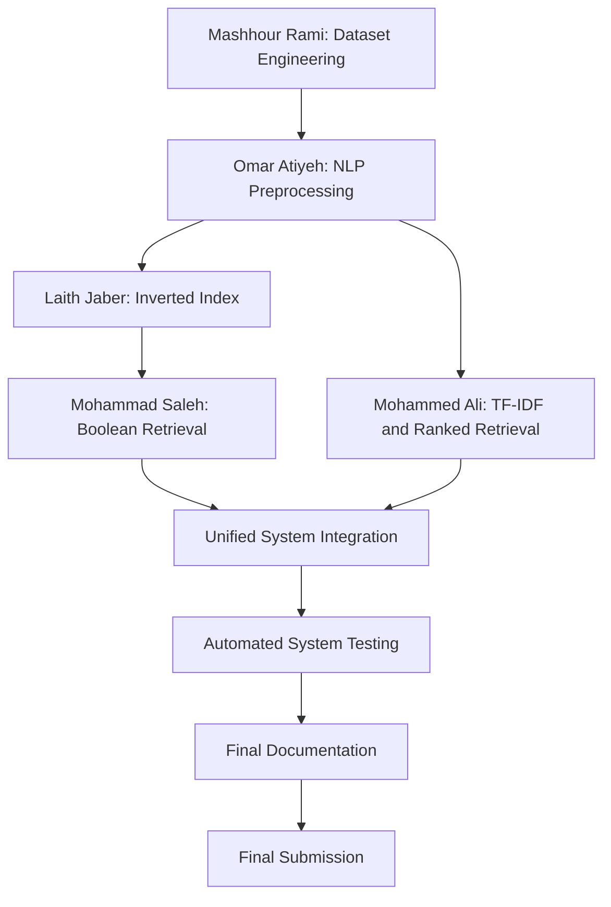

# Team Task Allocation and Responsibilities

## 1. Project Information

| Property | Description |
|---|---|
| Project | Medical Research Search |
| University | Al al-Bayt University |
| Course | Information Retrieval Systems (902333) |
| Phase | Phase 1 |
| Team Size | 5 Members |
| Team Leader | محمد بهجت فهمي علي |
| Submission Deadline | November 18, 2026 |
| Last Updated | November 17, 2026 |

---

## 2. Task Allocation Strategy

The project follows a modular development approach in which each team member is assigned a specific technical component of the information retrieval pipeline.

Task allocation is designed to:

- Establish clear technical responsibilities.
- Minimize unnecessary duplication of work.
- Distribute development activities across the team.
- Define component inputs and outputs.
- Maintain compatibility between project modules.
- Support independent component validation.
- Simplify system integration.
- Establish measurable technical deliverables.

Each assigned component contributes to the functionality of the unified Medical Research Search application.

---

## 3. Team Task Allocation Matrix

| Team Member | Assigned Role | Primary Component |
|---|---|---|
| محمد بهجت فهمي علي | Team Leader and Ranked Retrieval Engineer | TF-IDF, Cosine Similarity, Integration and Management |
| مشهور رامي مشهور أبو سنينة | Dataset Engineer | Dataset Acquisition and Cleaning |
| عمر عبد الباسط محمود عطية | NLP Preprocessing Engineer | Text Preprocessing |
| ليث بسام محمود جابر | Inverted Index Engineer | Inverted Index Construction |
| محمد مثنى محمد خالد صالح | Boolean Retrieval Engineer | Boolean Query Processing |

---

## 4. Member 01 — Team Leader

**Full Name:** محمد بهجت فهمي علي

**Technical Role:** Team Leader and Ranked Retrieval Engineer

**Related Areas:** Step 01, Step 02, Step 05, Integration and Testing

### Project Management Tasks

| Task ID | Assigned Task | Deliverable |
|---|---|---|
| TL-01 | Define project objectives | Project proposal |
| TL-02 | Allocate team responsibilities | Task allocation documentation |
| TL-03 | Establish repository structure | Organized GitHub repository |
| TL-04 | Track project milestones | Milestone register |
| TL-05 | Coordinate component dependencies | Integration plan |
| TL-06 | Manage repository integration | Main branch and integration log |

### Ranked Retrieval Tasks

| Task ID | Assigned Task | Deliverable |
|---|---|---|
| RK-01 | Implement TF-IDF vectorization | Document-term matrix |
| RK-02 | Implement query vectorization | Query TF-IDF vector |
| RK-03 | Calculate cosine similarity | Document similarity scores |
| RK-04 | Implement descending ranking | Ranked document list |
| RK-05 | Implement configurable Top-K retrieval | Top-K results |
| RK-06 | Explain ranking scores | Shared term contributions |
| RK-07 | Execute ranked search demonstrations | Ranking results |
| RK-08 | Validate ranked retrieval behavior | Component self-tests |

### Integration and Testing Tasks

| Task ID | Assigned Task | Deliverable |
|---|---|---|
| IN-01 | Integrate shared dataset loading | Unified dataset interface |
| IN-02 | Connect preprocessing and indexing | Integrated retrieval pipeline |
| IN-03 | Connect Boolean and ranked retrieval | Unified search application |
| IN-04 | Implement interactive CLI | Application menu |
| IN-05 | Configure module paths | Portable application execution |
| IN-06 | Execute integration demonstrations | Integration results |
| QA-01 | Design automated tests | System test suite |
| QA-02 | Validate regression results | Regression tests |
| QA-03 | Document testing outcomes | Test execution evidence |
| DOC-01 | Prepare main repository documentation | Main README |

### Expected Inputs

- Prepared document collection.
- Shared preprocessing functions.
- Inverted index module.
- Boolean retrieval module.
- User search queries.

### Expected Outputs

- Sparse TF-IDF document matrix.
- Ranked document identifiers and titles.
- Cosine similarity scores.
- Top-K retrieval results.
- Ranking explanations.
- Unified information retrieval application.
- Automated testing evidence.

### Technical Deliverables

- [ranked_search.py](../Step_05_Ranked_Search/ranked_search.py)
- [ranking_results.txt](../Step_05_Ranked_Search/ranking_results.txt)
- [main.py](../Integration/main.py)
- [integration_results.txt](../Integration/integration_results.txt)
- [test_system.py](../Testing/test_system.py)
- [test_results.txt](../Testing/test_results.txt)
- [Main README](../README.md)

### Component Completion Results

| Metric | Actual Result |
|---|---:|
| TF-IDF Documents | 1,000 |
| Vocabulary Terms | 10,758 |
| Nonzero TF-IDF Weights | 87,381 |
| Demonstrated Ranked Queries | 3 |
| Automated System Tests Passed | 15/15 |

**Technical Component Status:** Completed

---

## 5. Member 02 — Dataset Engineering

**Full Name:** مشهور رامي مشهور أبو سنينة

**Technical Role:** Dataset Engineer

**Assigned Branch:** `mashhour-rami`

**Related Stage:** Step 03

### Assigned Tasks

| Task ID | Assigned Task | Deliverable |
|---|---|---|
| DS-01 | Identify a suitable research corpus | Dataset source |
| DS-02 | Acquire original dataset records | Source collection |
| DS-03 | Validate required document fields | Validated records |
| DS-04 | Remove missing-field records | Cleaned collection |
| DS-05 | Detect duplicate identifiers | Unique document IDs |
| DS-06 | Detect duplicate content | Deduplicated records |
| DS-07 | Remove non-searchable documents | Searchable collection |
| DS-08 | Select documents reproducibly | Fixed-seed sample |
| DS-09 | Export structured CSV data | documents.csv |
| DS-10 | Generate dataset statistics | dataset_report.json |

### Expected Input

BEIR TREC-COVID research document corpus.

### Expected Output

A structured document collection containing:

- document_id
- title
- text
- source

The prepared collection must contain unique identifiers and searchable document content.

### Technical Deliverables

- [download_dataset.py](../Step_03_Preprocessing/download_dataset.py)
- [documents.csv](../Step_03_Preprocessing/dataset/documents.csv)
- [dataset_report.json](../Step_03_Preprocessing/dataset/dataset_report.json)

### Component Completion Results

| Metric | Actual Result |
|---|---:|
| Examined Records | 171,332 |
| Rejected Records | 42,383 |
| Valid Candidate Records | 128,949 |
| Selected Documents | 1,000 |
| Random Seed | 42 |

### Component Dependencies

The prepared dataset provides the shared input for the preprocessing, indexing, Boolean retrieval, and ranked retrieval components.

**Technical Component Status:** Completed

---

## 6. Member 03 — NLP Preprocessing

**Full Name:** عمر عبد الباسط محمود عطية

**Technical Role:** NLP Preprocessing Engineer

**Assigned Branch:** `omar-atiyeh`

**Related Stage:** Step 03

### Assigned Tasks

| Task ID | Assigned Task | Deliverable |
|---|---|---|
| NLP-01 | Implement text normalization | Normalized text |
| NLP-02 | Apply lowercasing | Case-normalized text |
| NLP-03 | Implement tokenization | Individual tokens |
| NLP-04 | Implement stopword removal | Filtered tokens |
| NLP-05 | Apply Porter Stemming | Stemmed terms |
| NLP-06 | Support configurable preprocessing | Reusable functions |
| NLP-07 | Standardize document and query processing | Shared preprocessing pipeline |
| NLP-08 | Demonstrate preprocessing stages | Preprocessing results |
| NLP-09 | Verify compatibility with retrieval modules | Integration-ready output |

### Expected Input

Raw document text, document titles, and user query text.

### Expected Output

A list of processed terms and a normalized searchable text representation.

### Example

Original input:

```text
COVID-19 vaccines are reducing infections.
```

Tokenization:

```text
['covid', '19', 'vaccines', 'are', 'reducing', 'infections']
```

After stopword removal:

```text
['covid', '19', 'vaccines', 'reducing', 'infections']
```

Final processed terms:

```text
['covid', '19', 'vaccin', 'reduc', 'infect']
```

### Technical Deliverables

- [preprocessing.py](../Step_03_Preprocessing/preprocessing.py)
- [preprocessing_results.txt](../Step_03_Preprocessing/preprocessing_results.txt)

### Component Dependencies

The preprocessing module provides a shared textual representation for both the inverted index and TF-IDF ranked retrieval.

**Technical Component Status:** Completed

---

## 7. Member 04 — Inverted Index

**Full Name:** ليث بسام محمود جابر

**Technical Role:** Inverted Index Engineer

**Assigned Branch:** `laith-jaber`

**Related Stage:** Step 04

### Assigned Tasks

| Task ID | Assigned Task | Deliverable |
|---|---|---|
| IDX-01 | Process document titles and text | Searchable document terms |
| IDX-02 | Construct the inverted index | Term-to-document mapping |
| IDX-03 | Implement dictionary-based storage | Index dictionary |
| IDX-04 | Maintain unique posting sets | Document ID sets |
| IDX-05 | Calculate document frequencies | Term frequency statistics |
| IDX-06 | Handle unknown terms | Empty posting behavior |
| IDX-07 | Validate index construction | Index self-tests |
| IDX-08 | Generate index statistics | Index results |
| IDX-09 | Support Boolean retrieval integration | Query-ready inverted index |

### Expected Input

- Prepared document collection.
- Shared NLP preprocessing functions.

### Expected Output

A dictionary mapping each processed term to a set of document identifiers.

Illustrative representation:

```python
{
    "covid": {"D1", "D2"},
    "vaccin": {"D1", "D3"},
    "infect": {"D2", "D3"}
}
```

### Technical Deliverables

- [inverted_index.py](../Step_04_Boolean_Search/inverted_index.py)
- [index_results.txt](../Step_04_Boolean_Search/index_results.txt)

### Component Completion Results

| Metric | Actual Result |
|---|---:|
| Indexed Documents | 1,000 |
| Vocabulary Terms | 10,758 |
| Total Postings | 87,381 |
| Documents Without Searchable Terms | 0 |

### Component Dependencies

The inverted index depends on the prepared dataset and preprocessing pipeline.

Its posting sets provide the input required by Boolean retrieval.

**Technical Component Status:** Completed

---

## 8. Member 05 — Boolean Retrieval

**Full Name:** محمد مثنى محمد خالد صالح

**Technical Role:** Boolean Retrieval Engineer

**Assigned Branch:** `Mohammad-Saleh`

**Related Stage:** Step 04

### Assigned Tasks

| Task ID | Assigned Task | Deliverable |
|---|---|---|
| BL-01 | Parse Boolean search queries | Query tokens |
| BL-02 | Implement AND operator | Set intersection |
| BL-03 | Implement OR operator | Set union |
| BL-04 | Implement NOT operator | Set complement |
| BL-05 | Implement operator precedence | Correct expression evaluation |
| BL-06 | Support parentheses | Compound Boolean expressions |
| BL-07 | Handle invalid expressions | Validation errors |
| BL-08 | Handle unknown search terms | Correct empty-set behavior |
| BL-09 | Execute Boolean search demonstrations | Boolean results |
| BL-10 | Validate retrieval behavior | Component self-tests |

### Expected Input

- User Boolean query.
- Inverted index.
- Complete set of indexed document identifiers.
- Shared preprocessing functions.

### Expected Output

A set of document identifiers satisfying the logical search expression.

### Supported Operations

| Operator | Operation |
|---|---|
| AND | Intersection |
| OR | Union |
| NOT | Complement |

### Technical Deliverables

- [boolean_search.py](../Step_04_Boolean_Search/boolean_search.py)
- [boolean_results.txt](../Step_04_Boolean_Search/boolean_results.txt)

### Component Completion Results

| Boolean Query | Matching Documents |
|---|---:|
| covid AND vaccine | 21 |
| covid OR vaccine | 357 |
| NOT vaccine | 923 |
| covid AND NOT vaccine | 280 |
| (covid OR virus) AND vaccine | 53 |

### Component Dependencies

Boolean retrieval depends on the inverted index, shared preprocessing functions, and complete indexed document universe.

**Technical Component Status:** Completed

---

## 9. Task Dependency Architecture



---

## 10. Responsibility Assignment Matrix

The following RACI matrix describes the assigned project responsibilities.

- R: Responsible for the assigned task.
- A: Accountable for project-level coordination and acceptance.
- C: Consulted where technical dependencies exist.
- I: Informed of progress and integration requirements.

| Task | Team Leader | Mashhour | Omar | Laith | Mohammad Saleh |
|---|---|---|---|---|---|
| Project Planning | A/R | C | C | C | C |
| Dataset Engineering | A | R | C | I | I |
| NLP Preprocessing | A | C | R | C | C |
| Inverted Index | A | I | C | R | C |
| Boolean Retrieval | A | I | C | C | R |
| Ranked Retrieval | A/R | I | C | I | I |
| System Integration | A/R | C | C | C | C |
| Automated System Testing | A/R | C | C | C | C |
| Technical Documentation | A/R | C | C | C | C |
| Final Presentation | A/R | R | R | R | R |

This matrix establishes assigned responsibilities rather than independently verified records of participation.

---

## 11. Component Acceptance Criteria

| Component | Acceptance Criteria | Technical Status |
|---|---|---|
| Dataset Engineering | Structured collection with valid, unique document records | Completed |
| NLP Preprocessing | Consistent normalization, tokenization, stopword removal and stemming | Completed |
| Inverted Index | Correct dictionary-based term and posting-set representation | Completed |
| Boolean Retrieval | Correct logical operators and expression evaluation | Completed |
| Ranked Retrieval | TF-IDF, cosine similarity and descending Top-K results | Completed |
| System Integration | All retrieval modules accessible through one application | Completed |
| Automated Testing | All defined automated tests executed successfully | 15/15 Passed |
| Final Documentation | Technical documentation and execution evidence | Technical Documentation Completed |
| Final Presentation | Recorded presentation covering all five assigned components | Pending |

The preprocessing implementation primarily targets English. Complete English-only coverage of the selected dataset has not been independently verified.

---

## 12. Presentation Task Allocation

The final project presentation is planned around the five assigned technical responsibilities.

| Presenter | Presentation Topic | Planned Duration |
|---|---|---|
| Mohammed Ali | Project overview, TF-IDF ranked retrieval, integration and testing | 2 minutes |
| Mashhour Rami | Dataset source, cleaning and preparation | 2 minutes |
| Omar Atiyeh | NLP preprocessing techniques and examples | 2 minutes |
| Laith Jaber | Inverted index construction and statistics | 2 minutes |
| Mohammad Saleh | Boolean retrieval operators and search demonstrations | 2 minutes |

**Target Total Duration:** 10 minutes maximum.

Individual presentation durations may be adjusted to accommodate transitions and system demonstrations.

The presentation allocation represents the planned recording structure rather than a completed recording.

---

## 13. Final Technical Deliverable Summary

| Technical Area | Assigned Responsibility | Status |
|---|---|---|
| Dataset Engineering | Mashhour Rami | Completed |
| NLP Preprocessing | Omar Atiyeh | Completed |
| Inverted Index | Laith Jaber | Completed |
| Boolean Retrieval | Mohammad Saleh | Completed |
| TF-IDF Ranked Retrieval | Mohammed Ali | Completed |
| Unified Application | Mohammed Ali | Completed |
| System Testing | Mohammed Ali | 15/15 Passed |
| Final Presentation | Entire Team | Pending |

---

## 14. Contribution Verification and Academic Integrity

Task assignments define the intended division of responsibilities across the project team.

The existence of assigned branches, technical deliverables, or successful system tests does not independently establish the authorship of each component.

Actual individual contributions should be verified through authentic development records, submitted files, GitHub history, communication records, and individual technical demonstrations.

AI assistance was used to support implementation development, debugging, testing, review, and technical documentation.

All reported numerical results are based on recorded project execution outputs.

---

## 15. Related Documentation

- [Team Contributions](contributions.md)
- [Project Progress Log](progress_log.md)
- [Project Milestones](milestones.md)
- [Integration Log](integration_log.md)
- [Development Workflow](development_workflow.md)
- [Meeting Notes](meeting_notes.md)
- [Collaboration Evidence](evidence/)
- [Main Project Documentation](../README.md)

---

**Medical Research Search**

Al al-Bayt University

Information Retrieval Systems — Phase 1

Last Updated: November 17, 2026
