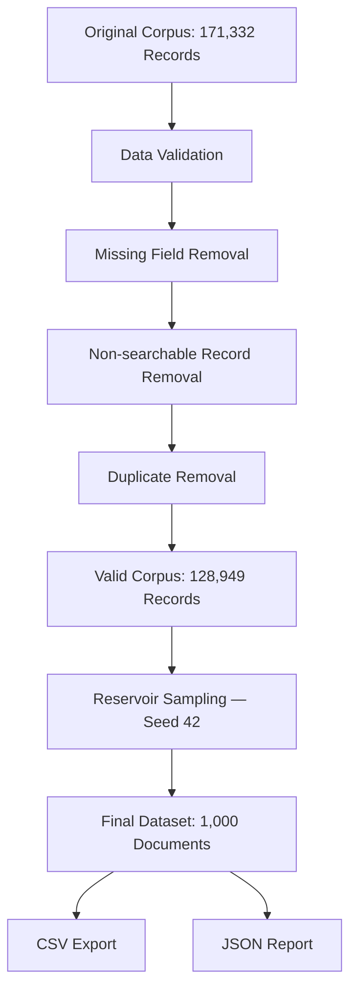
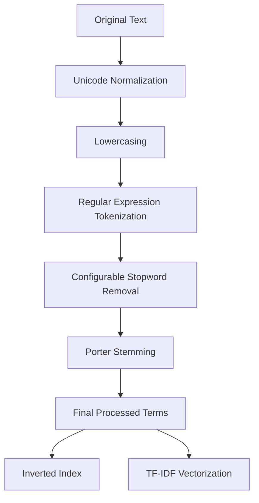

# Step 03 — Dataset and Text Preprocessing

## 1. Overview

This section implements dataset acquisition, data cleaning, validation, reproducible document sampling, and natural language preprocessing for the Medical Research Search project.

The objective is to prepare a reliable and consistent document collection for Boolean Information Retrieval and TF-IDF Ranked Retrieval.

| Property | Description |
|---|---|
| Project | Medical Research Search |
| Course | Information Retrieval Systems (902333) |
| Phase | Phase 1 |
| Assessment Weight | 3 Marks |
| Dataset | BEIR TREC-COVID |
| Final Collection Size | 1,000 Documents |
| Processing Language | English |
| Dataset Validation | Passed |
| Preprocessing Validation | Passed |

## 2. Team Responsibilities

| Team Member | Responsibility |
|---|---|
| Mashhour Rami | Dataset Acquisition, Data Cleaning, Sampling and Dataset Validation |
| Omar Atiyeh | NLP, Text Normalization, Tokenization, Stopword Removal and Stemming |
| Team Leader | Code Review, Result Verification and System Integration |

## 3. Repository Structure

```text
Step_03_Preprocessing/
├── README.md
├── download_dataset.py
├── preprocessing.py
├── preprocessing_results.txt
├── requirements.txt
└── dataset/
    ├── documents.csv
    └── dataset_report.json
```

The document collection can be generated locally using the dataset acquisition script.

## 4. Dataset Description

The project uses the TREC-COVID corpus distributed through the BEIR benchmark.

The dataset contains research documents related to COVID-19, coronavirus infections, public health, biomedical research, treatments, and other pandemic-related topics.

Dataset source:

https://huggingface.co/datasets/BeIR/trec-covid

The original corpus contains 171,332 records. A reproducible subset of 1,000 valid documents was selected for Phase 1.

## 5. Dataset Acquisition

The dataset acquisition module is implemented in [download_dataset.py](download_dataset.py).

The acquisition pipeline includes:

- Downloading the original compressed corpus.
- Using a fixed dataset revision.
- Verifying archive integrity using SHA-256.
- Validating document identifiers, titles, and text.
- Removing incomplete and non-searchable documents.
- Removing duplicate identifiers and duplicate content.
- Applying reproducible random sampling.
- Exporting the selected documents to CSV.
- Generating a structured dataset report.

### Sampling Configuration

| Parameter | Value |
|---|---|
| Dataset | BeIR/trec-covid |
| Sampling Method | Reservoir Sampling Without Replacement |
| Random Seed | 42 |
| Selected Documents | 1,000 |
| Dataset Revision | e068f9faf522968e3cdbb275c466c51edcaf4d1a |
| Integrity Verification | SHA-256 |

Reservoir sampling allows the system to select a random subset from a large document stream without storing the entire corpus in memory.

## 6. Data Cleaning Results

The following statistics were obtained from the actual dataset acquisition report.

| Metric | Document Count |
|---|---:|
| Total Examined Records | 171,332 |
| Records with Missing Fields | 42,146 |
| Non-searchable Records | 51 |
| Duplicate IDs | 0 |
| Duplicate Content Records | 186 |
| Total Rejected Records | 42,383 |
| Valid Records After Cleaning | 128,949 |
| Final Selected Documents | 1,000 |

Approximately 75.26% of the original records remained valid after cleaning.



Detailed results are available in [dataset_report.json](dataset/dataset_report.json).

## 7. Dataset Schema

Each document contains four fields.

| Field | Data Type | Description |
|---|---|---|
| document_id | String | Unique document identifier |
| title | String | Research document title |
| text | String | Document textual content |
| source | String | Original dataset source |

The title and text are combined to construct the searchable document content.

## 8. Dataset Integrity Validation

The final CSV collection was independently checked against the generated dataset report.

| Validation Test | Result |
|---|---|
| Total documents equal 1,000 | PASS |
| Unique document identifiers | PASS |
| No duplicate title-text pairs | PASS |
| No missing required fields | PASS |
| Correct CSV schema | PASS |
| Selected IDs match dataset report | PASS |
| CSV SHA-256 matches dataset report | PASS |
| Valid source field | PASS |

### Final Collection Statistics

| Property | Value |
|---|---:|
| Total Documents | 1,000 |
| Unique Document IDs | 1,000 |
| Duplicate Documents | 0 |
| Documents with Missing Required Fields | 0 |

The SHA-256 checksum of the verified CSV file is:

```text
ca3aa8ba3a25a42b000a90a985a97e4cafb7fd58f0d30b33c894b9110a2fdcde
```

## 9. Natural Language Processing

The shared preprocessing module is implemented in [preprocessing.py](preprocessing.py).

The same preprocessing pipeline is designed to be used by both the Boolean and Ranked Retrieval engines to maintain consistency between document representation and query processing.

### Preprocessing Pipeline



### Techniques

| Technique | Purpose |
|---|---|
| Unicode Normalization | Standardize textual representations |
| Lowercasing | Reduce case-related vocabulary variation |
| Tokenization | Split text into searchable terms |
| Stopword Removal | Remove common words with limited retrieval value |
| Negation Preservation | Preserve selected negation terms |
| Porter Stemming | Reduce related words to common stems |
| Whitespace Normalization | Standardize spacing |
| Function Caching | Avoid repeated stemming computations |

Stopword removal and stemming can be enabled or disabled independently.

## 10. Actual Preprocessing Results

A real document from the selected collection was used to demonstrate the preprocessing pipeline.

Document ID: `02zdg7ue`

Document title: Education in the Context of the Pandemic: A Look at the Case of Portugal

| Processing Stage | Token Count |
|---|---:|
| Tokenization | 102 |
| After Stopword Removal | 52 |
| After Porter Stemming | 52 |
| Removed Stopwords | 50 |
| Token Count Reduction | 49.02% |

These statistics describe the demonstrated document, not the entire collection.

### Actual Stemming Examples

| Original Term | Stemmed Term |
|---|---|
| education | educ |
| pandemic | pandem |
| structural | structur |
| transformations | transform |
| families | famili |
| companies | compani |
| sustainability | sustain |
| professionals | profession |
| students | student |
| government | govern |
| experience | experi |
| reforms | reform |

### Illustrative Processing Example

Original text:

```text
The vaccines are reducing infections.
```

Lowercasing and tokenization:

```text
the, vaccines, are, reducing, infections
```

Stopword removal:

```text
vaccines, reducing, infections
```

Porter stemming:

```text
vaccin, reduc, infect
```

The complete actual document demonstration is recorded in [preprocessing_results.txt](preprocessing_results.txt).

## 11. Preprocessing Validation

The preprocessing module was executed and its output was compared with the submitted preprocessing results.

| Test | Result |
|---|---|
| Original Text Consistency | PASS |
| Text Normalization | PASS |
| Tokenization | PASS |
| Stopword Removal | PASS |
| Porter Stemming | PASS |
| Configurable Stopword Handling | PASS |
| Negation Preservation | PASS |
| Empty Text Handling | PASS |
| Automated Self-Test | PASS |
| Processing All 1,000 Documents | PASS |
| No Empty Processed Documents | PASS |

All demonstrated preprocessing stages matched the independently reproduced output.

## 12. Shared Programming Interfaces

The preprocessing module provides reusable functions.

```python
preprocess(text, remove_stopwords=True, stem=True)
```

Returns a list of processed terms.

```python
normalized(text)
```

Returns processed terms as a space-separated string.

These interfaces allow consistent use of the preprocessing pipeline in the subsequent retrieval modules.

## 13. Installation and Execution

Run the following commands from the `Step_03_Preprocessing` directory.

### Install Dependencies

```bash
pip install -r requirements.txt
```

### Test Dataset Acquisition

```bash
python download_dataset.py --self-test
```

### Download and Prepare the Dataset

```bash
python download_dataset.py --count 1000 --seed 42
```

### Test the Preprocessing Module

```bash
python preprocessing.py --self-test
```

### Demonstrate Text Preprocessing

```bash
python preprocessing.py --text "COVID-19 vaccines are reducing infections"
```

### Process a Real Dataset Document

```bash
python preprocessing.py --dataset dataset/documents.csv
```

### Save Preprocessing Results

```bash
python preprocessing.py --dataset dataset/documents.csv > preprocessing_results.txt
```

## 14. Technologies and Libraries

| Technology | Purpose |
|---|---|
| Python | Core implementation |
| CSV | Structured document storage |
| JSON | Dataset reporting |
| urllib | Dataset downloading |
| gzip | Compressed corpus processing |
| hashlib | SHA-256 verification |
| Regular Expressions | Tokenization |
| NLTK | Porter Stemming |
| scikit-learn | English Stopwords |
| Git and GitHub | Version control and collaboration |

## 15. Assessment Requirements

| Requirement | Status |
|---|---|
| At least 100 meaningful documents | Completed |
| Unique document identifiers | Completed |
| Title and textual content | Completed |
| Duplicate removal | Completed |
| Missing data handling | Completed |
| Lowercasing | Completed |
| Tokenization | Completed |
| Configurable stopword removal | Completed |
| Stemming or lemmatization | Completed |
| Original text demonstration | Completed |
| Tokenized and processed text demonstration | Completed |
| Dataset and preprocessing validation | Completed |

## 16. Limitations

- The selected collection represents a subset of the original TREC-COVID corpus.
- The preprocessing pipeline is designed primarily for English text.
- Porter stemming may produce stems that are not dictionary words.
- Stopword removal may discard some context.
- Tokenization may split hyphenated biomedical terms.
- Document quality checks do not constitute medical or scientific validation.
- Retrieval relevance and ranking effectiveness will be evaluated in subsequent project sections.

## 17. References and Academic Integrity

- BEIR TREC-COVID Dataset: https://huggingface.co/datasets/BeIR/trec-covid
- BEIR Benchmark: https://github.com/beir-cellar/beir
- NLTK Documentation: https://www.nltk.org/
- Scikit-learn Documentation: https://scikit-learn.org/

AI assistance was used to review, refine, and document the implementation. Reported dataset statistics and preprocessing validation results are based on the supplied execution artifacts and independent verification.

Dataset use and redistribution must comply with the applicable source licensing and document-level rights.

## 18. Completion Status

Dataset acquisition, data cleaning, document sampling, preprocessing, and independent validation have been completed.

The verified collection of 1,000 documents is ready for Inverted Index Construction, Boolean Retrieval, and TF-IDF Ranked Retrieval.

## 19. Project Navigation

- [Main Repository](../README.md)
- [Step 01 — Problem Definition and Proposal](../Step_01_Proposal/)
- [Step 02 — Progress and Teamwork](../Step_02_Teamwork/)
- Step 03 — Dataset and Text Preprocessing
- [Step 04 — Inverted Index and Boolean Search](../Step_04_Boolean_Search/)
- [Step 05 — Ranked Search](../Step_05_Ranked_Search/)

---

**Medical Research Search**

Al al-Bayt University

Information Retrieval Systems — Phase 1
