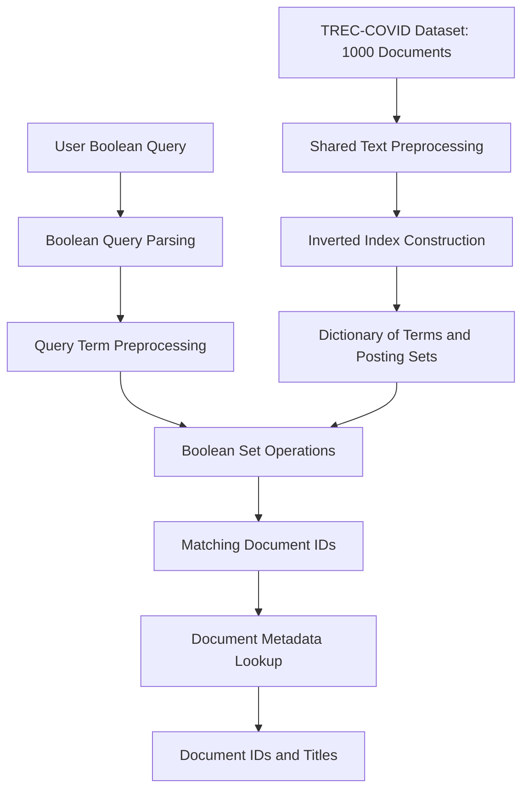
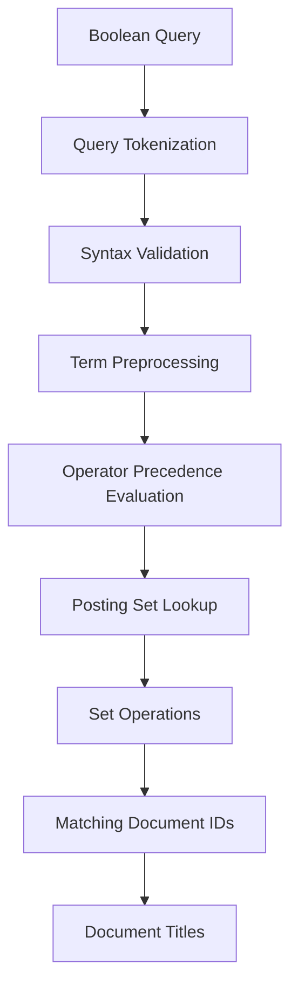

# Step 04 — Inverted Index and Boolean Information Retrieval

## 1. Overview

This stage implements the Inverted Index and Boolean Information Retrieval components of the Medical Research Search system.

The objective is to provide efficient exact-match retrieval using an inverted index and Boolean set operations over the document collection prepared in Step 03.

| Property | Description |
|---|---|
| Project | Medical Research Search |
| Course | Information Retrieval Systems (902333) |
| Phase | Phase 1 |
| Assessment Weight | 3 Marks |
| Dataset | BEIR TREC-COVID |
| Indexed Documents | 1,000 |
| Inverted Index Testing | Passed |
| Boolean Retrieval Testing | Passed |

## 2. Team Responsibilities

| Team Member | Responsibility |
|---|---|
| Laith Jaber | Inverted Index Construction, Posting Lists, Document Frequency and Index Validation |
| Mohammad Saleh | Boolean Query Processing, Logical Operations and Query Validation |
| Team Leader | Code Review, Result Verification, Documentation and Integration |

## 3. Directory Structure

```text
Step_04_Boolean_Search/
├── README.md
├── inverted_index.py
├── boolean_search.py
├── index_results.txt
└── boolean_results.txt
```

The modules use the document collection and shared preprocessing functions implemented in Step 03.

## 4. System Architecture



## 5. Inverted Index Implementation

The inverted index is implemented in [inverted_index.py](inverted_index.py).

An inverted index maps each processed term to the set of document identifiers containing that term.

The implementation uses Python dictionaries and sets to support efficient term lookup and Boolean operations.

### Main Features

- Shared text preprocessing.
- Combined document title and textual content.
- Term-to-document mapping.
- Posting list construction.
- Unique document identifier validation.
- Document frequency calculation.
- Document metadata lookup.
- Unknown term handling.
- Index statistics.
- Automated self-testing.

### Data Structure

```python
dict[str, set[str]]
```

Each dictionary key represents a processed term, while its value contains a set of matching document identifiers.

### Illustrative Example

```python
{
    "covid": {"D1", "D2"},
    "vaccin": {"D1", "D3"},
    "virus": {"D2"}
}
```

This example is illustrative and demonstrates the logical structure of the index.

## 6. Actual Inverted Index Results

The inverted index was constructed using the 1,000 documents prepared in Step 03.

| Metric | Actual Result |
|---|---:|
| Indexed Documents | 1,000 |
| Unique Indexed Terms | 10,758 |
| Total Postings | 87,381 |
| Documents with Zero Indexed Terms | 0 |

A posting represents an association between an indexed term and a document containing that term.

### Document Frequency Results

| Search Term | Document Frequency |
|---|---:|
| covid | 301 |
| vaccine | 77 |
| virus | 253 |

The displayed search terms are processed using the shared preprocessing pipeline before index lookup.

### Actual Posting List Examples

| Search Term | Sample Document IDs |
|---|---|
| covid | 02zdg7ue, 04esvfhp, 07uzz649, 085rj2qr, 0anag9ax |
| vaccine | 05emvz2v, 0pmsfrcx, 0wfsr4iw, 0wycbaki, 1d17iafs |
| virus | 05emvz2v, 0j7o8vr2, 0lp2aqlu, 0pmsfrcx, 13559uun |

These are sample identifiers from the generated posting sets, not the complete posting lists.

The full demonstration output is available in [index_results.txt](index_results.txt).

## 7. Boolean Information Retrieval

Boolean retrieval is implemented in [boolean_search.py](boolean_search.py).

The system evaluates logical queries using the posting sets generated by the inverted index.

### Supported Operations

| Operator | Set Operation | Python Implementation |
|---|---|---|
| AND | Intersection | A & B |
| OR | Union | A \| B |
| NOT | Complement | all_ids - A |
| AND NOT | Set Difference | A - B |

The NOT operation is evaluated relative to the complete collection of document identifiers.

### Query Processing Features

- Case-insensitive Boolean operators.
- Query tokenization.
- Shared term preprocessing.
- Operator precedence.
- Parentheses support.
- Implicit AND handling.
- Unknown term handling.
- Invalid query detection.
- Empty query validation.
- Document ID and title display.

### Operator Precedence

The system applies the following precedence rules:

1. Parenthesized expressions
2. NOT
3. AND
4. OR

Parentheses allow users to explicitly control query grouping.

### Query Evaluation Pipeline



## 8. Actual Boolean Search Results

The following queries were executed on the real collection of 1,000 documents.

| Query | Matching Documents |
|---|---:|
| covid AND vaccine | 21 |
| covid OR vaccine | 357 |
| covid AND NOT vaccine | 280 |
| NOT vaccine | 923 |
| (covid OR virus) AND vaccine | 53 |

### Query 1 — AND

```text
covid AND vaccine
```

Returns documents containing both processed search terms.

**Total matching documents:** 21

Sample document IDs:

- 0wycbaki
- 4jeaqqn9
- 59cuhfi5
- 640sw4pb
- a00crtah

### Query 2 — OR

```text
covid OR vaccine
```

Returns documents containing either term or both terms.

**Total matching documents:** 357

Sample document IDs:

- 02zdg7ue
- 04esvfhp
- 05emvz2v
- 07uzz649
- 085rj2qr

### Query 3 — AND NOT

```text
covid AND NOT vaccine
```

Returns documents containing the processed COVID term but excluding documents containing the processed vaccine term.

**Total matching documents:** 280

### Query 4 — NOT

```text
NOT vaccine
```

Returns documents that do not contain the processed vaccine term.

**Total matching documents:** 923

The complement is calculated using all 1,000 document identifiers.

### Query 5 — Complex Boolean Expression

```text
(covid OR virus) AND vaccine
```

Returns documents containing the processed vaccine term and at least one of the COVID or virus terms.

**Total matching documents:** 53

## 9. Actual Retrieved Document Examples

| Query | Document ID | Document Title |
|---|---|---|
| covid AND vaccine | 59cuhfi5 | Gaining insights on immune responses to the novel coronavirus, COVID-19 and therapeutic challenges |
| covid AND vaccine | 640sw4pb | Potential of live pathogen vaccines for defeating the COVID-19 pandemic: History and mechanism |
| covid OR vaccine | 02zdg7ue | Education in the Context of the Pandemic: A Look at the Case of Portugal |
| NOT vaccine | 065hmngz | Bronchiolitis obliterans organizing pneumonia after radiofrequency ablation of lung cancer: report of three cases. |
| (covid OR virus) AND vaccine | 0pmsfrcx | Zika Vaccine Development: Current Status |

Both document titles and document text are indexed. Therefore, a matching term does not necessarily appear in the displayed title.

Complete demonstration results are available in [boolean_results.txt](boolean_results.txt).

## 10. Mathematical Result Validation

The reported Boolean search counts are consistent with the document frequencies generated by the inverted index.

Let:

- U = complete collection of 1,000 documents.
- A = documents containing the processed COVID term.
- B = documents containing the processed vaccine term.

The observed set sizes are:

```text
|U| = 1000
|A| = 301
|B| = 77
|A intersection B| = 21
```

### AND Validation

```text
|A intersection B| = 21
```

### OR Validation

```text
|A union B| = |A| + |B| - |A intersection B|

301 + 77 - 21 = 357
```

### AND NOT Validation

```text
|A - B| = 301 - 21 = 280
```

### NOT Validation

```text
|U - B| = 1000 - 77 = 923
```

All four reported operation counts are mathematically consistent.

## 11. Inverted Index Testing

The inverted index self-test completed successfully using a synthetic test fixture.

| Test Case | Result |
|---|---|
| Posting List Construction | PASS |
| Shared Stemming | PASS |
| Unknown Term Handling | PASS |
| Set-Based Posting Storage | PASS |
| Complete Document ID Collection | PASS |
| Empty Index Handling | PASS |
| Duplicate ID Rejection | PASS |
| Defensive Copy | PASS |

The module was also executed successfully on the real document collection.

## 12. Boolean Search Testing

The Boolean retrieval module successfully completed 28 synthetic test cases.

| Test Category | Passed |
|---|---:|
| Valid Queries | 15 |
| Invalid Queries | 13 |
| Total Test Cases | 28 |

### Selected Synthetic Test Results

| Query | Expected and Actual Result |
|---|---|
| covid AND vaccine | D1 |
| covid OR vaccine | D1, D2, D3 |
| NOT vaccine | D2, D4 |
| covid AND NOT vaccine | D2 |
| covid OR vaccine AND virus | D1, D2 |
| (covid OR vaccine) AND virus | D2 |
| NOT NOT covid | D1, D2 |
| NOT (covid OR vaccine) | D4 |
| Unknown Term | Empty Set |
| NOT Unknown Term | D1, D2, D3, D4 |

Synthetic tests verify query evaluation behavior against known expected results.

The real dataset demonstrations verify execution on the actual project document collection.

## 13. Boolean Retrieval vs Ranked Retrieval

| Feature | Boolean Retrieval | Ranked Retrieval |
|---|---|---|
| Retrieval Model | Boolean Model | Vector Space Model |
| Document Representation | Posting Sets | TF-IDF Vectors |
| Query Evaluation | Logical Operations | Cosine Similarity |
| Output | Matching Documents | Ranked Documents |
| Relevance Score | Not Provided | Provided |
| Result Ordering | No Relevance-Based Ranking | Descending Similarity Score |
| Query Style | Logical Expressions | Natural Language Queries |
| Implementation Stage | Step 04 | Step 05 |

Boolean retrieval returns documents satisfying logical conditions.

Ranked retrieval assigns similarity scores and orders documents according to their estimated textual relevance.

## 14. Installation and Execution

Run the following commands from the project root using Windows PowerShell.

### Activate Virtual Environment

```powershell
.\.venv\Scripts\Activate.ps1
```

### Install Dependencies

```powershell
pip install -r Step_03_Preprocessing/requirements.txt
```

### Configure Module Paths

```powershell
$env:PYTHONPATH = "$PWD\Step_03_Preprocessing;$PWD\Step_04_Boolean_Search"
```

### Configure UTF-8 Encoding

```powershell
$env:PYTHONIOENCODING = "utf-8"
[Console]::OutputEncoding = [System.Text.Encoding]::UTF8
[Console]::InputEncoding = [System.Text.Encoding]::UTF8
$OutputEncoding = [System.Text.Encoding]::UTF8
```

### Navigate to Step 04

```powershell
cd Step_04_Boolean_Search
```

### Test the Inverted Index

```powershell
python inverted_index.py --self-test
```

### Build the Inverted Index and Save Results

```powershell
python -X utf8 inverted_index.py --dataset ../Step_03_Preprocessing/dataset/documents.csv | Tee-Object -FilePath index_results.txt
```

### Test Boolean Search

```powershell
python boolean_search.py --self-test
```

### Execute Boolean Queries and Save Results

```powershell
python -X utf8 boolean_search.py --dataset ../Step_03_Preprocessing/dataset/documents.csv | Tee-Object -FilePath boolean_results.txt
```

### Execute a Custom Query

```powershell
python -X utf8 boolean_search.py --dataset ../Step_03_Preprocessing/dataset/documents.csv --query "covid AND vaccine"
```

## 15. Shared Programming Interfaces

### Inverted Index

```python
build_inverted_index(documents)
```

Returns a dictionary mapping processed terms to sets of document identifiers.

### Boolean Search

```python
boolean_search(query, index, all_ids)
```

Returns the set of document identifiers satisfying the Boolean query.

Both interfaces are designed for integration into the main application.

## 16. Technical Issue and Resolution

During execution on Windows, printing research document titles initially produced a UnicodeEncodeError because the output encoding did not support some Unicode characters.

After enabling UTF-8 output and configuring PowerShell encoding, the system successfully displayed document titles containing Unicode characters.

This issue affected output presentation rather than the underlying inverted index construction.

## 17. Assessment Requirements

| Requirement | Status |
|---|---|
| Construct an inverted index | Completed |
| Use Python dictionaries | Completed |
| Use sets for posting lists | Completed |
| Implement AND using intersection | Completed |
| Implement OR using union | Completed |
| Implement NOT using complement | Completed |
| Demonstrate actual Boolean queries | Completed |
| Display matching document IDs | Completed |
| Display matching document titles | Completed |
| Test Boolean operations | Completed |
| Explain Boolean vs Ranked Retrieval | Documented |
| Record actual execution results | Completed |

## 18. Limitations and Future Improvements

- Boolean retrieval does not rank matching documents by relevance.
- Retrieval depends on the shared preprocessing pipeline.
- Stemming may merge terms with different meanings.
- Exact term matching does not capture all semantic relationships.
- Large result sets may require additional filtering.
- The demonstration displays a limited number of matching document titles.
- Functional correctness does not establish semantic retrieval effectiveness.
- UTF-8 output configuration may be required on Windows.

TF-IDF and Cosine Similarity are introduced in Step 05 to support relevance-based document ranking.

## 19. References and Academic Integrity

- Introduction to Information Retrieval: https://nlp.stanford.edu/IR-book/
- Python Set Types: https://docs.python.org/3/library/stdtypes.html#set-types-set-frozenset
- BEIR TREC-COVID Dataset: https://huggingface.co/datasets/BeIR/trec-covid
- NLTK Documentation: https://www.nltk.org/

AI assistance was used to review, refine, test and document implementation details.

All numerical execution results reported in this section are based on the supplied terminal execution records.

## 20. Completion Status

The Inverted Index and Boolean Retrieval modules have been implemented and successfully executed on the selected collection of 1,000 documents.

The automated synthetic tests passed, and five Boolean queries were demonstrated on the real dataset.

The modules are ready for integration with the Ranked Retrieval component, subject to final system-level testing.

## 21. Project Navigation

- [Main Repository](../README.md)
- [Step 01 — Problem Definition and Proposal](../Step_01_Proposal/)
- [Step 02 — Progress and Teamwork](../Step_02_Teamwork/)
- [Step 03 — Dataset and Text Preprocessing](../Step_03_Preprocessing/)
- Step 04 — Inverted Index and Boolean Search
- [Step 05 — TF-IDF and Ranked Retrieval](../Step_05_Ranked_Search/)
- [System Integration](../Integration/)
- [Testing and Validation](../Testing/)

---

**Medical Research Search**

Al al-Bayt University

Information Retrieval Systems — Phase 1
