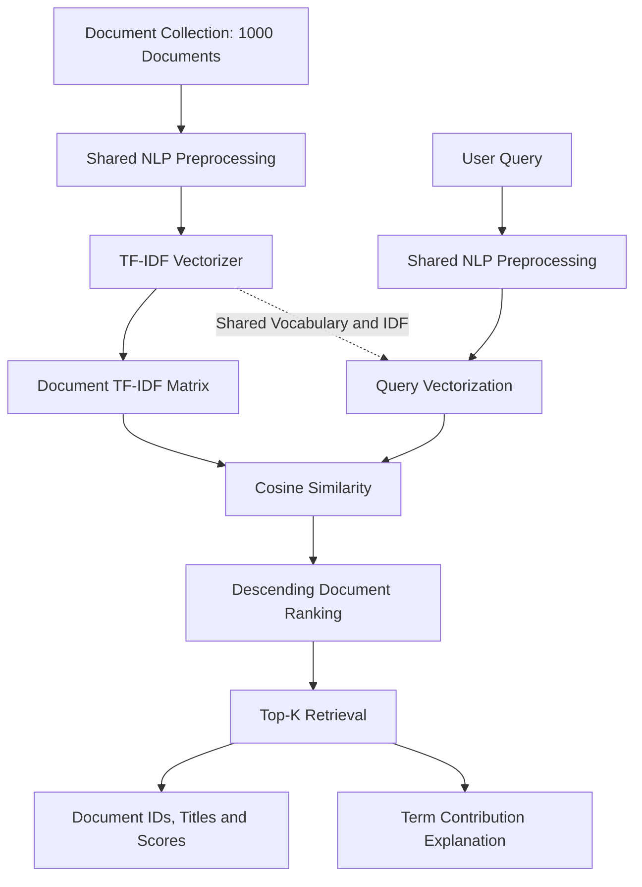

# Step 05 — TF-IDF and Ranked Information Retrieval

## 1. Overview

This stage implements the ranked information retrieval component of the Medical Research Search system.

Unlike Boolean retrieval, which returns documents satisfying logical conditions, ranked retrieval estimates textual relevance using TF-IDF vectorization and cosine similarity.

| Property | Description |
|---|---|
| Project | Medical Research Search |
| Course | Information Retrieval Systems (902333) |
| Phase | Phase 1 |
| Assessment Weight | 4 Marks |
| Retrieval Model | Vector Space Model |
| Document Representation | TF-IDF |
| Similarity Metric | Cosine Similarity |
| Dataset | BEIR TREC-COVID |
| Collection Size | 1,000 Documents |
| Developer | Mohammed — Team Leader |

## 2. Objectives

- Represent documents and queries as numerical vectors.
- Construct a shared TF-IDF vocabulary.
- Calculate cosine similarity between queries and documents.
- Rank documents according to similarity scores.
- Retrieve the Top-K matching documents.
- Display document identifiers, titles, and similarity scores.
- Explain the contribution of shared terms to ranking scores.
- Maintain consistency with the shared preprocessing pipeline.

## 3. Directory Structure

```text
Step_05_Ranked_Search/
├── README.md
├── ranked_search.py
└── ranking_results.txt
```

The module depends on the dataset and preprocessing functions implemented in Step 03.

## 4. System Architecture



## 5. Vector Space Model

The Vector Space Model represents documents and queries as numerical vectors in a shared vocabulary space.

Each vector dimension corresponds to a processed term, while its value represents the importance of that term.

The document collection is represented as a sparse TF-IDF matrix to reduce unnecessary storage of zero-valued features.

## 6. Term Frequency and Inverse Document Frequency

### Term Frequency — TF

Term Frequency measures the number of occurrences of a term within a document.

```text
TF(t, d) = frequency of term t in document d
```

### Inverse Document Frequency — IDF

Inverse Document Frequency reduces the influence of terms occurring frequently across the document collection.

The smoothed IDF formulation used by scikit-learn is:

```text
IDF(t) = ln((1 + N) / (1 + DF(t))) + 1
```

Where:

- N is the total number of documents.
- DF(t) is the number of documents containing term t.

### TF-IDF

```text
TF-IDF(t, d) = TF(t, d) × IDF(t)
```

L2 normalization is applied to the resulting vectors.

## 7. Cosine Similarity

Cosine similarity measures the similarity between the query vector and a document vector.

```text
Cosine(q, d) = (q · d) / (||q|| × ||d||)
```

With non-negative TF-IDF vectors, cosine similarity scores range from 0 to 1.

A higher score indicates stronger textual similarity within the selected feature representation.

The resulting similarity scores are not probabilities or measures of clinical correctness.

## 8. Ranked Retrieval Implementation

The ranked retrieval module is implemented in [ranked_search.py](ranked_search.py).

The implementation follows these steps:

1. Load the prepared document collection.
2. Combine document titles and textual content.
3. Apply the shared preprocessing pipeline.
4. Fit the TF-IDF vectorizer on the document collection.
5. Construct a sparse document-term matrix.
6. Preprocess the user query.
7. Transform the query using the fitted vectorizer.
8. Calculate cosine similarity.
9. Sort documents by descending similarity scores.
10. Retrieve the Top-K positive-scoring documents.
11. Display document identifiers, titles, and similarity scores.
12. Explain the highest-ranked result using shared term contributions.

The vectorizer is fitted on the document collection rather than refitted for individual queries.

## 9. Actual TF-IDF Statistics

The ranked retrieval module was executed on the same 1,000-document collection used by the inverted index.

| Metric | Actual Result |
|---|---:|
| Documents | 1,000 |
| Vocabulary Size | 10,758 |
| Nonzero TF-IDF Weights | 87,381 |
| Document-Term Matrix Shape | 1,000 × 10,758 |
| Demonstrated Search Queries | 3 |
| Results per Demonstration Query | 5 |

The reported vocabulary size and nonzero weight count are consistent with the inverted index statistics from Step 04.

This consistency supports the use of a shared preprocessing pipeline and document collection.

## 10. Actual Ranked Search Results

### Query 1 — COVID Vaccine Immune Response

Original query:

```text
covid vaccine immune response
```

Processed query:

```text
covid vaccin immun respons
```

| Rank | Document ID | Cosine Similarity |
|---:|---|---:|
| 1 | 6fhuon6k | 0.451483 |
| 2 | 1d17iafs | 0.396692 |
| 3 | od4c6fcg | 0.354211 |
| 4 | vbqgyll9 | 0.335271 |
| 5 | 0pmsfrcx | 0.320604 |

**Highest-Ranked Document**

The immune response during acute HIV-1 infection: clues for vaccine development

**Ranking Explanation**

| Shared Term | Score Contribution |
|---|---:|
| immun | 0.222565 |
| respons | 0.144711 |
| vaccin | 0.084207 |
| Total | 0.451483 |

The highest-ranked document received substantial contributions from the processed immune, response, and vaccine terms.

Although the document concerns HIV-1 rather than COVID-19, it achieved the highest lexical similarity score.

This illustrates a limitation of traditional TF-IDF retrieval: strong term overlap does not necessarily imply complete topical relevance.

### Query 2 — Respiratory Infection Treatment

Original query:

```text
respiratory infection treatment
```

Processed query:

```text
respiratori infect treatment
```

| Rank | Document ID | Cosine Similarity |
|---:|---|---:|
| 1 | yqr3e4kp | 0.331911 |
| 2 | 3hgupch5 | 0.220218 |
| 3 | ckbik777 | 0.210443 |
| 4 | r286hc2k | 0.206962 |
| 5 | vzwu2qol | 0.205862 |

**Highest-Ranked Document**

Viruses and acute respiratory infections

**Ranking Explanation**

| Shared Term | Score Contribution |
|---|---:|
| respiratori | 0.208921 |
| infect | 0.122990 |
| Total | 0.331911 |

The document achieved the highest similarity score through its shared respiratory and infection terms.

The treatment term did not contribute to its reported similarity score.

### Query 3 — Coronavirus Transmission Prevention

Original query:

```text
coronavirus transmission prevention
```

Processed query:

```text
coronaviru transmiss prevent
```

| Rank | Document ID | Cosine Similarity |
|---:|---|---:|
| 1 | nlzdto1h | 0.279990 |
| 2 | w0vm70no | 0.195235 |
| 3 | ynaum52m | 0.189076 |
| 4 | m1hampmt | 0.182151 |
| 5 | b0wd2jd3 | 0.168638 |

**Highest-Ranked Document**

Comparison of transmissibility of coronavirus between symptomatic and asymptomatic patients: Reanalysis of the Ningbo Covid-19 data

**Ranking Explanation**

| Shared Term | Score Contribution |
|---|---:|
| transmiss | 0.182608 |
| coronaviru | 0.097382 |
| Total | 0.279990 |

The document achieved the highest similarity score because of its shared coronavirus and transmission terms.

Complete ranked results, including document titles and score explanations, are recorded in [ranking_results.txt](ranking_results.txt).

## 11. Explainable Ranking

The ranked retrieval implementation provides term-level explanations for the highest-ranked document.

For L2-normalized TF-IDF vectors, cosine similarity equals the dot product of the query and document vectors.

```text
Cosine Similarity = Sum of Shared Term Contributions
```

Each shared term contribution is calculated from its query and document vector weights.

This feature helps explain why a specific document receives a higher similarity score.

It also demonstrates that the ranking is based on numerical calculations rather than manually assigned document priorities.

## 12. Result Validation

The recorded real dataset execution was reviewed for the following properties.

| Validation | Result |
|---|---|
| Dataset contains 1,000 indexed documents | PASS |
| Vocabulary matches Step 04 statistics | PASS |
| Nonzero weights match posting count | PASS |
| Three real search queries demonstrated | PASS |
| Five results per demonstrated query | PASS |
| Similarity scores within valid bounds | PASS |
| Results sorted in descending order | PASS |
| Document identifiers displayed | PASS |
| Document titles displayed | PASS |
| Similarity scores displayed | PASS |
| Highest-ranked result explained | PASS |
| Reported term contributions sum to top scores | PASS |

These checks validate the supplied execution output.

They do not constitute a formal relevance evaluation or a substitute for automated system-level testing.

## 13. Computational Efficiency

The module uses sparse TF-IDF representations.

| Metric | Value |
|---|---:|
| Matrix Rows | 1,000 |
| Matrix Columns | 10,758 |
| Total Possible Matrix Entries | 10,758,000 |
| Nonzero Entries | 87,381 |
| Approximate Matrix Density | 0.81% |

Sparse storage avoids explicitly storing the majority of zero-valued matrix entries.

The TF-IDF vectorizer and document matrix can be reused for multiple queries.

## 14. Boolean Retrieval vs Ranked Retrieval

| Feature | Boolean Retrieval | Ranked Retrieval |
|---|---|---|
| Model | Boolean Model | Vector Space Model |
| Representation | Posting Sets | TF-IDF Vectors |
| Query Type | Logical Expression | Natural Language |
| Retrieval Operation | Set Operations | Cosine Similarity |
| Matching | Logical Conditions | Weighted Term Similarity |
| Relevance Scores | No | Yes |
| Relevance-Based Ranking | No | Yes |
| Top-K Results | Not Required | Supported |
| Partial Term Matching | Limited by Logical Conditions | Supported |

Boolean retrieval is useful when users require explicit term inclusion or exclusion.

Ranked retrieval is useful when users want documents ordered by estimated textual relevance.

## 15. Programming Interface

The ranked retrieval module provides a reusable class.

```python
ranker = RankedSearch(documents)
```

The document collection is used to construct the TF-IDF representation.

```python
results = ranker.search(query, top_k=5)
```

The search method returns matching documents with their calculated cosine similarity scores.

This interface supports integration into the main system without rebuilding the TF-IDF matrix for each query.

## 16. Installation and Execution

Run the following commands from the project root using Windows PowerShell.

### Activate Virtual Environment

```powershell
.\.venv\Scripts\Activate.ps1
```

### Install Dependencies

```powershell
pip install -r Step_03_Preprocessing/requirements.txt
```

### Configure Module Paths

```powershell
$env:PYTHONPATH = "$PWD\Step_03_Preprocessing;$PWD\Step_04_Boolean_Search;$PWD\Step_05_Ranked_Search"
```

### Configure UTF-8 Output

```powershell
$env:PYTHONIOENCODING = "utf-8"
[Console]::OutputEncoding = [System.Text.Encoding]::UTF8
[Console]::InputEncoding = [System.Text.Encoding]::UTF8
$OutputEncoding = [System.Text.Encoding]::UTF8
```

### Navigate to Step 05

```powershell
cd Step_05_Ranked_Search
```

### Execute Automated Self-Tests

```powershell
python ranked_search.py --self-test
```

### Execute Ranked Retrieval Demonstrations

```powershell
python -X utf8 ranked_search.py --dataset ../Step_03_Preprocessing/dataset/documents.csv
```

### Save Actual Ranking Results

```powershell
python -X utf8 ranked_search.py --dataset ../Step_03_Preprocessing/dataset/documents.csv | Tee-Object -FilePath ranking_results.txt
```

### Execute a Custom Query

```powershell
python -X utf8 ranked_search.py --dataset ../Step_03_Preprocessing/dataset/documents.csv --query "covid vaccine effectiveness" --top-k 10
```

## 17. Technologies and Libraries

| Technology | Application |
|---|---|
| Python | Core implementation |
| scikit-learn | TF-IDF and Cosine Similarity |
| TfidfVectorizer | Document and Query Vectorization |
| Sparse Matrices | Efficient Feature Representation |
| NLTK | Shared Porter Stemming |
| Regular Expressions | Shared Tokenization |
| Linear Algebra | Vector Similarity Calculations |
| CSV | Document Collection Storage |
| Git and GitHub | Version Control and Collaboration |

## 18. Assessment Requirements

| Requirement | Status |
|---|---|
| Implement TF-IDF document representation | Completed |
| Implement query vectorization | Completed |
| Reuse fitted document vectorizer | Implemented |
| Calculate cosine similarity | Completed |
| Rank documents in descending order | Completed |
| Implement Top-K retrieval | Completed |
| Display document identifiers | Completed |
| Display document titles | Completed |
| Display similarity scores | Completed |
| Demonstrate at least three real queries | Completed |
| Explain highest-ranked results | Completed |
| Document actual execution results | Completed |

## 19. Limitations and Future Improvements

### Lexical Retrieval Limitations

TF-IDF relies on weighted term overlap rather than contextual understanding.

Consequently, a document may achieve high textual similarity while addressing a different medical topic.

This limitation was observed in the first demonstrated query, where an HIV-related vaccine document received the highest similarity score for a COVID-related query.

### Language Limitations

The preprocessing pipeline is primarily designed for English.

The dataset may contain documents or titles in other languages, as observed in the ranking results.

Explicit language detection and filtering could improve consistency in future versions.

### Semantic Limitations

TF-IDF does not directly model synonyms, contextual meaning, or relationships between medical concepts.

### Evaluation Limitations

The demonstrated cosine scores measure lexical similarity rather than clinical relevance.

Formal retrieval effectiveness should be evaluated using relevance judgments and metrics such as:

- Precision@K
- Recall@K
- Mean Average Precision (MAP)
- Normalized Discounted Cumulative Gain (NDCG)
- Mean Reciprocal Rank (MRR)

These metrics are proposed for future evaluation and are not reported as completed experiments.

### Future Retrieval Improvements

- BM25 ranking.
- Field-specific weighting for document titles.
- Query expansion.
- Medical terminology normalization.
- Language filtering.
- Semantic retrieval using sentence embeddings.
- Hybrid lexical and semantic retrieval.
- Relevance-based reranking.

## 20. References and Academic Integrity

- Introduction to Information Retrieval: https://nlp.stanford.edu/IR-book/
- Scikit-learn TF-IDF Vectorizer: https://scikit-learn.org/stable/modules/generated/sklearn.feature_extraction.text.TfidfVectorizer.html
- Scikit-learn Cosine Similarity: https://scikit-learn.org/stable/modules/generated/sklearn.metrics.pairwise.cosine_similarity.html
- BEIR TREC-COVID Dataset: https://huggingface.co/datasets/BeIR/trec-covid
- NLTK Documentation: https://www.nltk.org/

AI assistance was used to review, refine, and document the implementation.

All numerical ranking results presented in this section were obtained from the supplied execution output.

The system is an academic information retrieval application and is not intended to provide clinical recommendations.

## 21. Completion Status

The TF-IDF ranked retrieval module has been successfully implemented, tested, and validated on the real collection of 1,000 documents.

Three real search queries were executed, each returning five ranked documents with cosine similarity scores and highest-result explanations.

All automated synthetic self-tests passed successfully, including ranking, deterministic tie-breaking, score bounds, Top-K retrieval, empty queries, out-of-vocabulary queries, term contributions, vocabulary consistency, sparse matrix representation, and invalid input handling.

All Step 05 functional requirements have been demonstrated successfully.

The ranked retrieval module is ready for system integration and final system-level testing.

## 22. Project Navigation

- [Main Repository](../README.md)
- [Step 01 — Problem Definition and Proposal](../Step_01_Proposal/)
- [Step 02 — Progress and Teamwork](../Step_02_Teamwork/)
- [Step 03 — Dataset and Text Preprocessing](../Step_03_Preprocessing/)
- [Step 04 — Inverted Index and Boolean Search](../Step_04_Boolean_Search/)
- Step 05 — TF-IDF and Ranked Retrieval
- [System Integration](../Integration/)
- [Testing and Validation](../Testing/)

---

**Medical Research Search**

Al al-Bayt University

Information Retrieval Systems — Phase 1
