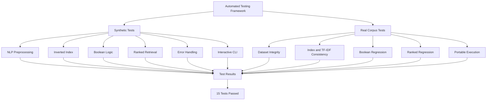

# System Testing and Validation

## 1. Overview

This stage provides comprehensive automated testing for the Medical Research Search system.

The testing framework verifies the functionality, consistency, reliability, and integration of the information retrieval components using both synthetic data and the real document collection.

| Property | Description |
|---|---|
| Project | Medical Research Search |
| Course | Information Retrieval Systems (902333) |
| Phase | Phase 1 |
| Testing Framework | Python unittest |
| Real Dataset | BEIR TREC-COVID |
| Collection Size | 1,000 Documents |
| Total Tests | 15 |
| Final Status | All Tests Passed |

## 2. Testing Objectives

- Validate dataset integrity.
- Verify NLP preprocessing correctness.
- Validate inverted index construction.
- Verify Boolean retrieval operations.
- Validate TF-IDF document representations.
- Verify cosine similarity calculations and ranked retrieval behavior.
- Test Top-K retrieval.
- Validate incorrect inputs and edge cases.
- Verify integration between system components.
- Detect regressions in previously validated results.
- Ensure portable command-line execution.

## 3. Directory Structure

```text
Testing/
├── README.md
├── test_system.py
└── test_results.txt
```

## 4. Testing Methodology

The automated testing framework combines two complementary testing approaches.

### Synthetic Data Testing

Controlled document collections are used to verify expected algorithmic behavior, logical operations, ranking behavior, invalid inputs, and edge cases.

### Real Corpus Testing

The prepared collection of 1,000 research documents is used to verify system consistency, integration behavior, and regression results.

## 5. Testing Architecture



## 6. Synthetic Test Cases

| ID | Test Name | Purpose | Result |
|---|---|---|---|
| ST-01 | test_boolean_logic | Validate logical retrieval operations | PASS |
| ST-02 | test_index | Validate inverted index behavior | PASS |
| ST-03 | test_interactive_menu | Verify interactive application behavior | PASS |
| ST-04 | test_invalid_boolean | Validate invalid Boolean query handling | PASS |
| ST-05 | test_invalid_csv | Validate invalid dataset file handling | PASS |
| ST-06 | test_preprocessing | Verify text preprocessing behavior | PASS |
| ST-07 | test_ranked_empty_and_invalid | Validate empty and invalid ranked search inputs | PASS |
| ST-08 | test_ranked_top_k_and_bounds | Verify Top-K retrieval and score bounds | PASS |
| ST-09 | test_ranking_ties | Verify ranking tie behavior | PASS |

Synthetic testing results:

- Total: 9
- Passed: 9
- Failed: 0

## 7. Real Corpus Test Cases

| ID | Test Name | Purpose | Result |
|---|---|---|---|
| RT-01 | test_boolean_regression | Verify previously established Boolean retrieval results | PASS |
| RT-02 | test_cli_demo_from_different_directory | Verify execution from different working directories | PASS |
| RT-03 | test_cli_missing_dataset | Validate missing dataset handling | PASS |
| RT-04 | test_dataset_integrity | Verify document collection integrity | PASS |
| RT-05 | test_index_matrix_consistency | Verify consistency between inverted index and TF-IDF representations | PASS |
| RT-06 | test_ranked_regression | Verify previously established ranked retrieval results | PASS |

Real corpus testing results:

- Total: 6
- Passed: 6
- Failed: 0

## 8. Regression Testing

Regression testing verifies that integrating the project components does not unexpectedly change previously validated retrieval behavior.

### Boolean Retrieval Baseline

| Query | Expected Matches |
|---|---:|
| covid AND vaccine | 21 |
| covid OR vaccine | 357 |
| NOT vaccine | 923 |
| covid AND NOT vaccine | 280 |
| (covid OR virus) AND vaccine | 53 |

The Boolean regression test passed successfully.

### Ranked Retrieval Baseline

| Query | Highest-Ranked Document ID | Expected Top Score |
|---|---|---:|
| covid vaccine immune response | 6fhuon6k | 0.451483 |
| respiratory infection treatment | yqr3e4kp | 0.331911 |
| coronavirus transmission prevention | nlzdto1h | 0.279990 |

The ranked retrieval regression test passed successfully.

Supporting numerical results are available in the standalone retrieval and integration evidence files.

## 9. System Consistency

The integrated system uses a shared document collection and preprocessing pipeline.

Previously recorded system statistics are:

| Metric | Value |
|---|---:|
| Documents | 1,000 |
| Vocabulary Size | 10,758 |
| Inverted Index Postings | 87,381 |
| TF-IDF Matrix Shape | 1,000 × 10,758 |
| Nonzero TF-IDF Weights | 87,381 |

The automated index and matrix consistency test passed successfully.

## 10. Actual Test Execution Results

The automated test suite was successfully executed twice on November 17, 2026.

| Metric | First Execution | Second Execution |
|---|---:|---:|
| Total Tests | 15 | 15 |
| Passed | 15 | 15 |
| Failed | 0 | 0 |
| Errors | 0 | 0 |
| Pass Rate | 100% | 100% |
| Execution Time | 10.161 seconds | 8.257 seconds |
| Status | OK | OK |

The second execution was saved as the official test evidence.

Actual recorded output:

```text
----------------------------------------------------------------------
Ran 15 tests in 8.257s

OK
```

The complete execution log is available in [test_results.txt](test_results.txt).

Execution times may vary depending on hardware, operating system, and runtime conditions.

## 11. Testing Environment

| Component | Environment |
|---|---|
| Operating System | Microsoft Windows |
| Development Environment | Visual Studio Code |
| Terminal | PowerShell |
| Programming Language | Python |
| Environment Management | Python Virtual Environment |
| Testing Framework | unittest |
| Machine Learning Library | scikit-learn |
| NLP Library | NLTK |
| Version Control | Git and GitHub |

## 12. Installation and Execution

Execute the following commands from the project root.

### Activate the Virtual Environment

```powershell
.\.venv\Scripts\Activate.ps1
```

### Install Project Dependencies

```powershell
pip install -r Step_03_Preprocessing/requirements.txt
```

Ensure that the prepared dataset exists at:

```text
Step_03_Preprocessing/dataset/documents.csv
```

### Run All Automated Tests

```powershell
python -X utf8 Testing/test_system.py
```

### Save Test Execution Results

```powershell
python -X utf8 Testing/test_system.py 2>&1 | Tee-Object -FilePath Testing/test_results.txt
```

The output redirection captures the test results generated by unittest.

## 13. Quality Assurance Summary

| Validation Area | Status |
|---|---|
| Dataset Integrity | PASS |
| NLP Preprocessing | PASS |
| Inverted Index | PASS |
| Boolean Retrieval | PASS |
| Ranked Retrieval | PASS |
| Top-K Retrieval | PASS |
| Score Bounds | PASS |
| Ranking Ties | PASS |
| Invalid Input Handling | PASS |
| Interactive CLI | PASS |
| Portable Execution | PASS |
| System Integration | PASS |
| Regression Testing | PASS |

## 14. Testing Limitations

The automated tests validate functional correctness and consistency for the implemented test cases.

A 100% test pass rate does not imply:

- Perfect retrieval relevance.
- Perfect medical document classification.
- Complete source code coverage.
- Guaranteed absence of undiscovered defects.
- Clinical correctness or reliability.

Formal retrieval effectiveness evaluation using Precision@K, Recall@K, MAP, MRR, and NDCG is outside the scope of the current automated test suite.

These metrics may be considered in future development.

## 15. Testing Evidence

- [Automated Test Implementation](test_system.py)
- [Actual Test Execution Results](test_results.txt)
- [Integration Results](../Integration/integration_results.txt)
- [Preprocessing Results](../Step_03_Preprocessing/preprocessing_results.txt)
- [Inverted Index Results](../Step_04_Boolean_Search/index_results.txt)
- [Boolean Search Results](../Step_04_Boolean_Search/boolean_results.txt)
- [Ranked Search Results](../Step_05_Ranked_Search/ranking_results.txt)

## 16. Academic Integrity

AI assistance was used to support test design, implementation review, and technical documentation.

The reported test results and execution times were obtained from actual executions of the automated test suite.

## 17. References

- Python unittest documentation: https://docs.python.org/3/library/unittest.html
- Scikit-learn documentation: https://scikit-learn.org/
- Introduction to Information Retrieval: https://nlp.stanford.edu/IR-book/
- NLTK documentation: https://www.nltk.org/

## 18. Completion Status

The automated system testing stage has been successfully completed.

All 15 tests passed across two executions, including nine synthetic tests and six real corpus tests.

The integrated Medical Research Search system has demonstrated consistent retrieval behavior and successful functional validation within the tested scope.

The project is ready for final documentation and submission preparation.

## 19. Project Navigation

- [Main Repository](../README.md)
- [Step 01 — Problem Definition and Proposal](../Step_01_Proposal/)
- [Step 02 — Progress and Teamwork](../Step_02_Teamwork/)
- [Step 03 — Dataset and Preprocessing](../Step_03_Preprocessing/)
- [Step 04 — Inverted Index and Boolean Search](../Step_04_Boolean_Search/)
- [Step 05 — TF-IDF and Ranked Retrieval](../Step_05_Ranked_Search/)
- [System Integration](../Integration/)
- System Testing and Validation
- [Final Submission](../Final_Submission/)

---

**Medical Research Search**

Al al-Bayt University

Information Retrieval Systems — Phase 1
